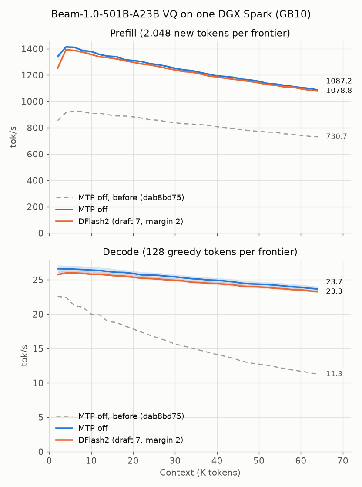

# Beam-1.0 VQ: format, execution and serving

Beam-1.0 VQ (family `BeamVq`, architecture `beam_vq`) is a GVQ1 conversion of
[reflection/Beam-1.0-501B-A23B](https://huggingface.co/reflection/Beam-1.0-501B-A23B/tree/78f8f654d40a40919b8e9954b40dd879ecb9a692):
[Baekpica/Beam-1.0-501B-A23B-VQ-GGUF](https://huggingface.co/Baekpica/Beam-1.0-501B-A23B-VQ-GGUF)
(recipe `beam1-vq8-mix8r13-41r12-q4k-embssd-v1`). This page describes how the
CUDA backend runs it on one DGX Spark (GB10), how serving fits beside its
91.55 GiB of resident weights, how the
[DFlash2 drafter](https://huggingface.co/reflection/Beam-1.0-501B-A23B-DFlash2)
speculates, and what was measured. The GVQ1 kernels are GLM VQ's
([GLM-5.3 Flash VQ](glm53-vq.md)); Beam's router, sandwich residuals, gated
attention and Harmony output are its own.

## Model and format

```
embed ─▶ [ rms ─▶ attn ─▶ rms ─▶ +h ─▶ rms ─▶ dense | MoE ─▶ rms ─▶ +h ] × 52 ─▶ rms ─▶ head ─▶ 30 tanh(·/30)
          (sublayer i: h = y / sqrt(i) + h · sqrt((i − 1) / i))
```

| Part | Shape | Storage |
|---|---|---|
| Attention | 52 layers, 48 query / 8 KV heads × 128, per-element sigmoid output gate with a per-head bias | Q4_K q/k/v/o/gate, BF16 norms |
| Layer kinds | 43 sliding (window 512, RoPE θ 10,000); 9 full NoPE layers (`il % 6 == 5` and the last) with query scale (1 + (p + 1) / 2048)^0.1 | — |
| Dense FFN | layers 0–2, 20,480 wide | Q4_K |
| Routed experts | layers 3–51, 256 × top-8, FFN 2,560; 8 groups, top-4 groups, sigmoid + bias, × 2.5 | GVQ1: K8192 13-bit books (layers 3–10), K4096 12-bit (11–51) |
| Router | 256 × 5,120 per layer | F32 |
| Embedding | 151,936 × 5,120 | BF16 `embedding` part, read by the host one row per token |
| Head | 151,936 × 5,120, soft cap 30 | Q4_K |

The release is a directory: `release.json` names 51 independent GGUF parts
(49 expert parts, `body-nonexpert.gguf`, `embed-tokens-bf16.gguf`;
99,860,088,576 bytes). The host checks the pinned recipe and source revision,
every part's SHA-256 (read with `O_DIRECT`) and its Q4_K scales, then binds
the HF tensor names. Engine open copies the 91.55 GiB of trunk weights to the
device and keeps the embedding part mapped: each token reads one 10,240-byte
row from the page cache over the SSD.

## Execution on GB10

**Decode (one row).** Routing stays on the device: F32 router logits from
cuBLAS (`CUBLAS_COMPUTE_32F_PEDANTIC`, never TF32), then the group-limited
top-8 in one warp per row. The GVQ decode kernels stream the eight selected
experts with the layer book in shared memory; 13-bit layers stage four
experts' mid rows per down pass to fit GB10's 99 KiB block. The q/k/v/gate
Q4_K projections of a token run as one launch. Sliding layers keep f16
`[K | V]` rings of 512 + one prefill chunk; the full layers keep Solar's FP8
rows (E4M3 K and V plus one f16 scale per KV head, 2,080 bytes per token and
layer; 18.28 GiB at 1M). Both attend with Beam's split-key decode kernel
(about 48 key chunks per KV head, its six query heads together); on sm_90+
the FP8 rows stream in with one bulk copy per key and QK/PV run on f16 MMAs.

**Prefill (2,048-row chunks).** Q4_K projections run the FP16 tensor-core q4p
kernel. Routed experts run on E4M3 codewords after host grouping (rows ≥ 5):
12-bit layers on the warp-specialized tokens × weights^T kernels of
`cuda/beam_mma8w.cuh` (128-token items), 13-bit layers on
`glmvq_mma8_kernel`; 2–4 rows (verify widths) take one pass over the rows'
expert union with the one-row kernel's arithmetic. The full layers' attention
takes the warp-specialized FP8 walk (byte-identical to the GQA-pair kernel),
the sliding layers the HMMA pair kernel. RoPE rows are computed once per
forward, and the next chunk's embedding rows are read ahead.
`DS4_BEAM_PREFILL_CHUNK` selects up to 4,096 rows.

**Numerics.** Every kernel rounds where the source has a BF16 tensor
(transformers `models/beam`, the handoff's `beam_ref.py`): RMSNorm as weight ×
F32-normalized row rounded once, depth-scaled sandwich residuals at the BF16
boundary, sigmoid router scores in double. The router's group scores sit near
37.5 with 4th/5th-group margins around 3e-4, so any accumulation-order change
flips near-tied routes; parity is judged against that floor (below).

## Output protocol

Beam writes Harmony: `<|channel|>analysis<|message|>…<|end|>`, then
`<|start|>assistant<|channel|>final<|message|>…<|return|>`; a tool call is
` to=NAME<|channel|>analysis <|constrain|>xml<|message|>` with
`<rfl:parameter name="K">` bodies, ended by `<|call|>` (parallel calls are
joined by `<|end|>`). `reasoning_effort` maps minimal…max to the template's
8…512 (default max). The server parses reasoning, the final answer and typed
tool arguments from that grammar, and streams both channels.

The released VQ weights drift at header positions: 73% of 75 greedy serial
replies broke a header (`<|channel|><|channel|>`, `<|channel|> final`) where
the BF16 teacher writes `analysis` with a 17-logit margin. The server forces
the header tokens the grammar admits alone (a reply opens with analysis, a
message after `<|end|>` restarts as `<|start|>assistant`, a second channel is
final, a call's header ends ` <|constrain|>xml<|message|>`); bodies, the
recipient and the choice between an answer and a call stay sampled. With
forcing, 150 greedy replies (75 serial, 75 continuous) broke no header. Four
replies, all to one prompt at temperature 0, kept reasoning until
`max_tokens` (a greedy self-doubt loop); at Beam's recommended sampling
(temperature 0.7, top-p 0.99) the same prompt answers in 179 tokens.

## DFlash2 speculative decoding

The drafter is [reflection/Beam-1.0-501B-A23B-DFlash2](https://huggingface.co/reflection/Beam-1.0-501B-A23B-DFlash2)
(Apache-2.0, 1.93B parameters) converted by
[tools/beam_dflash2.py](../tools/beam_dflash2.py): matrices Q8_0, norms and
conv kernels F32, selector codebooks BF16, `fc` split by tapped layer
(2,121,674,944 bytes, 1.98 GiB on the device). It is passed as the MTP file:

```sh
ds4-server --cuda -m Beam-1.0-501B-A23B-VQ-GGUF --mtp Beam-1.0-501B-A23B-DFlash2-Q8_0.gguf \
  --mtp-mode on --mtp-draft 7 --mtp-margin 2
```

Mechanics follow z-lab's `dflash/model.py`. Every target forward projects the
rows after layers 4, 16, 28, 40 and 46 (`Σ fc_k`, `hidden_norm`) into each
draft layer's f16 context ring (4,096 + 16 slots, k_norm + RoPE keys). A trial
embeds `[anchor, mask × (n − 1)]`, runs the five non-causal layers (two-tap
dynamic convolution before and after each sublayer) over the ring's last
4,095 positions and the block, and proposes n − 1 tokens through Beam's head
and the candidate selector (top-16 unary logits plus the pairwise codebook
score, greedy from the anchor). The target verifies the rows in one forward.
Nothing rolls back: rows above the committed position are rewritten before
any read. A prefix ends at a Harmony control token, so the server forces the
next header tokens one at a time.

**Margin gate.** The selector's best-minus-second score predicts acceptance:
proposals below a margin of 1 were accepted 33% of the time, 2–3 at 74%,
above 6 at 98% (521 ungated trials, draft 7). Verification stops before the
first proposal under `--mtp-margin`, and a doubtful first proposal skips the
verify for an ordinary step. A trial costs about 12–15 ms of drafting and
70–130 ms of verification (two to eight rows read the union of their experts),
against about 44 ms for one decode step at `dab8bd75` (37.6 ms after the
October 21 kernel work).

At `391b0bf1` the same five chat prompts run 26.23 tok/s without the drafter
and **32.03** with draft 7, margin 2 (+22%). The settings were chosen at
`dab8bd75`:

| Five greedy chat prompts, 384 tokens, at `dab8bd75` | tok/s |
|---|---:|
| Plain bank lane, no drafter | 24.0 |
| Drafter loaded, MTP off (that build still projected the taps) | 23.1 |
| draft 7, no margin gate | 23.0 |
| draft 2, no gate | 25.6 |
| draft 7, margin 1 | 29.2 |
| **draft 7, margin 2** | **30.9** |
| draft 7, margin 3 (the common default) | 27.6 |
| draft 15, margin 2 | 29.3 |

Drafting runs on the serial lane at any temperature
([sampled speculation](speculative-sampling.md)): the native open refuses
banks beside the drafter, so `--mtp` serves one sequence.

## Serving

The serving surface is GLM VQ's: persistent banks, partial prefix reuse, disk
KV and session snapshots, present and not yet release-qualified
([capabilities](serving-capabilities.md)); the DFlash2 drafter runs on the
serial lane. The native context default is `max_position_embeddings` =
1,048,576.

**Memory.** The device holds 91.68 GiB of trunk weights (the 1.45 GiB
embedding part stays mapped). One graph at 2,048 rows costs 1.12 GiB of
workspace; full layers keep 2,080 bytes per token and layer (18.28 GiB at
1M), the sliding rings 0.42 GiB. Further banks share graph 0's scratch and add
only their rows (2.71 GiB at 131K).

| Command (plus `-m` and the release directory) | Plan / what ran |
|---|---|
| default (1,048,576 context) | one bank at 2,048-row chunks: 115.4 of 117.2 GiB with the 4 GiB floor (`--check-config`) |
| `-c 131072 --max-seqs 2 --prefix-reuse partial` | two banks and eight checkpoint slots, 14.68 GiB spare |
| `--mtp DRAFTER --mtp-mode on --mtp-draft 7 --mtp-margin 2` | serial lane, one sequence; the drafter adds 1.98 GiB of weights and 190 MiB of rings and rows. The 1M plan leaves 0.12 GiB (unverified); 512K plans 108.4 GiB |

**Reuse and disk KV.** A four-turn conversation on a 4.4K-token system prompt
with `max_tokens` 96–160 (replies stop inside the reasoning), then a restart
and two more turns:

| Lane | Turns 1–3: cached / prompt tokens | After the restart: turns 4–5 |
|---|---|---|
| Banks (`-c 131072 --max-seqs 2 --prefix-reuse partial`) | 4,532 / 4,566, 4,696 / 4,726, 4,802 / 4,829 | 4,988 / 5,011 from disk, then 5,123 / 5,152 |
| Serial DFlash2 (`-c 65536 --mtp …`) | 4,533 / 4,566, 4,697 / 4,726, 4,803 / 4,829 | 0 / 5,011, then 5,124 / 5,152 |

Each count is the previous prompt plus its reply: a bank keys its history
without the last sampled token, which stays pending, while the serial session
has evaluated every accepted token. The serial lane's ordinary disk cache
skips thinking requests, and every Beam chat request thinks, so `--mtp`
serving neither saves nor loads disk records; banks persist and restore them.

## Performance

The [2K–64K sweep](benchmarks/beam-vq-spark-64k-2026-10-21-tuned/README.md) at
`391b0bf1`: three fresh `ds4-bench` processes per variant, 2,048-token
incremental prefill and 128 forced greedy tokens per frontier on the raw
`promessi_sposi.txt` prompt. The dashed line is the
[same sweep at `dab8bd75`](benchmarks/beam-vq-spark-64k-2026-10-21/README.md),
before the [October 21 optimization round](beam-vq-optimization-2026-10-21.md).

| Configuration (median of three run means) | Prefill tok/s | Decode tok/s |
|---|---:|---:|
| MTP off, 2K–64K | 1,241.2 | 25.23 |
| MTP off, 2K–32K | 1,326.0 | 26.03 |
| DFlash2 (draft 7, margin 2), 2K–64K | 1,225.7 | 24.73 |



A decoded token reads about 7.24 GB of weights (the eight selected experts of
49 layers 2.94 GB, Q4_K attention 3.07 GB, dense FFN 0.53 GB, head 0.44 GB,
F32 routers 0.26 GB): 29.4 ms at 246 GB/s against 37.6 ms measured at 2K.
Decode falls 11% from 2K (26.61) to 64K (23.67) as the full layers' FP8 rows
grow (1.23 GB per token at 64K, read at about 229 GB/s); before the round it
halved. Prefill peaks at 1,413.7 tok/s at 4K and is 23% lower at 64K, where the
nine full layers' attention over the prefix runs at 60% of the F16 peak. On
this raw prose DFlash2 costs 2.0% of decode (most blocks are doubtful; each
attempt still drafts) and 1.3% of prefill (the tap projections); on chat it
gains 22% (above).

## Quality

- **Reference parity.** The handoff's goldens are H100 (sm_90) runs of its
  reference; its own `beam_ref.py` rerun on this GB10 on the same release
  bytes matches them at 93.94% top-1 over 5,491 positions (NLL 1.4590 vs
  1.4629). The engine is judged against that GB10 rerun with bands fixed
  beforehand (NLL within 1%, top-1 at most 2 points below the reference's own
  agreement): at `391b0bf1` decode NLL +0.27%, top-1 93.59%; 512-row prefill
  NLL −0.28%, top-1 94.51% (at `dab8bd75`: −0.14%, 93.79%; −0.24%).
  Engine traces sit at 1e-3–1e-2 relative to the reference per stage until a
  route flips, and every flip lands at a reference near-tie.
- **DFlash2 losslessness** (`tests/beam_mtp_gate`, seven fixture cases, 128
  prompt tokens, 192 greedy tokens, draft 7, margin 2). Each generated token
  is scored in a one-row decode teacher-forced on the same tokens. The reference's own H100-vs-GB10 floor puts the other
  run's pick more than 0.5 logits below its argmax at 1.73–1.97% of positions
  and more than 4 at 0.09–0.22% (worst 8.3–15.5); the gate allows the 95%
  Poisson count of those rates. At `391b0bf1`: 1,227 tokens at 2.67 per step,
  14 exceeded 0.5 (33 allowed), two 4 (6 allowed), worst 5.1. At `dab8bd75`
  (1,224 tokens at 2.52 per step): 21, one, worst 5.6; twenty of those 21
  were anchors picked from a verify row's logits, one an accepted draft.

## Diagnostic switches

| Variable | Effect |
|---|---|
| `DS4_BEAM_PREFILL_CHUNK` | prefill rows per chunk (default 2,048; at most 4,096) |
| `DS4_BEAM_MMA_WS=0` | 12-bit prefill experts on `glmvq_mma8_kernel` (1×128 activation scales) |
| `DS4_SOLAR_FATTN_WS=0` | full-layer prefill attention on the GQA-pair kernel (byte-identical) |
| `DS4_BEAM_ATTN_LEGACY=1` | decode attention on the Solar/EXAONE kernels |
| `DS4_BEAM_FULL_KV=f16` | f16 `[K | V]` full-layer rows instead of FP8 (rounding diagnostic) |
| `DS4_BEAM_TRACE=DIR`, `DS4_BEAM_TRACE_POS` | per-stage rows of one forward |
| `DS4_MTP_SPEC_LOG=1` | per-trial width, accepted rows, draft/verify time and selector margins |
| `DS4_MTP_SPEC_DISABLE=1` | ordinary decode with the drafter loaded |

## Limits and next levers

- Drafting is serial: `--mtp` serves one sequence because the native open
  refuses banks beside the drafter.
- DFlash2 follows the text. It gained 28% on five chat prompts and lost
  2.8% of decode on the README sweep's raw Italian prose, where most blocks are
  doubtful and each attempt still costs its 13 ms draft. Misses do not
  cluster (after k misses the next block succeeds 25–50% of the time for any
  k), so a back-off lost 7% on chat and was dropped. The draft runs at about
  62% of its weight-streaming floor; that and the verify's expert union are
  the levers.
- Prefill and decode still fall with context: the nine full layers read
  1.23 GB of FP8 rows per decoded token at 64K (at ~229 GB/s now), and their
  prefill attention, at 60% of the F16 peak, grows with the prefix. The
  October 21 [optimization round](beam-vq-optimization-2026-10-21.md) lists
  the remaining levers: 4,096-row chunks (+12% one-shot prefill at 8K–32K,
  ~1.4 GiB more), coarser softmax steps in the attention walk, the 13-bit
  expert layers and small expert units.
- The VQ student agrees with the BF16 teacher on 82.9% of next tokens (the
  model card's held-out set); header forcing covers its Harmony drift, and
  greedy decoding can loop in reasoning on some prompts.
- With `--mtp` the serial lane keeps no disk KV for Beam's chat requests
  (its ordinary disk cache skips thinking requests); in-memory continuation
  still reuses every token.
- Partial reuse, disk KV, snapshots and DFlash2 are implemented and measured
  here, not release-qualified.
