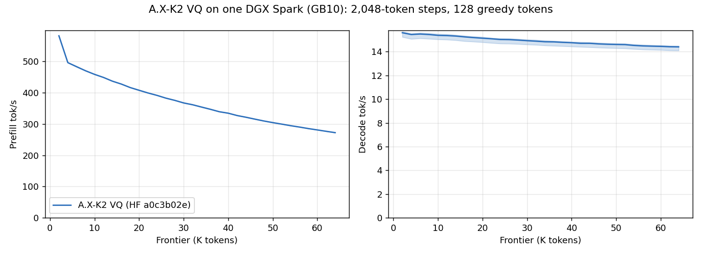

# A.X-K2 VQ on one DGX Spark: 2K–64K

The [README sweep](../../../speed-bench/README.md) on the
[A.X-K2 VQ release](https://huggingface.co/Baekpica/A.X-K2-VQ-GGUF)
(`a0c3b02e`) at `a4a7659b`, the family's first commit: three fresh
`ds4-bench` processes. Every frontier prefills 2,048 new tokens on top of the
cached prefix and generates 128 forced greedy tokens; the session then
restores the prompt snapshot (`AXK1`) before the next frontier.



| Configuration (median of three run means) | Prefill tok/s | Decode tok/s |
|---|---:|---:|
| 2K–64K | 370.2 | 14.91 |
| 2K–32K | 431.2 | 15.21 |

Curves show the median at each frontier; shading is the observed minimum–maximum
of the three runs, not a confidence interval. [All samples](tables.md) and the
[summary](summary.json) are retained.

| Frontier | Prefill | Decode |
|---:|---:|---:|
| 2K | 581.4 | 15.59 |
| 4K | 495.7 | 15.44 |
| 8K | 469.6 | 15.44 |
| 16K | 427.3 | 15.24 |
| 32K | 361.2 | 14.88 |
| 48K | 309.3 | 14.62 |
| 64K | 272.1 | 14.40 |

## Reading the numbers

- **Prefill** falls 53% from 2K to 64K. Past 2,048 keys every row scores
  every causal key in the DSA indexer (16K FLOP per key and layer, BF16 MMAs
  at ~37 TFLOPS), which at 64K adds ~3.4 s to each 2,048-row step; the 2K
  point is each process's first, dense prefill.
- **Decode** falls 8%: a token reads ~11.6 GB of weights (~66 ms at 8K in the
  trace, against ~46 ms at 250 GB/s), and the index keys add 129 bytes per
  key and layer (0.5 GB at 64K).

## Conditions

- One NVIDIA DGX Spark / GB10, driver 615.71.10; CUDA 13.4, `sm_121a`;
  Rust 1.98.0; Linux 7.0.0-1019-nvidia. SM clock 2,190–2,197 MHz after every
  run (the host's 300–2,200 MHz range).
- `ds4-bench` built from `a4a7659b` with `make cuda-spark`.
- Model: the 62-part release directory, `release.json` SHA256
  `3b4da5db6502611afe3ea06d83ef7cb77c2c205a9f3e93c75a2293579735e14c`, on a
  USB 3.2 (20 Gbps) NVMe. One model process at a time under
  `tools/host_memory_guard.py` (3 GiB reserve, PSI 40%), page cache dropped
  before each run.
- Prompt `speed-bench/promessi_sposi.txt`, SHA256
  `f53e0d80cb2d4492d24ebd63c7000c397b16ae70f9bf09b3763e5d8323ec209f`.

```sh
./ds4-bench --cuda -m A.X-K2-VQ-GGUF --prompt-file speed-bench/promessi_sposi.txt \
  --ctx-start 2048 --ctx-max 65536 --step-incr 2048 --gen-tokens 128 --csv plain-N.csv
```
