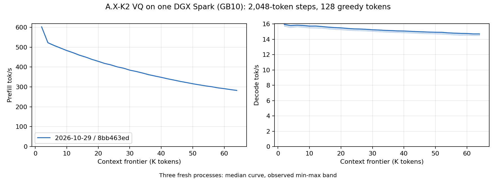

# A.X-K2 VQ on one DGX Spark: 2K–64K, 2026-10-29

Three fresh Rust `ds4-bench` processes measured code
[`8bb463ed`](https://github.com/Baekpica/ds4-dfm-rs/commit/8bb463ed51ce597f4d1eb8379092bb8e06230bd8)
after [three prefill and three decode adoptions](../../axk2-optimization-2026-10-29.md).
Each frontier prefills 2,048 new tokens over the cached prefix, generates
128 forced greedy tokens, then restores the prompt snapshot before the
next frontier. There is no extra warmup; each process's 2K point includes
its first dense prefill. Loading is outside the reported rates. All three
processes exit zero with all 32 frontiers present.



| Configuration (median of three run means) | Prefill tok/s | Decode tok/s |
|---|---:|---:|
| 2K–64K | 387.4 | 15.25 |
| 2K–32K | 452.9 | 15.57 |

| Run | Mean prefill tok/s | Mean decode tok/s |
|---|---:|---:|
| 1 | 388.50 | 15.02 |
| 2 | 386.94 | 15.29 |
| 3 | 387.43 | 15.25 |

| Frontier | Prefill tok/s | Decode tok/s |
|---:|---:|---:|
| 2K | 602.4 | 15.95 |
| 4K | 522.4 | 15.80 |
| 8K | 495.8 | 15.81 |
| 16K | 450.2 | 15.59 |
| 32K | 378.0 | 15.22 |
| 48K | 322.2 | 14.95 |
| 64K | 282.6 | 14.71 |

Curves show the median at each frontier; shading is the observed
minimum–maximum of three runs, not a confidence interval. [All frontier
ranges](tables.md), [summary](summary.json), [run 1](plain-1.csv),
[run 2](plain-2.csv), [run 3](plain-3.csv), and the [measurement
receipt](receipt.json) are retained. Decode uses CSV `gen_tps`, including
the first generated token, rather than the steady-state column.

The absolute run-mean ranges are 386.94–388.50 prefill and 15.02–15.29
decode tok/s. The remaining decode spread is unresolved despite fixed CPU
affinity, similar sampled GPU clocks and CPU performance counters, and
zero memory PSI; the raw ranges remain part of the result.
The [October 27 sweep](../axk2-vq-spark-64k-2026-10-27/README.md) remains a
historical result, not collected as a matched A/B against this campaign.
No cumulative A/B percentage is inferred from it. Individual adoption pairs
use a separate cold-8K protocol and are documented in the campaign.

## Conditions and reproduction

- One DGX Spark / GB10, 48 SM, `sm_121a`, CUDA 13.4.92, driver 615.71.10;
  cuBLAS/cuBLASLt 13.8.0.4. CPU affinity is fixed to CPU 9. Default PDL and
  all six family optimizations are enabled.
- Boot `f5d9ee6b-7f0f-443c-b629-4f39b4519994`; the enabled, successful
  `nvidia-clocks.service` retains its 300–2,200 MHz policy. Busy samples
  (GPU utilization at least 80%, sampled at 1 Hz) show 2184–2190 MHz
  and 47–73 °C. Software power-cap flags occur in 6/5/8 samples across
  the three runs, at 2,190 MHz; no thermal-cap flag is observed.
- One model process at a time, page cache cleared before each
  process; `tools/host_memory_guard.py` uses a 2 GiB reserve and trip,
  with PSI recorded. Minimum available memory is 10.108 GiB;
  maximum full PSI avg10 is 0.
- The 62-part [release](https://huggingface.co/Baekpica/A.X-K2-VQ-GGUF),
  revision `a0c3b02e9b45dc67ef8dd1d48eb48034c93d6607`, is on local NVMe.
  `release.json` SHA256:
  `3b4da5db6502611afe3ea06d83ef7cb77c2c205a9f3e93c75a2293579735e14c`.
- Raw novel prompt `speed-bench/promessi_sposi.txt`, SHA256:
  `f53e0d80cb2d4492d24ebd63c7000c397b16ae70f9bf09b3763e5d8323ec209f`.
- Measured `ds4-bench` SHA256:
  `5837613a2788a468c98d1c280cc71a2eb96cf77e5be272aae0390260490a291d`.
  The source tree was clean throughout all sweeps. This publication's
  documentation commit is separate from that measured code commit.

```sh
git checkout 8bb463ed51ce597f4d1eb8379092bb8e06230bd8
make cuda-spark
# Repeat in three fresh processes after the prior process exits and cache cleanup.
python3 tools/host_memory_guard.py --max-gib 128 --high-gib 128 \
  --reserve-gib 2 --trip-gib 2 \
  --psi-full-limit 0 --timeout 1800 -- \
  taskset -c 9 ./ds4-bench --cuda -m A.X-K2-VQ-GGUF \
  --prompt-file speed-bench/promessi_sposi.txt \
  --ctx-start 2048 --ctx-max 65536 --step-incr 2048 --gen-tokens 128 \
  --csv plain-N.csv
```

The benchmark command and log digests are in the receipt; full logs,
clock/host samples, source receipts and earlier A/B logits/tokens remain in
ignored `scratch/axk2-perf/`. The chart and summaries are generated from the
three CSVs.

This is a text throughput measurement, with no MTP or drafter. The novel's
forced continuation can become repetitive; it does not establish output
quality. The focused fixtures and bounded 8K A/Bs preserve the existing
arithmetic and outputs. Historical NLL, 262K context, HTTP concurrency and
session-reuse gates were not rerun in this campaign.
