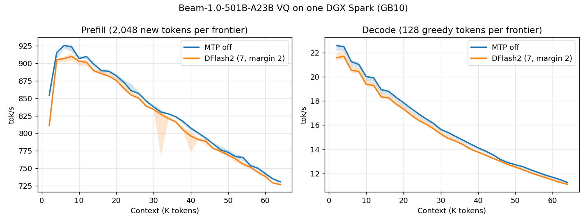

# Beam-1.0 VQ on one DGX Spark: 2K–64K, October 21

The [README sweep](../../../speed-bench/README.md) on the
[Beam-1.0-501B-A23B VQ release](https://huggingface.co/Baekpica/Beam-1.0-501B-A23B-VQ-GGUF)
(`faf8f1b0`) at the `feat/add-beam-vq` tree: three fresh `ds4-bench`
processes per variant, interleaved. Every frontier prefills 2,048 new tokens
on top of the cached prefix and generates 128 forced greedy tokens; the
session then restores the prompt snapshot before the next frontier. The
DFlash2 variant drafts with
[reflection/Beam-1.0-501B-A23B-DFlash2](https://huggingface.co/reflection/Beam-1.0-501B-A23B-DFlash2)
converted by `tools/beam_dflash2.py` (`--mtp`, draft 7, margin 2).



| Configuration (median of three run means) | Prefill tok/s | Decode tok/s |
|---|---:|---:|
| MTP off, 2K–64K | 830.4 | 15.86 |
| MTP off, 2K–32K | 881.5 | 18.70 |
| DFlash2 (draft 7, margin 2), 2K–64K | 821.1 | 15.41 |

Curves show the median at each frontier; shading is the observed minimum–maximum
of the three runs, not a confidence interval. [All samples](tables.md) and the
[summary](summary.json) are retained.

| Frontier | Prefill, MTP off | Decode, MTP off | Prefill, DFlash2 | Decode, DFlash2 |
|---:|---:|---:|---:|---:|
| 2K | 854.5 | 22.57 | 811.0 | 21.56 |
| 4K | 915.7 | 22.47 | 905.3 | 21.69 |
| 8K | 923.5 | 21.01 | 910.0 | 20.44 |
| 16K | 889.7 | 18.79 | 885.5 | 18.25 |
| 32K | 830.4 | 15.39 | 827.2 | 14.91 |
| 48K | 776.5 | 12.90 | 774.2 | 12.74 |
| 64K | 730.7 | 11.26 | 726.7 | 11.11 |

## Reading the numbers

- **Decode bytes.** A decoded token reads about 7.24 GB of weights: the eight
  selected experts of 49 layers (2.94 GB), Q4_K attention (3.07 GB), the dense
  FFN of layers 0–2 (0.53 GB), the head (0.44 GB) and the F32 routers
  (0.26 GB). That is 26.5 ms at GB10's 273 GB/s; decode measures 44.3 ms at 2K.
- **Context.** Decode halves from 2K to 64K: the nine full layers read their
  FP8 rows (2,080 bytes per token and layer, 1.23 GB at 64K) at about 27 GB/s
  in the split decode kernel. Prefill falls 21% from its 8K peak to 64K.
- **DFlash2 on raw prose.** The drafter follows chat and code (five greedy chat
  prompts: 24.0 → 30.9 tok/s) but not this Italian novel: most blocks are
  doubtful and each attempt still costs its 13 ms draft, so decode is 2.8%
  lower and the tap projections cost 1.1% of prefill.

## Conditions

- One NVIDIA DGX Spark / GB10, driver 615.71.09; CUDA 13.4, `sm_121a`;
  Rust 1.98.0; Linux 7.0.0-1019-nvidia. SM clock 2,190 MHz before and after
  the runs (one 305 MHz idle sample before `dflash2-2`).
- `ds4-bench` built from this PR's tree before three changes that leave the
  measured paths alone (a restore clears a pending trial, an MTP-off open
  allocates no drafter runtime, the drafter's plan reports one sequence).
  `plain-1`, `plain-2` and `dflash2-1` ran the 02:53 build, the others the
  03:29 build of the same native sources (Rust formatting and example
  declarations in between; SHA256
  `a963d3d19a6f235abaae395bc21d2eb9fc2019c1d860012c5878937b38fe4eaf`).
- Model: the 51-part release directory, `release.json` SHA256
  `67ed31bfc7f3fd2b093ae6545517876b6e133e81a5d347ebea7ceada983b2e53`.
  Drafter `Beam-1.0-501B-A23B-DFlash2-Q8_0.gguf` SHA256
  `7c7fa13e94dbf1d6c243706b636b03a9431623c5f32f69842c0c796f49092521`.
  One model process at a time under `tools/host_memory_guard.py` (3 GiB
  reserve, PSI 40%), page cache dropped before each run.
- Prompt `speed-bench/promessi_sposi.txt`, SHA256
  `f53e0d80cb2d4492d24ebd63c7000c397b16ae70f9bf09b3763e5d8323ec209f`.

```sh
./ds4-bench --cuda -m Beam-1.0-501B-A23B-VQ-GGUF --prompt-file speed-bench/promessi_sposi.txt \
  --ctx-start 2048 --ctx-max 65536 --step-incr 2048 --gen-tokens 128 --csv plain-N.csv
./ds4-bench ... --mtp Beam-1.0-501B-A23B-DFlash2-Q8_0.gguf --mtp-draft 7 --mtp-margin 2 --csv dflash2-N.csv
```
