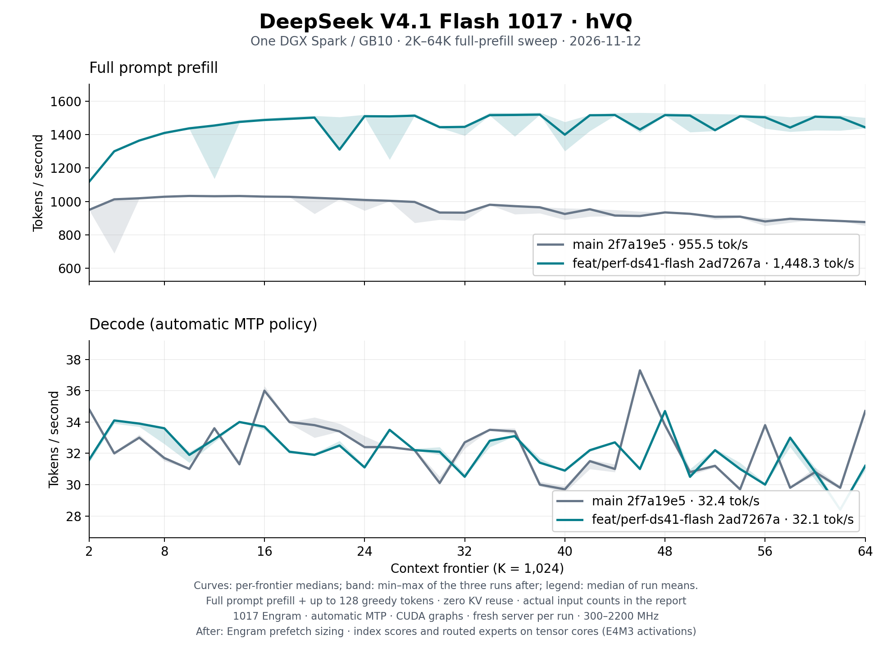

# DeepSeek V4.1 Flash 1017 hVQ on one DGX Spark: 2K–64K, November 12

Fresh `ds4-server` sweeps of
[DeepSeek-V4.1-Flash-1017 hVQ](https://huggingface.co/Baekpica/DeepSeek-V4.1-Flash-1017-hVQ-GGUF/tree/2f91f992dda543814725e4c25b954b4d9a502a55)
before and after the [November 12 prefill rounds](../../deepseek41-optimization-2026-11-12.md).
Every request prefills its whole prompt and generates up to 128 greedy tokens
with automatic MTP. Rates are the server's own prefill and decode timers.

| Build | Runs | Prefill tok/s | Decode tok/s |
|---|---:|---:|---:|
| `main` 2f7a19e5 | 3 | 955.5 | 32.38 |
| `feat/perf-ds41-flash` 2ad7267a | 3 | 1,448.3 | 32.11 |

Summary cells are the median of run means over 32 frontiers.
[All samples](tables.md), the [summary](summary.json) and the
[receipt](receipt.json) (binaries, clocks, memory, the speculation account
and every stalled block of each run) are retained.

| Frontier | Actual input | Prefill before | Prefill after | Decode before | Decode after |
|---:|---:|---:|---:|---:|---:|
| 2K | 2,149 | 949.7 | 1,118.1 | 34.8 | 31.6 |
| 8K | 8,449 | 1,028.0 | 1,409.4 | 31.7 | 33.6 |
| 16K | 16,546 | 1,028.8 | 1,486.9 | 36.0 | 33.7 |
| 32K | 32,749 | 932.9 | 1,445.9 | 32.7 | 30.5 |
| 48K | 49,440 | 934.3 | 1,516.1 | 33.8 | 34.7 |
| 64K | 66,608 | 876.6 | 1,442.8 | 34.7 | 31.2 |

Cells are per-frontier medians.

## Conditions

- One NVIDIA DGX Spark / GB10, driver 615.71.10, CUDA 13.4.92, `sm_121a`;
  clock service 300–2,200 MHz. Request clocks 2,184–2,190 MHz,
  run medians 2,190–2,190.
- `ds4-server` SHA256 `d79bb4b735538b95102c82ec0912f160de09877b7bdf85764599ac3dcb79d4e0` before and
  `8324196a4a8b854dcb844766647167f465f92e6a55d3cd04bf36e6ee9fd5756d` after.
- The release's 113,556,639,424-byte GGUF with its 1017 Engram tables and the
  vision sidecar attached; `--mem-budget-mb 110000 --mem-floor-gb 2`.
- `speed-bench/ds41_spark_sweep.sh` in boot mode: one fresh process per run
  under the host memory guard (2 GiB reserve and trip), `clear_cache` before
  it, the 2,512-token calibration prompt, then 32 frontiers of
  `speed-bench/promessi_sposi.txt`. Temperature 0; every frontier reports
  zero reused tokens.
- Minimum available host memory 6.93 GiB;
  maximum PSI full avg10 0.18.

## Reading the curves

- Before, prefill falls from 1,028.0 tok/s at 8K to
  876.6 at 64K: scalar index scores grow with the
  context. After, it reaches 1,486.9 at 16K and stays
  between 1,310.0 and 1,519.1 to 64K.
- A fresh process starts with the calibration prompt. That first short block
  is what left `main` without its Engram prefetch for the rest of the
  process (round 1); a server whose first long prompt declared a full block
  did not lose it.
- Dips are stalled Engram rounds: 55 of 3,360 prefill blocks waited
  0.5 s or more on one, in both builds. The before curve is 3 runs;
  the band is the min–max of the three runs after.
- Decode kernels did not change, and a round costs 59.3 ms before and
  58.9 ms after. Greedy continuations differ once prefill experts
  take E4M3 activations, so decode differs by frontier: paired over the 32
  frontiers -0.27 tok/s (standard error 0.37), accepted drafts per
  round 0.997 and 0.965.

## Validation

`ds4 --serving-check` on the build after passes ([output](serving-check.txt)):
prefix reuse, continue and disk KV each reproduce 16 of 16 tokens. Behind the
server one request per surface answers as in the
[hVQ evaluation](../../deepseek41-hvq-evaluation-2026-11-11.md): chat,
thinking, stream, a tool call and its follow-up, a base64 image, prefix
reuse, `/v1/messages`, `/v1/responses`, `/v1/completions` and a 24K-token
recall. Its seeded set at temperature 1.0: `think correct 24/24 closed 24 stop 24 | tools valid 12/12 | chat stop 8/8`.

Plot: `python3 docs/benchmarks/plot-ds41-64k.py docs/benchmarks/ds41-hvq-spark-64k-2026-11-12`
(Matplotlib 3.10.8).
