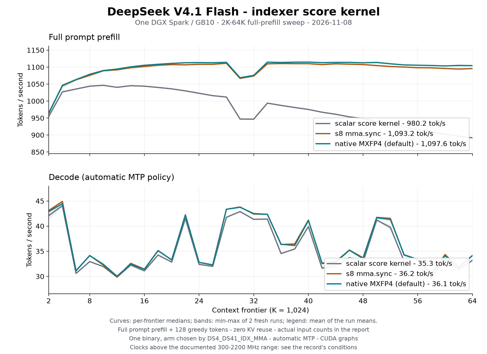

# DeepSeek V4.1 Flash: the indexer score on tensor cores

Three score kernels for the lightning indexer, one binary, two fresh server
processes each. The scalar kernel (`DS4_DS41_IDX_MMA=0`) is the ported
issue-bound original; the s8 arm (`=1`) is an `m16n8k32` int8 `mma.sync` per
32-dim block; the native MXFP4 arm (`=2`, the served default on a Blackwell
build) hands the raw e2m1 nibbles and their block scales to
`mma.sync.aligned.kind::mxf4.block_scale`, one instruction per 64 dims.

All 192 requests completed 128 generated tokens with zero reused prompt
tokens. These are full-prompt prefill rates from the server's own timers;
TTFT and wall time are separate CSV fields.



| Metric | scalar | s8 mma | native MXFP4 | MXFP4 vs scalar |
|---|---:|---:|---:|---:|
| Full prompt prefill, mean of run means | 980.2 | 1,093.2 | 1,097.6 | +12.0% |
| Decode, automatic embedded MTP | 35.3 | 36.2 | 36.1 | +2.3% |

| Frontier | Input | scalar | s8 mma | MXFP4 | MXFP4 vs scalar |
|---:|---:|---:|---:|---:|---:|
| 2K | 2,149 | 954.7 | 965.0 | 963.7 | +0.9% |
| 8K | 8,449 | 1,043.9 | 1,076.0 | 1,078.8 | +3.3% |
| 16K | 16,546 | 1,043.8 | 1,101.9 | 1,105.5 | +5.9% |
| 32K | 32,749 | 946.8 | 1,073.7 | 1,075.7 | +13.6% |
| 48K | 49,440 | 948.5 | 1,107.5 | 1,112.8 | +17.3% |
| 64K | 66,608 | 891.9 | 1,095.8 | 1,104.4 | +23.8% |

The [Prefill and Decode tables](tables.md) retain every sample. Curves are
per-frontier medians; shading is the observed minimum–maximum of the two
runs, not a confidence interval. Each arm's summary is the mean of its two
run means, following the [October 13 card](../ds41-spark-64k-2026-10-13/README.md).

## Conditions

- One NVIDIA DGX Spark / GB10, driver 580.178.04; CUDA compiler 13.0.88,
  `sm_121a` (`compute_121a` with `DS4_CUDA_HAVE_MXF4`, so the MXFP4 arm
  compiles). The host's configured clock range stays 300–2200 MHz; the
  request clocks observed here ran 2,398–2,444 MHz (median 2,411), above it,
  and are stated rather than smoothed away. Absolute tok/s is therefore not
  comparable with records measured under the capped range.
- Server `ds4-server` SHA256
  `865f239cfa945d8d078c9c9e225a873bfff7e8bfdabcd8eb797e865cb03f9f3d`, built
  from this commit's tree; the campaign build differs from it only in comment
  text. One binary for all three arms; the arm is chosen by
  `DS4_DS41_IDX_MMA` in the process environment, never by a rebuild.
- Same model, corpus and request bodies in every process: single serial
  sequence, automatic embedded MTP, default CUDA graphs and VMM, temperature
  0, reasoning off. No profiler, emitted token trace or logits dump.
- Pinned `speed-bench/promessi_sposi.txt`, SHA256
  `f53e0d80cb2d4492d24ebd63c7000c397b16ae70f9bf09b3763e5d8323ec209f`.
  The 8,192-byte calibration yields 2,512 tokens (3.2611 bytes/token); nominal
  frontiers run 2,048 through 65,536 in 2,048 steps, and the tables preserve
  the actual rendered prompt lengths.
- Every request prefills its entire prompt; the appended chat suffix prevents
  the next longer user message from extending the saved prompt checkpoint.
  Prefix reuse stays at its default and every measured cached-token count is
  zero. Disk KV is off, engram file caching may warm within a process, and the
  process is fresh for every run.
- The family uses its 1,048,576-token metadata boundary and allocates for the
  actual request; no `--ctx` override. The measured endpoint is 65,536 input
  tokens plus 128 generated tokens, not a 1M test.
- External reserve/trip 2 GiB, PSI recorded without terminating on pressure
  alone, swap disabled in scope. The 113,556,639,424-byte GGUF keeps the
  artifact identity verified by the [October 13 record](../ds41-spark-review-2026-10-13/README.md#model-and-source);
  `DS41_SWEEP_NO_GGUF_SHA=1` reuses that verification.

## Validation and limits

- Every request returned 128 tokens with zero reused prompt tokens: 192 of
  192 rows across the six runs. No row failed, and every rate is finite.
- Completion content is byte-identical across the three arms and both runs at
  all 32 frontiers. [receipts.json](receipts.json) holds each content's
  SHA-256; no frontier differs.
- The host-memory guard recorded peak `psi_full_avg10` 0.00 and at least
  7.4 GiB available in all six runs, with no termination event.
- Run-to-run prefill means stay within 0.6%: scalar 978.5 / 981.9, s8
  1,094.9 / 1,091.4, MXFP4 1,098.9 / 1,096.3 tok/s.
- Decode is the noisy quantity. Per-frontier min-max spans reach ~50% (see
  [tables.md](tables.md)), and the run means move from 35.3 to 36.1 tok/s
  between the scalar kernel and either arm, inside that spread. This record
  claims no decode gain.
- The gain grows with context: +0.9% at 2K, +3.3% at 8K, +13.6% at 32K,
  +23.8% at 64K. Below roughly 4K input tokens it is inside the run-to-run
  spread.
- MXFP4 over s8 is +0.4% on the mean and within 1.2% at every frontier. The
  s8 arm carries the gain; the MXFP4 arm is the served default because it
  matches s8 inside the run-to-run spread and does less work per group (one
  instruction per 64 dims).
- The campaign binary's source differs from this commit only in comment text
  (every changed line reviewed); the code is identical.

## Reproduce

With the verified model paths assigned to `MODEL` and `ENGRAM`, one arm is one
guarded sweep:

```sh
DS4_DS41_IDX_MMA=2 \
DS41_SWEEP_OUT="$OUT/run-1" DS41_SWEEP_CSV="$OUT/run-1.csv" \
DS41_SWEEP_NO_GGUF_SHA=1 DS41_SWEEP_NO_SVG=1 \
DS41_SWEEP_PORT_ARGS="--mem-floor-gb 2 --no-update-check" \
python3 tools/host_memory_guard.py \
  --max-gib 128 --high-gib 128 --reserve-gib 2 --trip-gib 2 \
  --psi-full-limit 0 --timeout 2700 --log "$OUT/run-1.guard.jsonl" \
  -- speed-bench/ds41_spark_sweep.sh ./ds4-server "$MODEL" "$ENGRAM" "" 8099
```

Repeat with `DS4_DS41_IDX_MMA=` 0 and 1 for the other two arms, and use a
unique `run-2` output for the second process. The sweep's defaults are 2,048
through 65,536 in 2,048 steps and 128 generated tokens.

Regenerate the tables, summary and PNG with Matplotlib:

```sh
python3 docs/benchmarks/plot-ds41-indexer.py
```

Published data: `run-{1,2}.csv` per arm, [summary](summary.json),
[every sample](tables.md), [completion receipts](receipts.json).

## Beyond this record

The sweep covers 2K through 64K, and the gain is still growing at its end
(+0.9% at 2K against +23.8% at 64K). A 106K and 300K receipt on the same
three arms was planned and is not part of this record: no number above
65,536 input tokens appears here.
