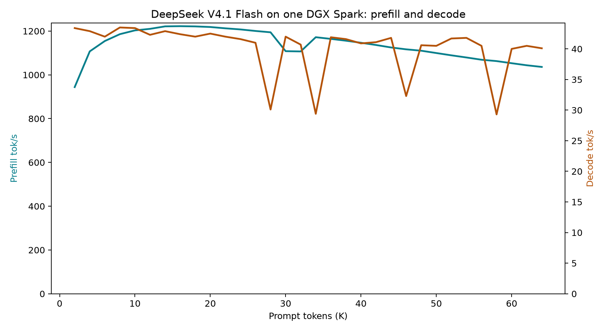

# DeepSeek V4.1 Flash on the feat/optimize head: suite and 2K-64K frontier

One DGX Spark / GB10, head `ae40aa1d`. The author's five-case suite ran three
fresh server processes; the 2K-64K frontier sweep ran a complete 32-frontier
pass on a fresh unguarded boot. The vision surface has its own
[record](../ds41-spark-vision-2026-10-14/README.md).

| Suite case | Prompt tokens | Decode, tok/s | Cold prefill, tok/s | Warm TTFT, ms |
| --- | ---: | ---: | ---: | ---: |
| prose_short | 54 | 36.17 | 79.5 | 18.1 |
| code_short | 54 | 54.10 | 135.6 | 13.5 |
| table_short | 43 | 65.85 | 119.2 | 15.4 |
| prose_long | 10,356 | 32.67 | 1,311.4 | 91.2 |
| table_long | 10,377 | 58.98 | 1,307.6 | 92.7 |

Frontier highlights; the full 32-frontier tables are in [tables.md](tables.md):

| Frontier | Input tokens | Prefill, tok/s | Decode, tok/s |
| ---: | ---: | ---: | ---: |
| 2K | 2,149 | 944.1 | 43.4 |
| 16K | 16,546 | 1,222.4 | 42.4 |
| 32K | 32,749 | 1,107.0 | 40.7 |
| 48K | 49,440 | 1,110.3 | 40.6 |
| 64K | 66,608 | 1,036.2 | 40.1 |

Every sweep request prefilled its whole prompt: `prefill_cached_tokens` reads
zero in all 32 rows, the suite's warm repeats exercise the cached path by
design, and the sweep reached the same 66,608-token render the October 13 64K
record measured at its 65,536 frontier.

## Conditions

- One NVIDIA DGX Spark / GB10, driver 580.142, CUDA 13.0 (compiler 36424714),
  kernel 6.17.0-1014-nvidia, `sm_121`. The sweep's request-clock median is
  2,405 MHz (`frontier-run-1.csv.meta.txt`); the campaign telemetry is
  retained on the box. The documented user-managed clock range for this host
  is 300-2200 MHz; as in the other ds41 records the observed medians sit
  above it and are recorded as observed.
- Head `ae40aa1d`; `ds4-server` SHA256
  `534958311c347a9900d92b0a64ce4258746f258cbdff81f5966f1e543628f76b`
  (68,696,688 bytes). The sweep boot line (full text in
  `frontier-run-1.csv.meta.txt`): `--cuda -m <vq8sh14-q4k-mtpnative gguf>
  --port 8099 --engram-dir <engram> --zchain
  <grrb-code_fit_n15360-engine> --mem-budget-mb 110000 --mem-floor-gb 2
  --no-update-check --host 127.0.0.1`, no cgroup scope. The suite boots added
  `--vision-gguf` and bound 0.0.0.0:8000 (recorded in `suite-N.console.log`).
- Corpus `speed-bench/promessi_sposi.txt` SHA256
  `f53e0d80cb2d4492d24ebd63c7000c397b16ae70f9bf09b3763e5d8323ec209f`; the
  8,192-byte calibration yields 2,512 tokens (3.2611 bytes/token) in every
  pass, and measured slices start at byte 262,144. The GGUF in play is the
  vq8sh14-q4k-mtpnative artifact whose SHA256 the vision run hashed
  (`9469cfa9ff47c5b9f1e2bbf31b4226ef11b4de9ddb92a0c7641c4a9b623e4654`,
  113,556,639,424 bytes).
- Suite protocol: `suite.py --reps 3`, three fresh server processes (cold
  prefill is the first request of each), boot times 133 / 132 / 130 s; the
  case bytes are the archived ones (`suite.py`, `cases.json`; SHAs in
  `identity.txt`).
- Frontier protocol: the sweep's one-process-per-request standard was
  applied as a fresh boot plus attach passes. The recorded pass is pass 1;
  its process had served only the 65,536-token probe before it (68,298
  tokens, 1,059.7 t/s prefill, 64.5 s TTFT; `probe65k.resp.json`). An
  earlier attempt ran inside the host guard's cgroup scope (`--max-gib 128
  --reserve-gib 2`): those runs died at ctx 36-40k on the scope's
  `MemoryMax` (instant release, host available ~7.1 GiB, no guard trip, no
  PSI), so the recorded pass ran unguarded on the dedicated box. Host
  availability stayed at 6.50 GiB or above across the passes
  (`telemetry-text.txt`, on the box).
- Pass 2 of the sweep stopped at ctx 57,344 when the serving instance on
  this box changed hands: the benchmark process exited at 07:40:52 with no
  error line and an instant release, and a vision server came up on
  0.0.0.0:8000 at 07:41:01. The campaign timeline is in `timeline.txt`.
  Pass 1, taken before that, is complete and self-contained.

## Caveats and limits

- One complete frontier pass; the earlier frontier records in this tree are
  single-pass too. The min-max bands in [tables.md](tables.md) read as single
  values until passes 2-3 exist; the tables fill in automatically when the
  files are present.
- Clocks: the 2,401-2,405 MHz medians sit above the documented 300-2200 MHz
  user-managed range, as in the other ds41 records; compare only within this
  window.
- Warm TTFT reflects the cached warm path; the short-case cold prefill (43-54
  prompt tokens) is a latency figure, not a throughput one.
- No task-quality or long-context accuracy claim follows from these numbers.
