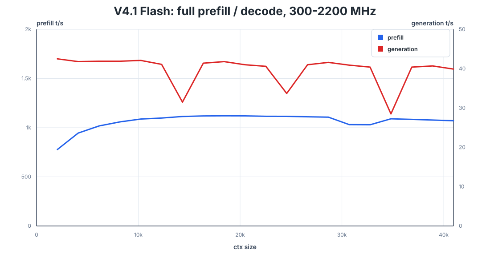

# V4.1 Flash review qualification, 2026-10-13

Fresh DGX Spark measurements of PR80 `9689f88f` and PR81 `a91e1121`, with
the review fixes committed as `80443f15`. This record is independent of the
[contributor's five-case benchmark](../ds41-spark-2026-10-13/README.md).
The later `64503131` change bounds sampled full-prompt reuse; it does not change
the cold, greedy path measured by the sweep. Its validation is separate below.

## Throughput

All 20 screenshot frontiers, 2,048 through 40,960, completed with 128 generated
tokens each and zero cached prompt tokens. Decode median was 41.0 tok/s;
the supplied screenshot's median was 41.45 tok/s. Prefill was 777.8–1,120.6
tok/s. The paired median prefill ratio was 0.9345, decode 0.9928.



| Frontier | Actual prompt tokens | Prefill tok/s | Screenshot | Decode tok/s | Screenshot |
| ---: | ---: | ---: | ---: | ---: | ---: |
| 2,048 | 2,149 | 777.8 | 852.6 | 42.5 | 43.7 |
| 8,192 | 8,449 | 1,058.8 | 1,146.9 | 41.9 | 42.6 |
| 16,384 | 16,546 | 1,119.3 | 1,201.9 | 41.4 | 41.6 |
| 32,768 | 32,749 | 1,029.6 | 1,095.8 | 40.4 | 41.5 |
| 40,960 | 41,121 | 1,070.6 | 1,135.3 | 39.9 | 40.2 |

[All local rows](sweep.csv), [screenshot transcription](screenshot.csv) and
[binary, hardware and evidence identities](evidence.json) retain the full
results, including slower decode cells. These are single samples per frontier.
Local clocks were 2,184–2,190 MHz within the user's unchanged 300–2,200 MHz
range; the screenshot records 2,398–2,450 MHz. No clock-normalized rate is
claimed. Its displayed generated-token count is zero; the screenshot's rates
are observations without raw usage receipts. Local responses prove all 2,560
output tokens.

## Conditions

- NVIDIA GB10, driver 615.71.09, CUDA compiler 13.3.73. Actual port compilation:
  `-O3 -g -lineinfo --use_fast_math`, `compute_121a` / `sm_121a`.
- Rust `ds4-server`, SHA256
  `ab31fb5c9f066ea28acd195113fd963abb7d0ead09fbcd3280e59846d39bdf80`.
  Default VMM, graphs and embedded MTP; temperature 0, reasoning off, serial
  requests, real Engram tables and `grrb-code_fit_n15360-engine` sidecar.
- One fresh server process on `127.0.0.1:8099`, `--mem-budget-mb 110000`.
  No trace, logits dump or rollback diagnostic in the timed process.
- `speed-bench/promessi_sposi.txt`, SHA256
  `f53e0d80cb2d4492d24ebd63c7000c397b16ae70f9bf09b3763e5d8323ec209f`.
  Calibration: 2,512 tokens / 8,192 bytes. All actual prompt counts match the
  screenshot. Prefill uses the server timer, not prompt tokens divided by TTFT.
- Guard: `--max-gib 128 --high-gib 128 --reserve-gib 2 --trip-gib 2
  --psi-full-limit 0`. The effective hard limit is capped at launch availability
  minus 2 GiB; PSI remains telemetry. Swap remains disabled in the task scope.
- Startup: 218.5 s. Minimum host availability: 6.31 GiB. Maximum sampled host
  PSI full avg10: 0. Cgroup high/max/OOM events: 0; no NVIDIA allocation,
  Xid or OOM entries in the bounded sweep kernel journal.

Reproduce the workload with the repository's sweep script and verified paths:

```sh
DS41_SWEEP_CTX="$(seq 2048 2048 40960)" DS41_SWEEP_GEN=128 \
python3 tools/host_memory_guard.py \
  --max-gib 128 --high-gib 128 --reserve-gib 2 --trip-gib 2 \
  --psi-full-limit 0 --timeout 3600 \
  -- speed-bench/ds41_spark_sweep.sh ./ds4-server \
     "$MODEL" "$ENGRAM" "$CODE_SIDECAR" 8099
```

## Model and source

The assembled 113,556,639,424-byte GGUF and both original Engram shards were
fully SHA256-verified before inference. The Engram shards total
203,073,077,576 bytes on disk and are read by row, not loaded as resident tables.
The base and code sidecar use Hugging Face revision
`84b86701456f4e4b357e41340b3b88914f51834d`; the original shards use
`5254448103b6254fc646dacbca1cbbf20e9216c1`.

| File | SHA256 |
| --- | --- |
| `DeepSeek-V4.1-Flash-vq8sh14-q4k-mtpnative.gguf` | `9469cfa9ff47c5b9f1e2bbf31b4226ef11b4de9ddb92a0c7641c4a9b623e4654` |
| `model-00047-of-00048.safetensors` | `824db4881320407ac340736d14dcee5ecd748c27d0f5836b8127ecc2e3781b0f` |
| `model-00048-of-00048.safetensors` | `976330f4954338e1ad8b508c32aa912032c7ad908959fd53c8307650fe4520ed` |

The reference is the unmodified YoungAi engine at
`7fb26cc332d740416792204a29c7d13d2986caf5`. `/data/YoungAi` was absent on this
host; a clean pinned checkout supplied the original source objects. Diagnostic
drivers set its public weight-cache cap to 110,000 MiB before opening weights.
Actual accounting was 105.76 GiB device-resident, 0 host-mapped. This avoids
whole-map registration without changing arithmetic or streaming any weights.

## Paired numerical proof

Ten short input captures, five bare and five with the code sidecar, matched
all 830 binary files byte-for-byte: 13,186,560 logits, 41,779,200 layer x/y
values and 4,177,920 Engram HC values. Exact extents and finite values were
checked independently. Every row argmax and next-token NLL matched; Rust's
Engram hash provider produced the same bounded row IDs as the original.
This is inference parity on fixed inputs, not a task-quality benchmark.

## Completed generation proof

With Engram enabled, both the bare model and code sidecar matched the original
engine for all 20 × 1,024 generated-token cases: pure eager/captured, fixed-five
MTP eager/captured, and automatic MTP captured, on 5,598-token and 59-token
inputs. The short input uses the original user/assistant chat template.

Pure eager/captured full-vocabulary logits and the GR-to-bare reset were
byte-exact; all captured rows were finite and their CPU argmax matched the
emitted token. Real graph replay crossed the 6,144 and 1,024 position buckets.
There were 5,802 successful rollback checks, including 4,547 rejecting rounds,
against the current verification snapshot and accepted-prefix frontier.
These diagnostic runs are excluded from throughput measurements.

The earlier raw 55-token essay fixture returned EOS after 15 tokens in one
condition. That incomplete batch remains a failed long-run precondition;
its completed 5,598-token cases were retained and the short chat fixture was
qualified separately. Earlier loader failures and the validator's corrected
bucket-start assumption are retained in the local evidence ledger.

## Serving evidence

In one fresh Rust server, extending a 3,725-token prompt by one token restored
3,725/3,726 tokens. Repeating it restored all 3,726. Both requests matched the
reference's 47 output tokens and full logits rows byte-for-byte.

The disk gate passed all seven fresh server boots. B loaded A's 3,725-token
checkpoint and prefilled one token; C loaded all 3,726 tokens. Both matched
the same 47 tokens and full logits rows. The unrelated-prompt, truncated-file,
reuse-disabled and 1 MiB store-budget controls all stayed cold; disabled reuse
and the small budget wrote no new checkpoint. Minimum host availability was
7.23 GiB, maximum PSI full avg10 0.04. Each payload exited 0 after the gate's
requested shutdown; wrapper exit 75 records that deliberate guard stop.
This qualifies the recorded serial plain-decode restart fixture, not arbitrary
sampling, banks or context sizes; the generic capability remains unverified.

Model metadata, ordinary/streamed completion, English finance and Python
answers, Chinese answers, and a returned tool call followed by its real tool
result passed. The tool continuation reused 292/371 prompt tokens, answered
with the supplied 18°C/sunny result, and matched its SSE response exactly.
The raw completion fixture checks transport and stream equality, not
instruction-following quality; it produced repetitive continuation text.

Six paired chat/tool requests matched the original engine's prompt and output
IDs, JSON messages and finish reasons. The historical tool, seeded speculative
sampling and 839-token Engram-feed fixtures also matched. Original source
completion requests differed because that endpoint adds a chat frame by
default (`server_parse_completion.c:184-201`); Rust preserves the common raw
completion surface (`generate.rs:1279-1285`). Source `raw: true` is the matching
input contract. The original mismatched comparison is retained as evidence.

The omitted-temperature sampling case exposed an inherited checkpoint defect:
`core_v41_kvreuse.c:109` restores the logits row without the position
slot read by `cuda_v41_sample.inc.cu:158-160`. A full-prompt hit sampled from
uninitialized state and differed at its first token. The port now prefills
device-sampled full hits again; suffix reuse and greedy/penalty full hits keep
their existing path. This is a named correctness deviation from the pinned
source. The failure-first native checkpoint test passed after the fallback.

On the final server (`e43f03de`, runtime `64503131`), all five additional
source comparisons passed: temperature 0.7, omitted temperature 1.0, frequency
penalty 0.5, and raw completion normal/SSE. Source reuse was disabled for this
comparison. All prompt/output IDs matched; response text and finish matched,
including both raw SSE streams. Repeating the default-temperature request
and explicitly setting 1.0 produced the same answer. Four full sampled hits
took the fallback; the response correctly reported zero cached tokens.
The common memory floor was 2 GiB and MTP was off in this paired run.

The synchronous Engram control (`DS41_FEED_SYNC=1`) matched the original and
the asynchronous port for all 48 generated tokens on the 839-token fixture.
Its repeat matched too. Common `--mtp-mode on --prefix-reuse off
--mem-floor-gb 2` was effective: the two requests executed 23/25 MTP rounds,
stayed cold, and left all existing disk checkpoint hashes unchanged. These
diagnostic runs establish correctness and controls, not a feed-speed A/B.

With `DS41_FEED_WAIT_WITHHOLD=1`, two consecutive requests returned HTTP 500
at the Engram wait boundary. The server remained responsive to `/v1/stats`,
memory/governor fault counters stayed zero and disk files were unchanged.
Both controls used the final server binary and completed requested shutdown.

The extended kernel-log audit retains `NV_ERR_NO_MEMORY` allocation messages
and a repeated-print summary during the original engine's diagnostic runs.
Those runs completed and passed their numerical comparisons. All such log
timestamps fall inside source-process intervals; none fall in the Rust runs.
No Xid, OOM-killer or kernel page-allocation-failure entry was observed in the
bounded interval. Source allocation warnings are not reported as zero faults.

`/v1/stats` recorded zero census, observation and governor faults before and
after these requests. `/health` returned 404 and is not claimed as a health
endpoint. Effective metadata reported the serial lane, one sequence, exact
prefix reuse and automatic MTP. Metadata context remains distinct from the
measured context bound.

The [host-parity CI run on `4be54e7d`](https://github.com/Baekpica/ds4-dfm-rs/actions/runs/38375032889)
passed, including the new model-free V4.1 lifecycle/state gates. Its preceding
run failed because the generated serving-capabilities document was omitted
from the code commit; committing that existing update resolved the mismatch.

## Limits

This throughput record reaches the 40,960 frontier, or 41,121 actual prompt
tokens. It does not qualify the screenshot's configured 65,536 limit or the
artifact's 1,048,576 metadata limit. It does not establish broad task accuracy,
concurrency, banks, session snapshots, other domain sidecars or post-training.
Per-case raw requests, responses, logs, guards and numerical dumps remain under
`scratch/vq-pr80-81/`; their reports are bound by the hashes in `evidence.json`.
