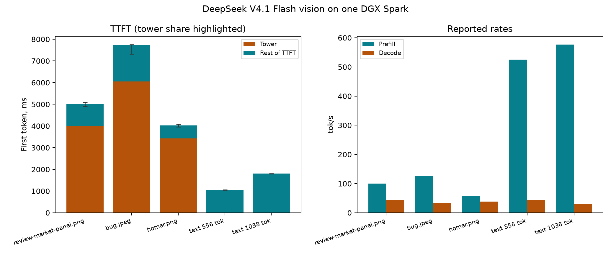

# DeepSeek V4.1 Flash vision on one DGX Spark

Three attach passes against one vision server process (`--vision-gguf`
sidecar), on the head of the port (`feat/optimize`, PR #83). Each pass sends
the repo's three fixtures with one fixed prompt and two text rows from the
pinned corpus that bracket the image spans. Every row is a full prefill:
`prefill_cached_tokens` reads zero in all fifteen requests.

| Row | Prompt tokens | Image span | Patch -> token | Tower, s | TTFT, ms | Prefill, tok/s | Decode, tok/s |
| --- | ---: | ---: | --- | ---: | ---: | ---: | ---: |
| review-market-panel.png | 502 | 482 | 48x86 -> 16x29 | 4.00 | 5,016 | 100.3 | 43.10 |
| bug.jpeg | 967 | 947 | 134x60 -> 45x20 | 6.06 | 7,725 | 126.2 | 32.50 |
| homer.png | 231 | 211 | 56x28 -> 19x10 | 3.43 | 4,029 | 57.4 | 38.50 |
| text 556 tok | 556 | - | - | - | 1,060 | 525.0 | 44.50 |
| text 1,038 tok | 1,038 | - | - | - | 1,803 | 576.2 | 30.10 |

Medians of the three passes; the [tables](tables.md) carry the min-max
bands and every sample is retained in `vision-run-N.csv`.

The tower is the vision cost centre: the sidecar weights are read per block
and freed after every image, which costs 3.4-6.1 s per image here. The
prefill rate is the server's own prefill timer over the whole prompt build,
so for image rows it includes the tower; the text rows show the same timer
without it (525-576 tok/s at these spans). homer.png ends early in every
pass (finish=stop after 59 tokens).

## Conditions

- One NVIDIA DGX Spark / GB10, driver 580.142, CUDA 13.0 (compiler
  36424714), kernel 6.17.0-1014-nvidia. Request-clock medians per pass:
  2,437 / 2,431 / 2,424 MHz. The documented user-managed range for this
  host is 300-2200 MHz; as in the other ds41 records, the observed medians
  sit above it and are recorded as observed, not normalized.
- Head `ae40aa1d`; `ds4-server` SHA256
  `534958311c347a9900d92b0a64ce4258746f258cbdff81f5966f1e543628f76b`.
  The boot line is in each `vision-run-N.csv.meta.txt`: `--cuda -m
  <vq8sh14-q4k-mtpnative gguf> --zchain <grrb-code_fit_n15360-engine>
  --mem-budget-mb 110000 --engram-dir <engram> --vision-gguf
  <DeepSeek-V4.1-Flash.vision.gguf> --host 0.0.0.0 --port 8099`.
- Vision sidecar SHA256
  `b50974c405aafbd941f8e8767cf90231b522aa4f2fcb506eaea68fbf8b409af5`,
  971,066,016 bytes. Fixture and corpus SHAs are in the metas; the corpus
  is `speed-bench/promessi_sposi.txt`, and the 8,192-byte calibration
  yields 2,512 tokens (3.2611 bytes/token) in every pass.
- One boot served all three passes, and it served no request before pass 1.
  The sweep's three-fresh-process protocol was reduced to three attach
  passes on one process per the operator's one-engine instruction (no
  per-run restarts); attach mode never kills the server.
- Tower seconds and the per-image plan come from the server's own log
  lines (`tower-lines.txt`: `[v41] vision tower: 1 image(s) X.XXs` and
  `[v41] image 0: WxH patch -> WxH token (span N)`, in request order).
  Attach mode cannot capture per-request log tails, so the CSV's
  tower/patch/span columns read `-` and the record sources them here.
- Request build: the sweep's earlier inline `jq --arg` form exceeded the
  kernel's 128 KB per-argument limit on the panel PNG and bug.jpeg; the
  file-based form (`--rawfile`) landed in `3c06770` and ran these passes.
- Per row: full prompt prefill, temperature 0, reasoning off, greedy,
  128 generated tokens (homer stops at 59). No cgroup scope on the
  server; the boot carried `--mem-floor-gb 2`; host availability stayed
  near 7 GiB across the passes (campaign telemetry retained with the
  [head record](../ds41-spark-head-2026-10-14/README.md)).

## Caveats and limits

- Three passes on one boot: the min-max band is pass-to-pass, not a
  confidence interval, and it cannot separate boot order from variance.
- The tower's per-image time varies with the plan (patch grids 48x86,
  134x60, 56x28) and there is no warmed / unwarmed split; the sidecar
  pages are freed after each image by design.
- The outputs themselves are gated by the [vision correctness
  record](../ds41-vision-2026-10-13/README.md) (three images, tower
  parity, byte-identical text); this record measures rates only.
