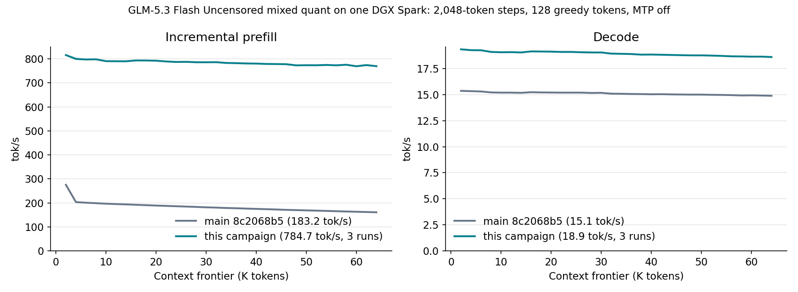

# GLM-5.3 Flash Uncensored mixed quant on one DGX Spark: 2K–64K, November 2

The [README sweep](../../../speed-bench/README.md) protocol on the
[mixed IQ2_XXS/IQ2_XS/Q2_K artifact](https://huggingface.co/Baekpica/GLM-5.3-Flash-Uncensored-Mixed-Quant-GGUF)
before and after the [November 2 rounds](../../glm53-mixed-optimization-2026-11-02.md):
fresh `ds4-bench-perf` processes against one raw VMM weight owner, MTP off. Every
frontier prefills 2,048 new tokens on top of the cached prefix and generates 128
greedy tokens; the session restores the prompt snapshot before the next frontier.

| Build | Runs | Prefill tok/s | Decode tok/s |
|---|---:|---:|---:|
| `main` 8c2068b5 | 1 | 183.2 | 15.09 |
| `feat/perf-glm-mxq` c3af8f97 | 3 | 784.7 | 18.92 |

Summary cells are the median of run means over 32 frontiers.
[All samples](tables.md), the [summary](summary.json), per-run receipts
(binary, clocks, memory) and [cold 8K and NLL gates](checks.json) are retained.

## Conditions

- One NVIDIA DGX Spark / GB10, driver 615.71.10; CUDA 13.4.92, `sm_121a`;
  clock service 300–2,200 MHz (enabled, applied at boot 2026-10-27).
- Weights: one `ds4_weight_server --backend vmm --scope base` owner without
  repacks, imported by every worker (`DS4_WEIGHT_RESIDENCY_BASE=eager`).
- Binaries: base SHA256 `e3b77844bccca53151c84569794a14da9ca5718656d61119a842428309ea999d`, final `838cdaaacfe261fb8b1dc3fc516c4d6cf82747eb1f44b08f453609af1daa42d9`.
- Prompt `speed-bench/promessi_sposi.txt`, SHA256
  `f53e0d80cb2d4492d24ebd63c7000c397b16ae70f9bf09b3763e5d8323ec209f`.
- `--ctx-start 2048 --ctx-max 65536 --step-incr 2048 --ctx-alloc 67584
  --gen-tokens 128`, temperature 0 with EOS excluded; default 2,048-row chunks.
- Another session's `hf download` ran beside the measurements (CPU and disk
  only); arms of one A/B interleave.

## Reading the curves

- Prefill rises 4.28x on average. The base curve drops from 275.5 tok/s at
  2K (dense attention, below the 2,048-key selection) to 203.6 at 4K, when
  its SIMT selected attention starts, and to 161.2 at 64K as its SIMT pool
  scores grow with the context; the final curve falls 5.7%, 815.7 to 769.5.
- Decode rises 25.3%, 15.35 -> 19.33 tok/s at 2K and
  14.88 -> 18.59 at 64K; the plain-decode floor of this artifact is
  21.9-23.8 tok/s (10.52 GB per token).
- The three final runs differ by at most 1.2% in prefill and
  0.4% in decode at any frontier. Busy SM clocks
  were 2,184-2,197 MHz in the final runs and 2,138-2,190 MHz in the base run;
  memory PSI stayed at zero (receipts).
- `serving-check.txt`: `ds4 --serving-check` on the final build passes all
  ten reuse, disk, snapshot and bank items.

Plot: `uv run --with matplotlib==3.10.7 --python 3.12 docs/benchmarks/plot-glm53-mixed-64k.py docs/benchmarks/glm53-mixed-spark-64k-2026-11-02`.
