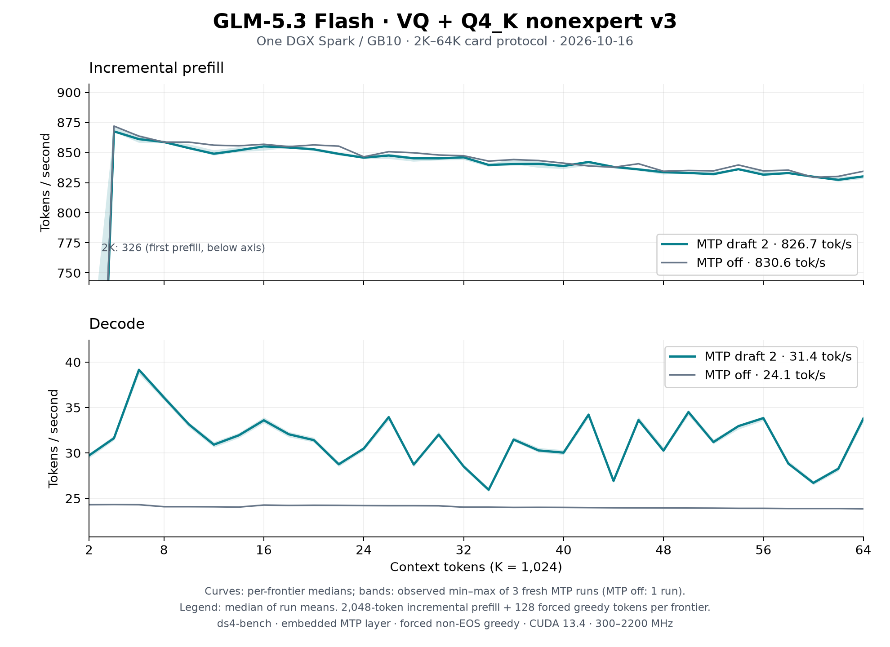

# GLM-5.3 Flash VQ on one DGX Spark: 2K–64K

The [README sweep](../../../speed-bench/README.md) on the
[Q4_K nonexpert v3 artifact](https://huggingface.co/Baekpica/GLM-5.3-Flash-VQ-GGUF):
three fresh `ds4-bench` processes with two embedded MTP drafts and one with
MTP off. Every frontier prefills 2,048 new tokens on top of the cached prefix
and generates 128 forced greedy tokens; the session then restores the prompt
snapshot before the next frontier.

| Configuration | Prefill tok/s | Decode tok/s |
|---|---:|---:|
| Two embedded MTP drafts (median of three run means) | 826.7 | 31.41 |
| MTP off (one run) | 830.6 | 24.07 |

Curves show the median at each frontier; shading is the observed minimum–maximum
of the three MTP runs, not a confidence interval. Summary cells are the median
of the run means over 32 frontiers (the MTP-off row is one run), as in the
[Qwen MXQ card](https://huggingface.co/Baekpica/Qwen3.8-Flash-Next-Mixed-Quant-SSD-PLE-GGUF).
[All samples](tables.md) and the [summary](summary.json) are retained.

| Frontier | Prefill, MTP 2 | Decode, MTP 2 | Decode, MTP off |
|---:|---:|---:|---:|
| 2K | 326.3 | 29.7 | 24.3 |
| 4K | 867.6 | 31.6 | 24.3 |
| 8K | 858.8 | 36.1 | 24.1 |
| 16K | 855.1 | 33.6 | 24.3 |
| 32K | 846.0 | 28.5 | 24.0 |
| 48K | 833.7 | 30.3 | 23.9 |
| 64K | 830.2 | 33.8 | 23.9 |

## Conditions

- One NVIDIA DGX Spark / GB10, driver 615.71.09; CUDA 13.4.92, `sm_121a`;
  Rust 1.98.0; Linux 7.0.0-1019-nvidia. Clock range 300–2200 MHz; observed
  busy SM clock 2,177–2,190 MHz.
- Source `75b82426` (`feat/add-glm-vq`), `ds4-bench` with NVTX instrumentation
  compiled in and no profiler attached, SHA256
  `503426c6d8b5a98740cdf0182990cc5e13c5c5e0d570b4b908a5598e00897820`.
- Model `GLM-5.3-Flash-VQ-Q4K-v3-GGUF` (manifest `18b997f2…`): routed experts
  in GVQ1 (1.625 bit), 316 nonexpert matrices in Q4_K, the MTP layer in source
  precision. One resident model owner; no other GPU work.
- Prompt `speed-bench/promessi_sposi.txt`, SHA256
  `f53e0d80cb2d4492d24ebd63c7000c397b16ae70f9bf09b3763e5d8323ec209f`.
- `--ctx-start 2048 --ctx-max 65536 --step-incr 2048 --gen-tokens 128`,
  `--mtp-draft 2` (or MTP disabled), temperature 0 with EOS excluded so every
  frontier generates 128 tokens. Default prefill chunk (4,096 rows, so each
  2,048-token step is one chunk); no warm-up besides the first frontier.

## Reading the curves

- Prefill falls by 4.3% from 4K to 64K: sparse attention reads the
  same 2,048 selected keys at every context, while the indexer's pool scores
  and top-k grow with the prefix. The 2K point includes first-use allocation.
- Decode with MTP depends on draft acceptance, which follows the generated
  text at each frontier; the band shows its spread across runs. MTP-off decode
  is the plain reference.
- The workload is incremental. A cold full-prompt prefill uses 4,096-row
  chunks and measures higher (920 tok/s at 8K, see
  [GLM VQ](../../glm53-vq.md#optimization-log-2026-10-16)).
