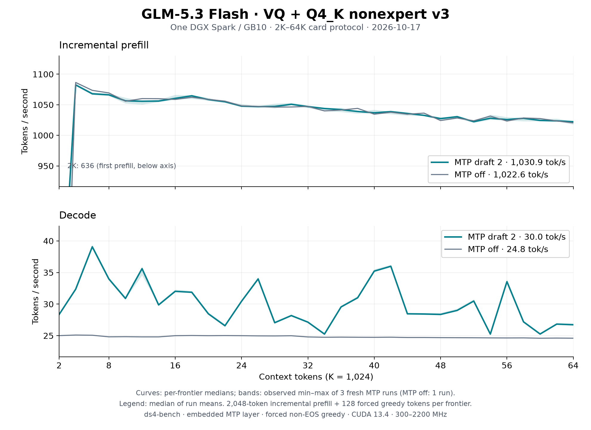

# GLM-5.3 Flash VQ on one DGX Spark: 2K–64K, October 17

The [README sweep](../../../speed-bench/README.md) on the
[Q4_K nonexpert v3 artifact](https://huggingface.co/Baekpica/GLM-5.3-Flash-VQ-GGUF),
repeated after the tensor-core KDA prefill, BF16 activation storage and
dependent decode launch: three fresh `ds4-bench` processes with two embedded
MTP drafts and one with MTP off. Every frontier prefills 2,048 new tokens on
top of the cached prefix and generates 128 forced greedy tokens; the session
then restores the prompt snapshot before the next frontier.

| Configuration | Prefill tok/s | Decode tok/s | Tokens per verify |
|---|---:|---:|---:|
| Two embedded MTP drafts (median of three run means) | 1,030.9 | 30.04 | 2.26 |
| MTP off (one run) | 1,022.6 | 24.82 | 1 |
| [October 16](../glm53-vq-spark-64k-2026-10-16/README.md), two drafts / MTP off | 826.7 / 830.6 | 31.41 / 24.07 | 2.38 / 1 |

Curves show the median at each frontier; shading is the observed minimum–maximum
of the three MTP runs, not a confidence interval. Summary cells are the median
of the run means over 32 frontiers (the MTP-off row is one run).
[All samples](tables.md) and the [summary](summary.json) are retained.

| Frontier | Prefill, MTP 2 | Decode, MTP 2 | Decode, MTP off |
|---:|---:|---:|---:|
| 2K | 636.5 | 28.4 | 25.0 |
| 4K | 1,082.4 | 32.4 | 25.1 |
| 8K | 1,066.3 | 34.0 | 24.8 |
| 16K | 1,060.5 | 32.0 | 25.0 |
| 32K | 1,047.0 | 27.1 | 24.8 |
| 48K | 1,027.3 | 28.4 | 24.7 |
| 64K | 1,022.3 | 26.7 | 24.6 |

## Conditions

- One NVIDIA DGX Spark / GB10, driver 615.71.09; CUDA 13.4.92, `sm_121a`;
  Rust 1.98.0; Linux 7.0.0-1019-nvidia. Clock range 300–2200 MHz; observed
  busy SM clock 2,177–2,190 MHz.
- Source `60d0b689` (`feat/add-glm-vq`), `ds4-bench` with NVTX instrumentation
  compiled in and no profiler attached, SHA256
  `a21a00397a9cc518a3b3e59ce6d48132947d588a419aecaa57a66b4b6d2f5c24`.
- Model `GLM-5.3-Flash-VQ-Q4K-v3-GGUF` (manifest `18b997f2…`), unchanged from
  October 16. One resident model owner; no other GPU work.
- Prompt `speed-bench/promessi_sposi.txt`, SHA256
  `f53e0d80cb2d4492d24ebd63c7000c397b16ae70f9bf09b3763e5d8323ec209f`.
- `--ctx-start 2048 --ctx-max 65536 --step-incr 2048 --gen-tokens 128`,
  `--mtp-draft 2` (or MTP disabled), temperature 0 with EOS excluded so every
  frontier generates 128 tokens. Default prefill chunk (4,096 rows, so each
  2,048-token step is one chunk); no warm-up besides the first frontier.

## Reading the curves

- Incremental prefill falls 5.6% from 4K (1,082.4) to 64K (1,022.3): sparse
  attention reads the same 2,048 selected keys at every context, while the
  indexer's pool scores and top-k grow with the prefix. The 2K point is each
  process's first prefill (first-use allocation).
- MTP-off decode is the per-token reference: 24.07 → 24.82 since October 16.
- MTP decode follows draft acceptance on the generated text. The new prefill
  arithmetic changed the continuations, and drafts were accepted less often
  (2.26 instead of 2.38 tokens per verify, from the expert-kernel call
  counts), so the MTP mean fell while each verify cycle got faster
  (75.8 → 75.3 ms). At any frontier the three runs differ by at most 3.8%
  in decode and 0.9% in prefill.
