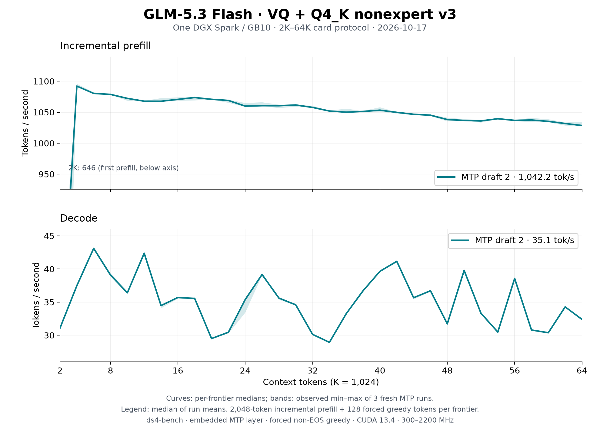

# GLM-5.3 Flash VQ on one DGX Spark: 2K–64K, merged main, October 17

The [README sweep](../../../speed-bench/README.md) on the
[Q4_K nonexpert v3 artifact](https://huggingface.co/Baekpica/GLM-5.3-Flash-VQ-GGUF)
at merged `main` (`c5384b5e`, [#86](https://github.com/Baekpica/ds4-dfm-rs/pull/86)):
three fresh `ds4-bench` processes with two embedded MTP drafts. Every frontier
prefills 2,048 new tokens on top of the cached prefix and generates 128 forced
greedy tokens; the session then restores the prompt snapshot before the next
frontier. MTP off was not rerun.

| Configuration | Prefill tok/s | Decode tok/s | Tokens per verify |
|---|---:|---:|---:|
| Two embedded MTP drafts (median of three run means) | 1,042.2 | 35.12 | 2.34 |
| [Earlier October 17 sweep](../glm53-vq-spark-64k-2026-10-17/README.md) (`60d0b689`), two drafts | 1,030.9 | 30.04 | 2.26 |

Curves show the median at each frontier; shading is the observed minimum–maximum
of the three runs, not a confidence interval. Summary cells are the median of
the run means over 32 frontiers. [All samples](tables.md) and the
[summary](summary.json) are retained.

| Frontier | Prefill, MTP 2 | Decode, MTP 2 |
|---:|---:|---:|
| 2K | 646.4 | 31.1 |
| 4K | 1,092.2 | 37.5 |
| 8K | 1,078.8 | 39.1 |
| 16K | 1,070.8 | 35.7 |
| 32K | 1,057.8 | 30.1 |
| 48K | 1,038.2 | 31.7 |
| 64K | 1,028.5 | 32.4 |

## Conditions

- One NVIDIA DGX Spark / GB10, driver 615.71.09; CUDA 13.4.92, `sm_121a`;
  Rust 1.98.0; Linux 7.0.0-1019-nvidia. Clock range 300–2200 MHz; observed
  busy SM clock 2,184–2,190 MHz.
- Source `c5384b5e` (`main`), `ds4-bench` with NVTX instrumentation compiled
  in and no profiler attached, SHA256
  `4f69e16cb6acb1753fde493a536f2e34246571b2db39ddd5821862ad207fd640`. Runs 2
  and 3 record an uncommitted edit to the plot script only.
- Model `GLM-5.3-Flash-VQ-Q4K-v3-GGUF` (manifest `18b997f2…`), unchanged. One
  resident model owner; no other GPU work.
- Prompt `speed-bench/promessi_sposi.txt`, SHA256
  `f53e0d80cb2d4492d24ebd63c7000c397b16ae70f9bf09b3763e5d8323ec209f`.
- `--ctx-start 2048 --ctx-max 65536 --step-incr 2048 --gen-tokens 128
  --mtp-draft 2`, temperature 0 with EOS excluded so every frontier
  generates 128 tokens. Default prefill chunk (4,096 rows, so each
  2,048-token step is one chunk); no warm-up besides the first frontier.

## Reading the curves

- Incremental prefill falls 5.8% from 4K (1,092.2) to 64K (1,028.5): sparse
  attention reads the same 2,048 selected keys at every context, while the
  indexer's pool scores and top-k grow with the prefix. The 2K point is each
  process's first prefill (first-use allocation).
- A two-draft verify cycle averages 66.7 ms against 75.3 ms at `60d0b689`
  (tensor-core verify Q4_K, the expert gain after the dot, the fused Q4_K
  gate/up and the mHC split preload). The continuations also accepted more
  drafts (2.34 instead of 2.26 tokens per verify, from the expert-kernel call
  counts), so decode rose 16.9%, about 13% of it from the faster cycle.
- MTP decode follows draft acceptance on the generated text (28.9–43.1 per
  frontier). At any frontier the three runs differ by at most 5.7% in decode
  and 0.7% in prefill.
