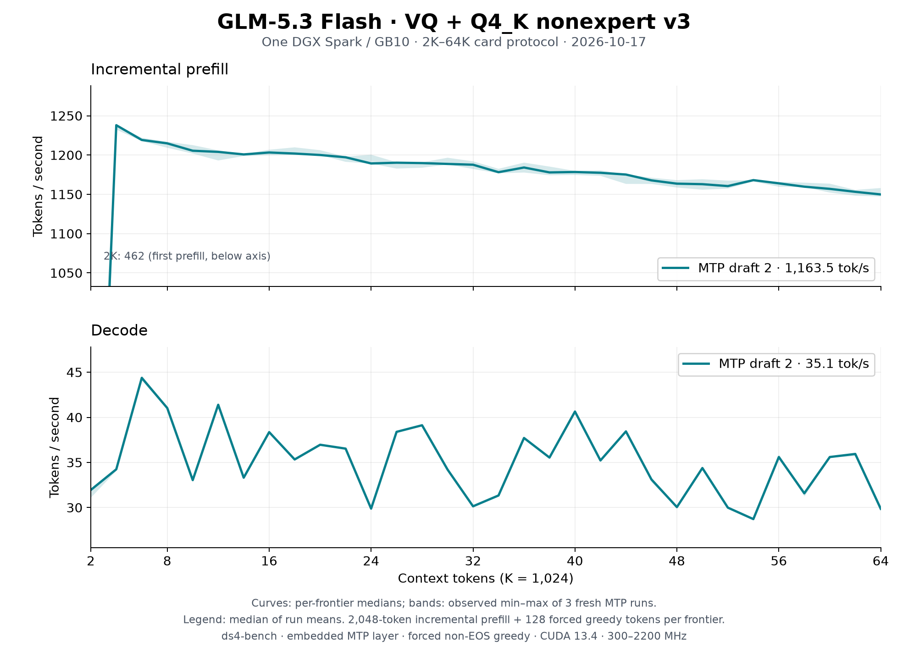

# GLM-5.3 Flash VQ on one DGX Spark: 2K–64K after the prefill PR, October 17

The [README sweep](../../../speed-bench/README.md) on the
[Q4_K nonexpert v3 artifact](https://huggingface.co/Baekpica/GLM-5.3-Flash-VQ-GGUF)
at merged `main` (`3dd964ba`, [#88](https://github.com/Baekpica/ds4-dfm-rs/pull/88)):
three fresh `ds4-bench` processes with two embedded MTP drafts. Every frontier
prefills 2,048 new tokens on top of the cached prefix and generates 128 forced
greedy tokens; the session then restores the prompt snapshot before the next
frontier. MTP off was not rerun.

| Configuration | Prefill tok/s | Decode tok/s | Tokens per verify |
|---|---:|---:|---:|
| Two embedded MTP drafts (median of three run means) | 1,163.5 | 35.08 | 2.32 |
| [Merged `main` before #88](../glm53-vq-spark-64k-main-2026-10-17/README.md) (`c5384b5e`), two drafts | 1,042.2 | 35.12 | 2.34 |

Curves show the median at each frontier; shading is the observed minimum–maximum
of the three runs, not a confidence interval. Summary cells are the median of
the run means over 32 frontiers. [All samples](tables.md) and the
[summary](summary.json) are retained.

| Frontier | Prefill, MTP 2 | Decode, MTP 2 |
|---:|---:|---:|
| 2K | 462.4 | 31.9 |
| 4K | 1,238.0 | 34.2 |
| 8K | 1,214.8 | 41.0 |
| 16K | 1,203.2 | 38.4 |
| 32K | 1,187.7 | 30.1 |
| 48K | 1,163.6 | 30.1 |
| 64K | 1,149.9 | 29.9 |

## Conditions

- One NVIDIA DGX Spark / GB10, driver 615.71.09; CUDA 13.4.92, `sm_121a`;
  Rust 1.98.0; Linux 7.0.0-1019-nvidia. Clock range 300–2200 MHz; observed
  busy SM clock 2,184–2,190 MHz.
- Source `3dd964ba` (`main`, clean tree), `ds4-bench` with NVTX
  instrumentation compiled in and no profiler attached, SHA256
  `ba986e066e75c62fbac5b5663839ff19836a4dc14eda7339e7550ba100c3564a`.
- Model `GLM-5.3-Flash-VQ-Q4K-v3-GGUF` (manifest `18b997f2…`), unchanged. One
  resident model owner; no other GPU work.
- Prompt `speed-bench/promessi_sposi.txt`, SHA256
  `f53e0d80cb2d4492d24ebd63c7000c397b16ae70f9bf09b3763e5d8323ec209f`.
- `--ctx-start 2048 --ctx-max 65536 --step-incr 2048 --gen-tokens 128
  --mtp-draft 2`, temperature 0 with EOS excluded so every frontier
  generates 128 tokens. Default prefill chunk (4,096 rows, so each
  2,048-token step is one chunk); no warm-up besides the first frontier.

## Reading the curves

- Incremental prefill rises 11.6% over `c5384b5e` (4K 1,092.2 → 1,238.0, 64K
  1,028.5 → 1,149.9): eight-warp flash attention, the FP16 tensor-core Q4_K
  prefill and BF16 rows around it, and the staged mHC expand-mix. It falls
  7.1% from 4K to 64K: sparse attention reads the same 2,048 selected keys at
  every context, while the indexer's pool scores and top-k grow with the
  prefix and are now a larger share. The 2K point is each process's first
  prefill (first-use allocation, 321–623 tok/s here and 282–718 before).
- Decode is unchanged: #88 changed prefill kernels only. The three runs
  accepted drafts identically (74,130 expert decode calls each, 2.32 tokens
  per verify against 2.34 on the earlier continuations); a two-draft verify
  cycle averages 66.2 ms (66.7 before).
- Past the 2K point the three runs differ by at most 1.1% in prefill and 1.2%
  in decode at any frontier.
