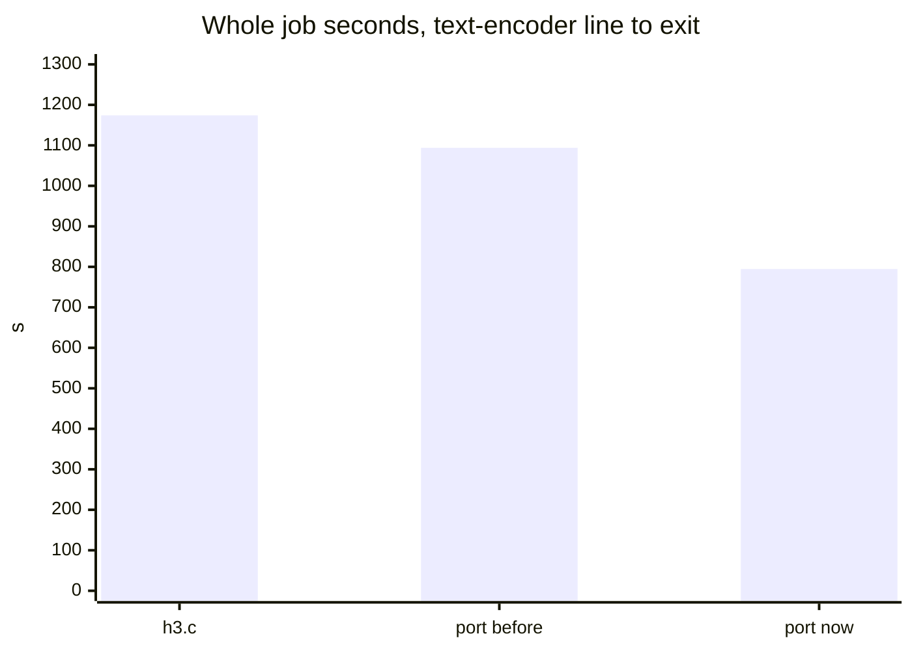
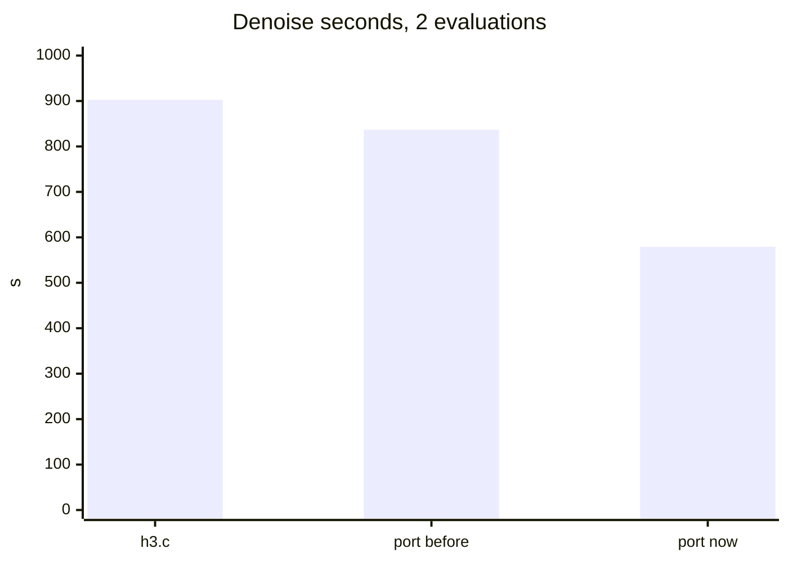
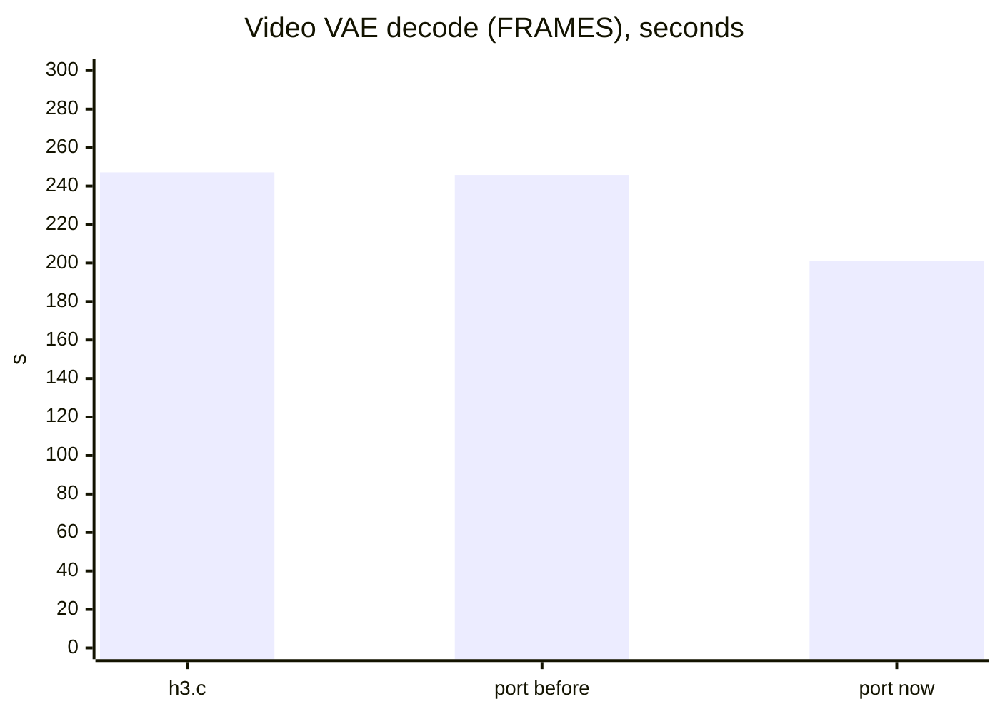

# H3 job A — the port against h3.c

MiniMax-H3 at 768x768, 107 frames, 2 steps, seed 42, on the DGX Spark (GB10),
one run per binary. The numbers are the tables in
[../../minimax-h3/speed-2026-10-27.md](../../minimax-h3/speed-2026-10-27.md),
which carries the full provenance: both binaries by sha256, the commands, the
page-cache method, and the kernel-level sweeps each arm rests on.

Every arm's render is byte-identical
(`69816f7f4683d41b1c677e1e6028b36294ca8a87e77efba78c6056a3154a16f4`), so these
plots compare execution, not output.

- `job.png` — text-encoder line to exit. h3.c 1,173.955 s, port before
  1,093.885 s, port now 794.556 s.
- `denoise.png` — the two evaluations. 902.486 s, 836.886 s, 579.392 s.
- `video-vae.png` — the decoder, the port's FRAMES phase. 247.111 s,
  245.751 s, 201.210 s.

"Port before" is the campaign's baseline binary; "port now" carries the three
attention restructures (staged key rows and a hoisted query row, two query rows
per warp in the DiT kernel, and the same treatment in the video VAE's F32
kernel). The three arms are one end-to-end run each, so their repeatability
rests on the kernel-level sweeps in the speed file rather than on repeated job
runs.

The F32 VAE unit's own run is the source of the "port now" column, and its TEXT
and LOAD phases are 5.3 s slower than the previous run's for page-cache reasons;
the change's own effect is the video-vae plot's 44.758 s.

Source of each plot, rendered with mermaid-mcp:

