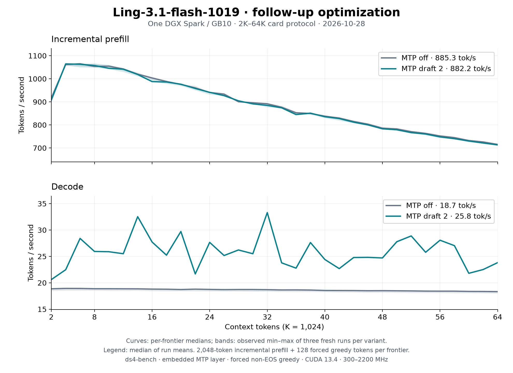

# Ling-3.1-flash-1019 follow-up: 2K–64K on DGX Spark

The six accepted changes in the [follow-up](../../ling31-optimization-2026-10-28-followup.md)
are measured at `e01b409ddb413fdcc7c275eb008745f8629f35c2`. This uses the same incremental
protocol as the [earlier publication](../ling31-1019-vq-spark-64k-2026-10-28/README.md).
The per-round matched controls remain in that follow-up report.

| Configuration (median of three run means) | Prefill tok/s | Decode tok/s |
|---|---:|---:|
| MTP off, 2K–64K | 885.3 | 18.65 |
| MTP off, 2K–32K | 982.4 | 18.81 |
| Two embedded MTP drafts, 2K–32K | 977.8 | 26.48 |
| Two embedded MTP drafts, 2K–64K | 882.2 | 25.79 |

Curves are per-frontier medians; bands are the observed min–max of three
fresh processes per mode, including the slower ordinary run. They are not
confidence intervals. [Per-frontier ranges](tables.md), [summary](summary.json),
[receipts and proof hashes](evidence.json), and [raw clock samples](clocks.csv)
are retained. The first 2K prefill includes first-use allocation and is
visible on the graph. The six `plain-*.csv` and `mtp2-*.csv` files retain
every measured frontier from each process.

## Protocol and identity

- One GB10 / DGX Spark, driver 615.71.10, CUDA 13.4.92, `sm_121a`.
  The operator's 300–2200 MHz clock service stays enabled. Busy samples
  (GPU utilization at least 80%) are 2184–2190 MHz, sampled every 500 ms.
  Boot identity: `f5d9ee6b-7f0f-443c-b629-4f39b4519994`.
- `ds4-bench-perf`, NVTX compiled in, no profiler attached; SHA256
  `0cf490e447a9875ea98cee00cfa508bb6cd9d382d79453636b6e8e5d5e568197`. Source tree is clean at the same
  commit for all six processes; no diagnostic environment overrides.
- The all-12-bit `Baekpica/Ling-3.1-flash-1019-VQ-GGUF` release;
  manifest SHA256 `940c92ca2d347e47b929dceb7d25acc852f31a58c443e368a78d1484bd4265d9`.
  `speed-bench/promessi_sposi.txt` SHA256
  `f53e0d80cb2d4492d24ebd63c7000c397b16ae70f9bf09b3763e5d8323ec209f`.
- CPU affinity 5–9,15–19. One model at a time; GPU checked empty and caches
  dropped before each load. Host guard reserve/trip 2 GiB and PSI limit 40%.
  Minimum available memory 5.78 GiB; maximum recorded PSI full avg10 0.00%.
- `--ctx-start 2048 --ctx-max 65536 --step-incr 2048 --gen-tokens 128`,
  plus `--mtp-draft 2` for MTP. Commands and exact paths are in the receipts.
  Default 4096-row chunks, no warmup besides first frontier.
  Each frontier prefills 2048 new tokens, generates 128 non-EOS greedy tokens,
  then restores the prompt snapshot. Full frontier logits, token IDs and
  acceptance cycles are dumped outside the timed regions.
- Order: plain 1, MTP 1, MTP 2, plain 2, plain 3, MTP 3.

## Repeatability and limits

- plain: Prefill run means 885.34, 884.36, 887.86; Decode 18.7013, 18.2913, 18.6513 tok/s.
- mtp2: Prefill run means 878.16, 887.29, 882.16; Decode 25.8106, 25.7881, 25.7281 tok/s.

All 192 full-vocabulary frontier proofs are finite. Within each mode,
repeated frontiers have identical packed-F32 logits, generated tokens and
acceptance cycles. Thus the measured repeat range is not caused by a
different greedy continuation or acceptance pattern.

The slower ordinary process has about 2% lower Decode while Prefill stays
close. A [live snapshot](plain-2-gpu-state.txt) found 2190 MHz, 70°C, no active power/thermal limit,
PSI 0 and no competing GPU process. A slow regime in unchanged Q4 kernels
was also observed on the earlier clean baseline; the cause of this
process variation remains unresolved. No uniform ordinary Decode gain or
speed-equivalence claim is made. All samples stay in the table and bands.

MTP speed follows speculative acceptance, and this corpus can repeat near
the continuation tail. It does not represent general assistant throughput.
Ten independent short assistant cases supplement the per-round comparisons.
The final [MTP state gate](mtp-gate.json) passes 16 cases / 1,312 tokens,
549 speculative calls, 2.390 tokens/call, maximum one-row logit gap 0.5 and
zero tokens beyond the existing 0.5 tie. That tie is a regression threshold,
not a measured numerical noise floor.

The P1 arithmetic change has a separate measured noise comparison through
32K; its 32K top-1 agreement is lower than the chunk reference despite the
aggregate NLL/top-1 result. Quality beyond 32K, other models/GPUs and sustained
serving are not newly qualified. Existing 1M records remain historical.
