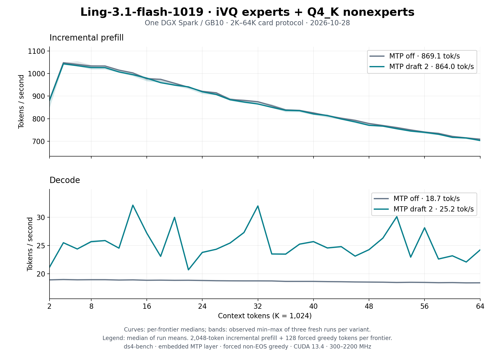

# Ling-3.1-flash-1019 VQ on one DGX Spark: 2K–64K, October 28

The [README sweep](../../../speed-bench/README.md) on the
[Ling-3.1-flash-1019 VQ release](https://huggingface.co/Baekpica/Ling-3.1-flash-1019-VQ-GGUF)
at `76bc05cb` (branch `feat/add-ling31-1019`, [#123](https://github.com/Baekpica/ds4-dfm-rs/pull/123)):
three fresh `ds4-bench` processes per variant. Every frontier prefills 2,048
new tokens on top of the cached prefix and generates 128 forced greedy
tokens; the session then restores the prompt snapshot before the next
frontier. With the embedding on SSD, two embedded MTP drafts now run to 64K
as well. The [v2 sweep](../ling31-vq-spark-64k-v2-2026-10-18/README.md)
(`709cf8df`, the earlier release) is beside it.

| Configuration (median of three run means) | Prefill tok/s | Decode tok/s | v2 at `709cf8df` |
|---|---:|---:|---:|
| MTP off, 2K–64K | 869.1 | 18.68 | 774.1 / 17.70 |
| MTP off, 2K–32K | 961.1 | 18.85 | 861.7 / 17.83 |
| Two embedded MTP drafts, 2K–32K | 954.2 | 25.82 | 861.0 / 23.58 |
| Two embedded MTP drafts, 2K–64K | 864.0 | 25.23 | — |

Curves show the median at each frontier; shading is the observed minimum–maximum
of the three runs, not a confidence interval. [All samples](tables.md) and the
[summary](summary.json) are retained.

| Frontier | Prefill, MTP off | Decode, MTP off | Prefill, MTP 2 | Decode, MTP 2 | v2 decode (off / MTP 2) |
|---:|---:|---:|---:|---:|---:|
| 2K | 883.0 | 18.91 | 881.2 | 21.15 | 17.63 / 22.12 |
| 4K | 1048.3 | 18.97 | 1043.6 | 25.48 | 17.94 / 22.25 |
| 8K | 1033.9 | 18.94 | 1026.9 | 25.68 | 17.85 / 27.32 |
| 16K | 977.4 | 18.84 | 979.8 | 27.19 | 17.78 / 21.03 |
| 32K | 875.0 | 18.73 | 865.0 | 31.98 | 17.73 / 22.00 |
| 48K | 778.3 | 18.52 | 770.4 | 24.25 | 17.57 / — |
| 64K | 708.7 | 18.39 | 702.8 | 24.21 | 17.44 / — |

## What changed

- The release: the post-trained 1019 checkpoint with activation-calibrated
  books, K4096 (12-bit) in all 68 expert layers and MTP, and its BF16
  embedding read from SSD by row instead of a device table.
- The runtime: 4,096-row prefill chunks, Beam's warp-specialized experts,
  the router on tensor cores, BF16 norm rows at prefill, one launch for
  KDA's five decode projections and the KDA state held in registers across
  MTP verify rows. The [round](../../ling31-optimization-2026-10-28.md)
  records each change and its evidence.

## Conditions

- One NVIDIA DGX Spark / GB10, driver 615.71.10; CUDA 13.4, `sm_121a`;
  Rust 1.98.0; Linux 7.0.0-1019-nvidia. Clock range 300–2200 MHz
  (`nvidia-clocks.service` active); 2,184–2,190 MHz in five samples taken at
  launch, 305 MHz in one (not sampled during the sweep).
- Source `76bc05cb`, `ds4-bench` with NVTX instrumentation compiled in and
  no profiler attached, SHA256
  `7a16df4acfe68f777c14dbbc4c28fd2c2ae1fcc9b5a0d698869e9deaf74ff8aa`.
- Model: the release directory of recipe
  `ling31-1019-ivq8-all12-q4k-embssd-v1`, `release.json` SHA256
  `940c92ca2d347e47b929dceb7d25acc852f31a58c443e368a78d1484bd4265d9`. One
  model process at a time under `tools/host_memory_guard.py` (2 GiB floor,
  PSI 40%), one foreground command per run. Page cache and the driver's
  freed pages were dropped before each launch (`KReclaimable` 0 GiB);
  without that, every load after a host build tripped the guard's PSI limit.
- Prompt `speed-bench/promessi_sposi.txt`, SHA256
  `f53e0d80cb2d4492d24ebd63c7000c397b16ae70f9bf09b3763e5d8323ec209f`.
- `--ctx-start 2048 --ctx-max 65536 --step-incr 2048 --gen-tokens 128`,
  once without and once with `--mtp-draft 2`; temperature 0 with EOS
  excluded so every frontier generates 128 tokens. Default 4,096-row prefill
  chunk; no warm-up besides the first frontier.

## Reading the curves

- MTP-off decode is flat: 18.91 tok/s at 2K and 18.39 at 64K (v2 17.63 and
  17.44). Run means were 18.67, 18.78 and 18.68 tok/s.
- Incremental prefill peaks at 4K (1,048 tok/s) and falls to 709 at 64K:
  the nine MLA layers expand each 2,048-key segment of the latent cache in
  every step. Each 2,048-token step is half a 4,096-row chunk; a whole 8K
  prompt prefills at about 1,170 tok/s.
- MTP decode follows draft acceptance on each frontier's 128 generated
  tokens (20.7–32.1 tok/s); the 2K–32K mean gains 9.5% over v2, whose
  generated tokens differ.
