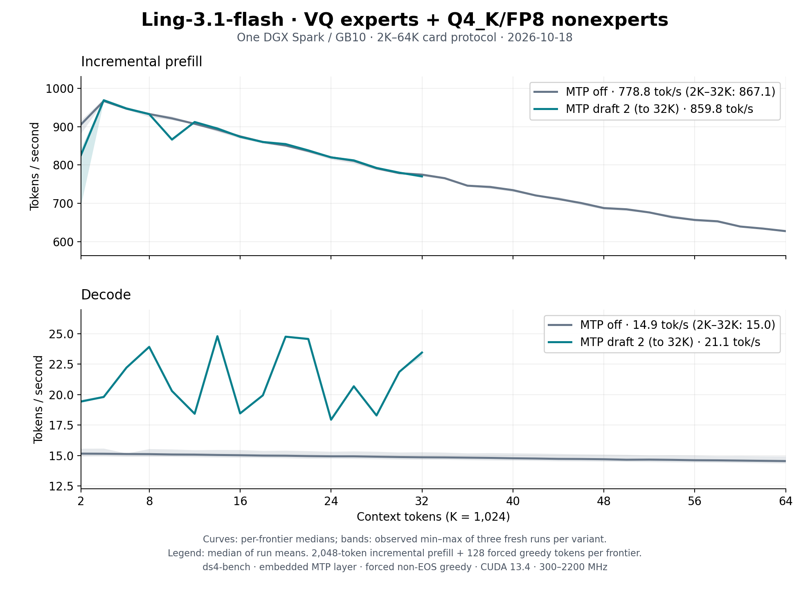

# Ling-3.1-flash VQ on one DGX Spark: 2K–64K after the prefill round, October 18

The [README sweep](../../../speed-bench/README.md) on the
[Ling-3.1-flash VQ release](https://huggingface.co/Baekpica/Ling-3.1-flash-VQ-GGUF)
at `a64e323b` (branch `perf/ling31-prefill`): three fresh `ds4-bench`
processes per variant. Every frontier prefills 2,048 new tokens on top of the
cached prefix and generates 128 forced greedy tokens; the session then
restores the prompt snapshot before the next frontier. Two embedded MTP
drafts run to 32K only: the 1.68 GiB MTP part, a 64K session and the bench's
host-memory snapshot (about 1 GiB at 64K) would leave under 2 GiB of the
128 GB Spark. The [first sweep](../ling31-vq-spark-64k-2026-10-18/README.md)
(`4d6f096b`, merged in #92) is the baseline.

| Configuration (median of three run means) | Prefill tok/s | Decode tok/s | `4d6f096b` |
|---|---:|---:|---:|
| MTP off, 2K–64K | 778.8 | 14.86 | 669.6 / 15.24 |
| MTP off, 2K–32K | 867.1 | 15.02 | 772.1 / 15.42 |
| Two embedded MTP drafts, 2K–32K | 859.8 | 21.15 | 751.6 / 20.99 |

Curves show the median at each frontier; shading is the observed minimum–maximum
of the three runs, not a confidence interval. [All samples](tables.md) and the
[summary](summary.json) are retained.

| Frontier | Prefill, MTP off | Decode, MTP off | Prefill, MTP 2 | Decode, MTP 2 | Prefill at `4d6f096b` |
|---:|---:|---:|---:|---:|---:|
| 2K | 905.9 | 15.16 | 826.3 | 19.43 | 778.0 |
| 4K | 967.0 | 15.15 | 969.0 | 19.81 | 908.1 |
| 8K | 933.0 | 15.12 | 932.8 | 23.91 | 863.5 |
| 16K | 874.8 | 15.03 | 873.7 | 18.46 | 782.5 |
| 32K | 775.0 | 14.86 | 770.4 | 23.45 | 657.2 |
| 48K | 687.8 | 14.70 | — | — | 567.6 |
| 64K | 627.5 | 14.55 | — | — | 501.2 |

## What changed

- Expanded-MLA prefill attention copies K/V tiles with a cp.async ring and
  shares each tile among 128 queries (one 2,048 × 2,048-key, 64-head segment:
  5.14 → 2.96 ms), and folds each key segment into the running heads in
  place instead of a separate state merge. Both are byte-identical.
- The FP8 KDA decay/gate projections run on the q4p kernel's producer warps
  (FP16 operands from the E4M3 bytes) instead of a BF16 weight restore and
  cuBLAS: +4–6% at every frontier.

## Conditions

- One NVIDIA DGX Spark / GB10, driver 615.71.09; CUDA 13.4, `sm_121a`;
  Rust 1.98.0; Linux 7.0.0-1019-nvidia. Clock range 300–2200 MHz; busy SM
  clock 2,190 MHz in this session's A/B runs (not sampled during the sweep).
- Source `a64e323b` (clean tree), `ds4-bench` with NVTX instrumentation
  compiled in and no profiler attached, SHA256
  `300400e09378f81aa1f5775e51ad4a92908f982dc5b1c315de1fc70cf65e8cbd`.
- Model `Ling-3.1-flash-VQ-GGUF` (release directory, recipe
  `ling31-vq8-mix8r13-60r12-mtp13-q4h-v1`), unchanged. One model process at a
  time under `tools/host_memory_guard.py` (2 GiB floor, PSI 40%), one
  foreground command per run.
- Prompt `speed-bench/promessi_sposi.txt`, SHA256
  `f53e0d80cb2d4492d24ebd63c7000c397b16ae70f9bf09b3763e5d8323ec209f`.
- `--ctx-start 2048 --ctx-max 65536 --step-incr 2048 --gen-tokens 128` (MTP
  off) and `--ctx-max 32768 --mtp-draft 2`; temperature 0 with EOS excluded
  so every frontier generates 128 tokens. Default 2,048-row prefill chunk;
  no warm-up besides the first frontier.

## Reading the curves

- Incremental prefill falls 35% from 4K (967.0) to 64K (627.5), against 45%
  before: the nine MLA layers still expand every 2,048-key segment of the
  latent cache in each step, but attention per segment costs about half.
- MTP-off decode run means were 15.25, 14.86 and 14.67 tok/s, against 14.79,
  15.24 and 15.26 at `4d6f096b`; the changes touch prefill only.
- MTP decode follows draft acceptance on each frontier's 128 generated
  tokens (17.9–24.9 tok/s, +41% over MTP off on 2K–32K). The 2K point is each
  process's first prefill (first-use allocation; MTP also allocates its
  journal and draft rows).
