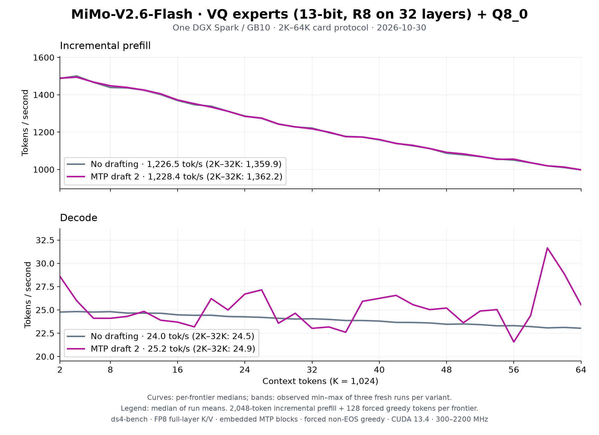

# MiMo-V2.6-Flash VQ on one DGX Spark: 2K–64K, 2026-10-30

Three fresh Rust `ds4-bench` processes per variant measured code
`d249bf41` after the [October 30 optimization rounds](../../mimo2-vq-optimization-2026-10-30.md),
on the [UNCENSORED VQ release](https://huggingface.co/Baekpica/MiMo-V2.6-Flash-RL-UNCENSORED-VQ-GGUF)
`f1cd8523`. Each frontier prefills 2,048 new tokens over the cached prefix,
generates 128 forced greedy tokens, then restores the prompt snapshot.
Variants: no drafting, and two embedded MTP drafts (the server default).
All six processes exit zero with all 32 frontiers.



| Median of three run means | Prefill tok/s | Decode tok/s |
|---|---:|---:|
| No drafting, 2K–64K | **1,226.5** | **23.97** |
| No drafting, 2K–32K | 1,359.9 | 24.46 |
| Two MTP drafts, 2K–64K | **1,228.4** | **25.16** |
| Two MTP drafts, 2K–32K | 1,362.2 | 24.94 |

| Run | Prefill, no drafting | Decode, no drafting | Prefill, MTP 2 | Decode, MTP 2 |
|---|---:|---:|---:|---:|
| 1 | 1,224.81 | 23.98 | 1,225.07 | 25.12 |
| 2 | 1,229.45 | 23.97 | 1,228.42 | 25.16 |
| 3 | 1,226.50 | 23.97 | 1,230.33 | 25.17 |

| Frontier | Prefill, no drafting | Decode, no drafting | Prefill, MTP 2 | Decode, MTP 2 |
|---:|---:|---:|---:|---:|
| 2K | 1,487.3 | 24.77 | 1,488.9 | 28.60 |
| 4K | 1,500.6 | 24.82 | 1,494.0 | 25.98 |
| 8K | 1,438.9 | 24.81 | 1,448.2 | 24.10 |
| 16K | 1,369.2 | 24.47 | 1,372.3 | 23.69 |
| 32K | 1,221.7 | 24.05 | 1,217.7 | 23.02 |
| 48K | 1,086.8 | 23.46 | 1,091.9 | 25.20 |
| 64K | 998.0 | 23.03 | 998.1 | 25.55 |

Curves show per-frontier medians; shading is the observed min–max of three
runs. [All frontiers](tables.md), [summary](summary.json), the six CSVs
(`plain-N.csv`, `mtp2-N.csv`) and the [receipt](receipt.json) are retained.
Decode is CSV `gen_tps`, including the first generated token.

Each frontier's MTP decode repeats across the three runs: the same tokens
and the same acceptance on that frontier's continuation, 21.6–31.6 tok/s
against 23.0–24.8 without drafting. The embedded MTP blocks attend only to
their own draft rows, not to the prompt, and each restored snapshot empties
them; the mean gain is 5% (15% at 2K). The MTP runs' prefill does no
drafter work and equals the plain prefill.

The first plain run 2 overlapped about 45 s of `cargo clippy` on the other
cores (prefill −6% at its 12K–14K frontiers, one 1,995 MHz sample); a clean
repeat replaced it, and the original is kept as
[discarded-plain-2.csv](discarded-plain-2.csv).

## Conditions and reproduction

- One DGX Spark / GB10, CUDA 13.4.92, driver 615.71.10; the benchmark
  process on CPU 9. Boot `f5d9ee6b-7f0f-443c-b629-4f39b4519994`; the
  enabled, successful `nvidia-clocks.service` keeps its 300–2,200 MHz
  policy. Busy samples (utilization ≥ 50%, every 5 s, 270): 2,177–2,190 MHz.
- One model process at a time under `tools/host_memory_guard.py` with a
  2 GiB reserve and trip; minimum available memory 23.54 GiB, full PSI 0.
- The 53-part release on local NVMe; `release.json` SHA-256
  `17b16b6c92732be42292917c44ea4043941383333182b8f8f15bb17c9c5d35c3`.
- Prompt `speed-bench/promessi_sposi.txt`, SHA-256
  `f53e0d80cb2d4492d24ebd63c7000c397b16ae70f9bf09b3763e5d8323ec209f`.
- `ds4-bench` SHA-256
  `58cc63821e889e1167e1bd52f89b0dfa3a5dd741019db05177904a50d1fde666`,
  built from `7939b08b`, which differs from `d249bf41` only by rustfmt.

```sh
git checkout d249bf4170b534ab79635243a888a693ff9671ab
make cuda-spark
# Three fresh processes per variant; add --mtp-draft 2 for the MTP runs.
python3 tools/host_memory_guard.py --max-gib 128 --high-gib 128 \
  --reserve-gib 2 --trip-gib 2 --psi-full-limit 0 --timeout 3600 -- \
  taskset -c 9 ./ds4-bench --cuda -m MiMo-V2.6-Flash-RL-UNCENSORED-VQ-GGUF \
  --prompt-file speed-bench/promessi_sposi.txt \
  --ctx-start 2048 --ctx-max 65536 --step-incr 2048 --gen-tokens 128 \
  --csv plain-N.csv
python3 docs/benchmarks/plot-mimo2-vq-64k.py docs/benchmarks/mimo2-vq-spark-64k-2026-10-30
```

This is a text throughput measurement. The novel's forced continuation does
not establish output quality; the [family page](../../mimo2-vq.md#quality)
records the quality gates.
