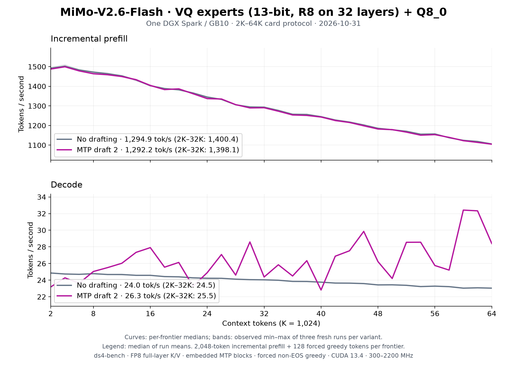

# MiMo-V2.6-Flash VQ on one DGX Spark: 2K–64K, 2026-10-31

Three fresh Rust `ds4-bench` processes per variant measured code
`2fa8c08e` after the [October 31 rounds](../../mimo2-vq-optimization-2026-10-31.md)
(MTP blocks that see the prompt, E4M3 full-layer prefill scores), on the
[UNCENSORED VQ release](https://huggingface.co/Baekpica/MiMo-V2.6-Flash-RL-UNCENSORED-VQ-GGUF)
`f1cd8523`. Each frontier prefills 2,048 new tokens over the cached prefix,
generates 128 forced greedy tokens, then restores the prompt snapshot.
Variants: no drafting, and two embedded MTP drafts (the server default),
run alternately. All six processes exit zero with all 32 frontiers.



| Median of three run means | Prefill tok/s | Decode tok/s | October 30 |
|---|---:|---:|---:|
| No drafting, 2K–64K | **1,294.9** | **23.96** | 1,226.5 / 23.97 |
| No drafting, 2K–32K | 1,400.4 | 24.46 | 1,359.9 / 24.46 |
| Two MTP drafts, 2K–64K | **1,292.2** | **26.35** | 1,228.4 / 25.16 |
| Two MTP drafts, 2K–32K | 1,398.1 | 25.48 | 1,362.2 / 24.94 |

| Frontier | Prefill, no drafting | Decode, no drafting | Prefill, MTP 2 | Decode, MTP 2 |
|---:|---:|---:|---:|---:|
| 2K | 1,492.2 | 24.86 | 1,487.7 | 23.18 |
| 8K | 1,472.3 | 24.78 | 1,463.9 | 25.04 |
| 16K | 1,402.8 | 24.58 | 1,404.0 | 27.91 |
| 32K | 1,293.4 | 24.04 | 1,290.6 | 24.38 |
| 48K | 1,185.8 | 23.43 | 1,182.2 | 26.23 |
| 64K | 1,106.1 | 23.04 | 1,105.0 | 28.40 |

Prefill at 64K rose from 998.0 to 1,106.1 and the 2K→64K decline from 32.9%
to 25.9%. MTP decode follows each frontier's acceptance on the novel's
forced continuation (22.8–32.4 tok/s), the same in all three runs; its mean
gain over plain decode rose from 5% to 10%. A frontier whose continuation
changed with the prefill arithmetic can draft worse: 2K went from 28.60 to
23.18. Curves show per-frontier medians; shading is the observed min–max of
three runs. [All frontiers](tables.md), [summary](summary.json), the six
CSVs and the [receipt](receipt.json) are retained. Decode is CSV `gen_tps`,
including the first generated token.

## Conditions and reproduction

- One DGX Spark / GB10, CUDA 13.4.92, driver 615.71.10; the benchmark
  process on CPU 9. The enabled, successful `nvidia-clocks.service` keeps
  its 300–2,200 MHz policy. Busy samples (utilization ≥ 50%, every 5 s,
  261): 2,177–2,190 MHz.
- One model process at a time under `tools/host_memory_guard.py` with a
  2 GiB reserve and trip; minimum available memory 23.31 GiB, full PSI 0.
- The 53-part release on local NVMe; `release.json` SHA-256
  `17b16b6c92732be42292917c44ea4043941383333182b8f8f15bb17c9c5d35c3`.
- Prompt `speed-bench/promessi_sposi.txt`, SHA-256
  `f53e0d80cb2d4492d24ebd63c7000c397b16ae70f9bf09b3763e5d8323ec209f`.
- `ds4-bench` SHA-256
  `c7bc01ac2b1f687727085e27c35b5b2dfdb4e6bde6654d03e8ea0740dda572bf`,
  built from `2fa8c08e`.

```sh
git checkout 2fa8c08e0229d463340b0823f2b1d54cfad93087
make cuda-spark
# Three fresh processes per variant; add --mtp-draft 2 for the MTP runs.
python3 tools/host_memory_guard.py --max-gib 128 --high-gib 128 \
  --reserve-gib 2 --trip-gib 2 --psi-full-limit 0 --timeout 3600 -- \
  taskset -c 9 ./ds4-bench --cuda -m MiMo-V2.6-Flash-RL-UNCENSORED-VQ-GGUF \
  --prompt-file speed-bench/promessi_sposi.txt \
  --ctx-start 2048 --ctx-max 65536 --step-incr 2048 --gen-tokens 128 \
  --csv plain-N.csv
python3 docs/benchmarks/plot-mimo2-vq-64k.py docs/benchmarks/mimo2-vq-spark-64k-2026-10-31
```

This is a text throughput measurement. The novel's forced continuation does
not establish output quality; the [family page](../../mimo2-vq.md#quality)
records the quality gates.
