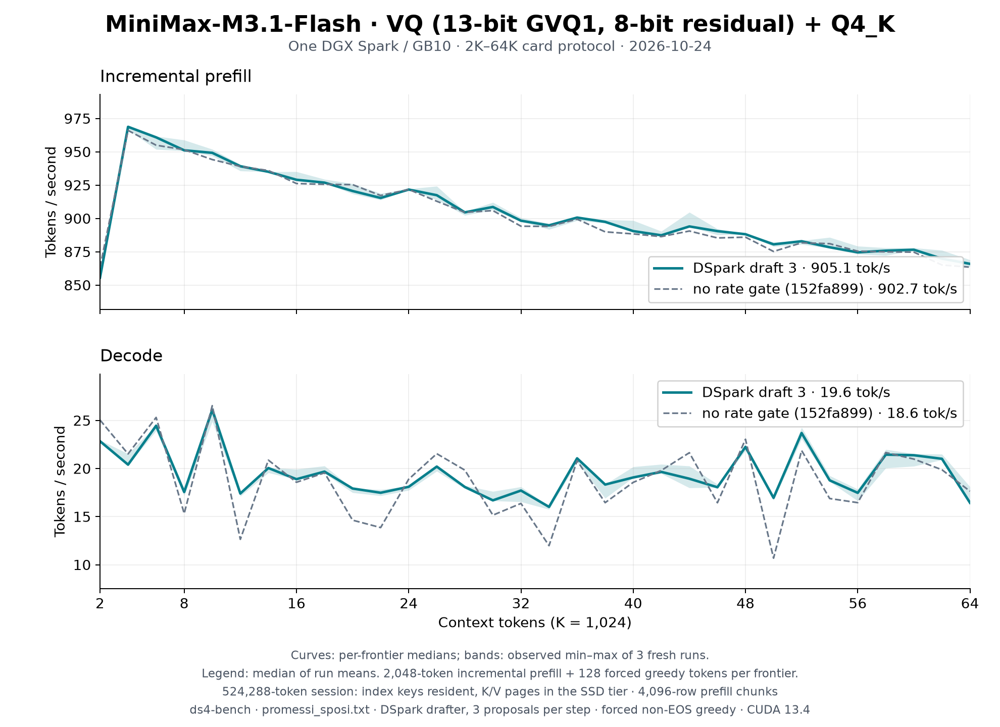

# MiniMax-M3.1-Flash VQ on one DGX Spark: 2K–64K with the DSpark rate gate

The [README sweep](../../../speed-bench/README.md) on the
[MiniMax-M3.1-Flash VQ release](https://huggingface.co/Baekpica/MiniMax-M3.1-Flash-VQ-GGUF)
(`74e5a9fd`) at `ff430197`, which gates DSpark drafting on measured rates
([MiniMax page](../../minimax-vq.md#dspark-drafting)): three fresh `ds4-bench`
processes, the DSpark draft head proposing three tokens per step. The session
allocates a 524,288-token context, as a 512K server does, so the K/V pages live
in the SSD tier (an unlinked `O_DIRECT` file and a 0.66 GiB pinned pool; the
index keys stay resident); prefill chunks are the default 4,096 rows. Every
frontier prefills 2,048 new tokens on top of the cached prefix and generates
128 forced greedy tokens; the session then restores the prompt snapshot before
the next frontier. The dashed line is the
[same sweep without the gate](../minimax-vq-spark-64k-2026-10-24/README.md)
(`152fa899`).



| Configuration (median of three run means) | Prefill tok/s | Decode tok/s | Without the gate |
|---|---:|---:|---:|
| DSpark draft 3, 2K–64K | 905.1 | 19.56 | 902.7 / 18.65 |
| DSpark draft 3, 2K–32K | 924.9 | 19.51 | 924.4 / 19.11 |

Curves show the median at each frontier; shading is the observed minimum–maximum
of the three runs, not a confidence interval. [All samples](tables.md) and the
[summary](summary.json) are retained.

| Frontier | Prefill | Decode |
|---:|---:|---:|
| 2K | 855.6 | 22.8 |
| 4K | 968.7 | 20.4 |
| 8K | 951.1 | 17.6 |
| 16K | 929.0 | 18.9 |
| 32K | 898.3 | 17.7 |
| 48K | 888.1 | 22.2 |
| 64K | 865.9 | 16.4 |

## Reading the numbers

- **Decode.** Without the gate, frontiers whose proposals were mostly
  rejected decoded at 10.7–15 tok/s, below plain decoding (~19–20 tok/s here),
  because a four-row verify runs the routed experts row by row (~2.4
  decodes). The gate measures the rate of trials and of plain decodes and
  decodes plainly while drafting is slower: the dips fill in (12K 12.6 →
  17.4, 50K 10.7 → 16.9) at the cost of probes on frontiers where drafting
  wins (2K 25.0 → 22.8). Per frontier decode now spans 16.0–26.1 tok/s;
  greedy output is the same either way.
- **Prefill.** Unchanged (each frontier is one 2,048-row forward; a cold 8K
  prompt prefills at 1,126 tok/s in 4,096-row chunks).

## Conditions

- One NVIDIA DGX Spark / GB10, driver 615.71.10; CUDA 13.4, `sm_121a`;
  Rust 1.98.0; Linux 7.0.0-1019-nvidia. SM clock 2,411–2,431 MHz at the run
  boundaries.
- Clock annotation (2026-10-27): those historical readings have no archived
  per-sample clock CSV. The operator recalls a 300–2200 MHz policy too;
  the discrepancy remains [unreconciled](../../gb10-hardware.md#clock-policy-and-measurement-stability).
  Missing metadata does not establish an uncapped run.
- `ds4-bench` built from `ff430197` (SHA256
  `3704f24b9a7cf40000ca9a2525f21ae1647e81d6981b97f5648fc4bd7f92cf9d`).
- Model: the 61-part release directory, `release.json` SHA256
  `2110c1e5cba8d59987e370d50dab6dde5d5f7fc82009cdc27d8131452536f4b0`.
  One model process at a time in a cgroup scope (117 GiB ceiling), page
  cache dropped before each run; peak RSS 115.1 GiB.
- Prompt `speed-bench/promessi_sposi.txt`, SHA256
  `f53e0d80cb2d4492d24ebd63c7000c397b16ae70f9bf09b3763e5d8323ec209f`.

```sh
./ds4-bench --cuda -m MiniMax-M3.1-Flash-VQ-GGUF --prompt-file speed-bench/promessi_sposi.txt \
  --ctx-start 2048 --ctx-max 65536 --step-incr 2048 --ctx-alloc 524288 --gen-tokens 128 \
  --mtp-draft 3 --csv dspark3-N.csv
python3 docs/benchmarks/plot-minimax-vq-64k.py docs/benchmarks/minimax-vq-spark-64k-2026-10-24-gate \
  docs/benchmarks/minimax-vq-spark-64k-2026-10-24 "no rate gate (152fa899)"
```
