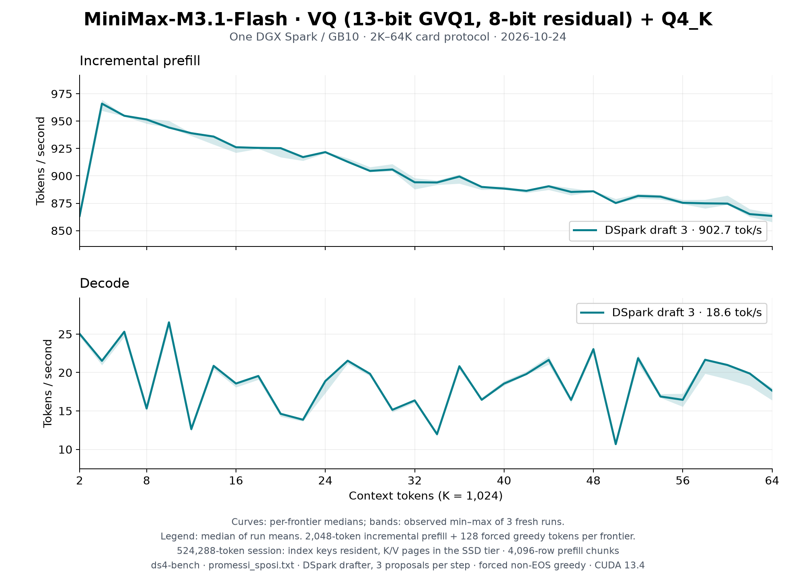

# MiniMax-M3.1-Flash VQ on one DGX Spark: 2K–64K with DSpark

The [README sweep](../../../speed-bench/README.md) on the
[MiniMax-M3.1-Flash VQ release](https://huggingface.co/Baekpica/MiniMax-M3.1-Flash-VQ-GGUF)
(`74e5a9fd`) at `152fa899`: three fresh `ds4-bench` processes, the DSpark
draft head proposing three tokens per step. The session allocates a
524,288-token context, as a 512K server does, so the K/V pages live in the
SSD tier (an unlinked `O_DIRECT` file and a 0.66 GiB pinned pool; the index
keys stay resident); prefill chunks are the default 4,096 rows. Every
frontier prefills 2,048 new tokens on top of the cached prefix and generates
128 forced greedy tokens; the session then restores the prompt snapshot
before the next frontier.



| Configuration (median of three run means) | Prefill tok/s | Decode tok/s |
|---|---:|---:|
| DSpark draft 3, 2K–64K | 902.7 | 18.65 |
| DSpark draft 3, 2K–32K | 924.4 | 19.11 |

Curves show the median at each frontier; shading is the observed minimum–maximum
of the three runs, not a confidence interval. [All samples](tables.md) and the
[summary](summary.json) are retained.

| Frontier | Prefill | Decode |
|---:|---:|---:|
| 2K | 863.5 | 25.0 |
| 4K | 966.0 | 21.5 |
| 8K | 951.5 | 15.3 |
| 16K | 926.2 | 18.6 |
| 32K | 894.2 | 16.4 |
| 48K | 885.9 | 23.0 |
| 64K | 863.4 | 17.6 |

## Reading the numbers

- **Prefill.** Each frontier is one 2,048-row forward, which streams every
  routed expert it touches for 2,048 tokens: a 4,096-row chunk reads half the
  expert bytes per token (a cold 8K prompt prefills at 1,126 tok/s). From 4K
  to 64K the rate falls 11% as block scoring and attention grow with the
  prefix and the chunk's K/V pages pass through the SSD tier's pool. The 2K
  point is each process's first prefill.
- **Decode.** DSpark follows the drafter's acceptance on this Italian prose:
  10.7–26.5 tok/s across frontiers, the same in all three runs (greedy
  output, and so acceptance, repeats). A four-row verify still runs the
  routed experts row by row, so a frontier whose proposals are mostly
  rejected decodes below plain decoding, which measures 20.2 tok/s at 8K and
  19.0 at 124K (cold single frontiers,
  [MiniMax page](../../minimax-vq.md#performance)).

## Conditions

- One NVIDIA DGX Spark / GB10, driver 615.71.10; CUDA 13.4, `sm_121a`;
  Rust 1.98.0; Linux 7.0.0-1019-nvidia. SM clock 2,411–2,567 MHz at the run
  boundaries.
- `ds4-bench` built from `152fa899` (SHA256
  `2ee7fb4310bb25556e092ffe4b9d718a5a1de2923602e5e3846997eabecef416`).
- Model: the 61-part release directory, `release.json` SHA256
  `2110c1e5cba8d59987e370d50dab6dde5d5f7fc82009cdc27d8131452536f4b0`.
  One model process at a time in a cgroup scope (117 GiB ceiling), page
  cache dropped before each run; peak RSS 115.1 GiB.
- Prompt `speed-bench/promessi_sposi.txt`, SHA256
  `f53e0d80cb2d4492d24ebd63c7000c397b16ae70f9bf09b3763e5d8323ec209f`.

```sh
./ds4-bench --cuda -m MiniMax-M3.1-Flash-VQ-GGUF --prompt-file speed-bench/promessi_sposi.txt \
  --ctx-start 2048 --ctx-max 65536 --step-incr 2048 --ctx-alloc 524288 --gen-tokens 128 \
  --mtp-draft 3 --csv dspark3-N.csv
python3 docs/benchmarks/plot-minimax-vq-64k.py docs/benchmarks/minimax-vq-spark-64k-2026-10-24
```
