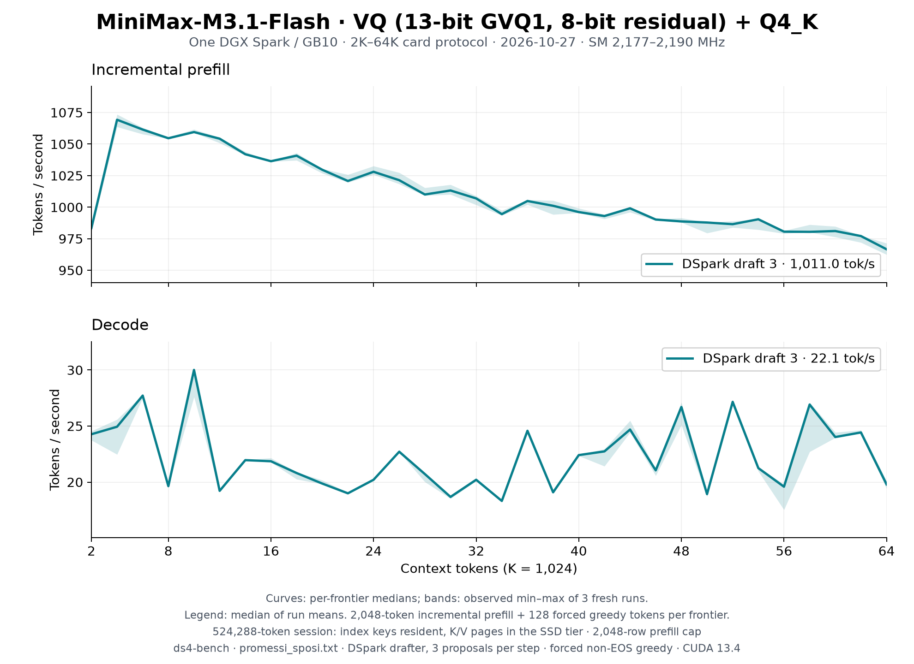

# MiniMax-M3.1-Flash VQ: fresh 2K–64K sweep, 2026-10-27

Three fresh Rust benchmark processes after the [three prefill and three decode
rounds](../../minimax-vq-optimization-2026-10-27.md), on the unchanged
[MiniMax-M3.1-Flash VQ release](https://huggingface.co/Baekpica/MiniMax-M3.1-Flash-VQ-GGUF).
Native source matches `84960118`; the qualified frozen binary was built before
that commit from `6c186d36` plus its D3 patch (SHA-256 below).



| Median of three run means | Prefill tok/s | Decode tok/s |
|---|---:|---:|
| DSpark draft 3 gated, 2K–64K | **1,011.0** | **22.10** |
| DSpark draft 3 gated, 2K–32K | 1,033.1 | 21.90 |

Curves are per-frontier medians; bands are the observed min–max of three
runs, not a confidence interval. Legends use the median of run means.
The [three CSVs](dspark3-1.csv), [all samples](tables.md),
[summary](summary.json), [conditions/resources](conditions.json) and
[correctness/cycle receipt](correctness.json) retain the evidence.

| Frontier | Prefill tok/s | Decode tok/s |
|---:|---:|---:|
| 2K | 983.5 | 24.27 |
| 4K | 1,069.3 | 24.94 |
| 8K | 1,054.6 | 19.64 |
| 16K | 1,036.4 | 21.86 |
| 32K | 1,007.0 | 20.21 |
| 48K | 988.7 | 26.70 |
| 64K | 966.6 | 19.80 |

## Workload and stability

Every frontier prefills 2,048 new tokens over the cached prefix, generates
128 forced non-EOS greedy tokens with gated DSpark draft 3, then restores
the prompt snapshot. The allocated session is 524,288 tokens: index keys
resident, K/V pages in the SSD tier, 9,660 pinned pool slots (0.66 GiB) and
a 0.07 GiB device prefill stage. This measures through 64K; it does not
qualify a full 512K workload. No extra 4K warmup is used; 2K is each
process's first measured prefill.

`DS4_MINIMAX_PREFILL_CHUNK=2048` matches the actual frontier width. It
reduces allocated workspace from 1.91 to 1.00 GiB compared with the default
4,096-row cap, without changing a frontier's forward width or SSD pool.
The first completed sweep with the default cap lost its controller and
telemetry when systemd-oomd killed the Codex scope; its payload finished
with status 0, but it is excluded from these three performance runs.
Its full logits and IDs serve only as an additional exact-output check.
All completed samples are retained; no successful tag was rerun.

The retained three run means are 1,011.62 / 1,010.98 / 1,009.75 prefill and
22.10 / 22.34 / 22.03 decode. Their total ranges are **0.19% / 1.39%** of
the respective medians. Per-frontier prefill range peaks at 1.10%.
Decode's timing-based gate carries measured draft/plain rates across
snapshot restores, so short frontiers can choose different call sequences
even with identical tokens. At 58K, calls are **48 / 48 / 74** and throughput
**27.11 / 26.92 / 22.71 tok/s** (16.34% min–max range relative to median).
The bands retain that variation. This sweep does not establish a fixed
steady decode rate at every frontier or provide an additional adoption A/B.
The separate resident plain-decode pairs establish the three decode rounds.

All 96 frontier observations have 200,064 finite logits and 128 tokens;
repeats 2/3 match repeat 1 bit for bit on all logits and IDs. Repeat 1 also
matches the completed 4,096-cap payload at every frontier. Cycle records
prove speculative mode, draft 3 and the 128-token emission budget.
Proofs are collected outside both timed regions; that extra receipt
collection was absent from the October 24 card command.

## Conditions

- GB10, CUDA 13.4.92, driver 615.71.10. Operator-confirmed **300–2200 MHz**
  policy; observed busy SM **2,177–2,190 MHz** at GPU utilization >=80%.
  Raw 1 Hz clocks are [run 1](clocks-1.csv), [run 2](clocks-2.csv),
  [run 3](clocks-3.csv); maximum sampled temperatures 72 / 72 / 73 C.
  Boot identity and confirmation are in `conditions.json`; agents did not
  change clocks. Follow the [operator/reboot policy](../../gb10-hardware.md#clock-policy-and-measurement-stability).
- One model at a time, cleared freed-driver/page cache before each process.
  Guard reserve/trip 2 GiB, PSI full abort threshold 20%, 1,200 s deadline;
  all payload/guard exits 0, full-run PSI 0. Minimum available host RAM
  6.16 / 5.88 / 6.08 GiB. No source changes or builds during measurement.
- CPU helpers inherit performance cores `5-9,15-19`; after graph readiness,
  the serial GPU-submission thread stays on CPU 5. [The exact affinity
  monitor](pin-main.py) and per-run log hashes are retained.
- Artifact `release.json` SHA-256
  `2110c1e5cba8d59987e370d50dab6dde5d5f7fc82009cdc27d8131452536f4b0`;
  recipe `minimax-m31f-vq8-r13x57-r8x20-q4k-nvfp4idx-ssdkv-embssd-v1`.
- Prompt `speed-bench/promessi_sposi.txt` SHA-256
  `f53e0d80cb2d4492d24ebd63c7000c397b16ae70f9bf09b3763e5d8323ec209f`.
- Frozen binary SHA-256
  `c9c627eb6294a2c0931cfdb2b569acfb1b454f64ed39b0ce947de0ad18e137f6`.
  Source hashes and all enabled diagnostic switches are in `conditions.json`.

The [October 24 graph](../minimax-vq-spark-64k-2026-10-24-gate/README.md)
remains a dated reference (905.1 / 19.56). It reports 2,411–2,431 MHz at run
boundaries without archived per-sample clocks; the operator recalls the
300–2200 MHz policy there too. That discrepancy is unresolved, so no
uncapped-policy or clock-causal claim is made. Runtime, workspace cap and
receipt collection also differ: this is a fresh retained-build graph,
not a matched estimate of cumulative optimization gain.

## Reproduce

The operator applies the clock policy after reboot. Build the source
revision above with the documented CUDA toolchain, then use one fresh
process per `N=1,2,3`; clear caches only after the previous process exits.
`DATA` below names this receipt directory; `LOG`, `AFFINITY`, `CSV`, `PROOF`
and the guard log must be unique per run.

```sh
DS4_MINIMAX_PREFILL_CHUNK=2048 CUDA_MODULE_LOADING=LAZY DS4_GLMVQ_PDL=1 \
DS4_MINIMAX_CUR_BF16=1 DS4_MINIMAX_PRELOAD_DECODE=1 \
DS4_MINIMAX_REDUCE_RESIDUAL=1 DS4_MINIMAX_NORM_Q8=1 \
DS4_MINIMAX_GU16=1 DS4_MINIMAX_DECODE_RESIDUAL=1 \
python3 tools/host_memory_guard.py \
  --max-gib 128 --high-gib 128 --reserve-gib 2 --trip-gib 2 \
  --psi-full-limit 20 --timeout 1200 --log "$GUARD_LOG" -- \
  taskset -c 5-9,15-19 python3 "$DATA/pin-main.py" "$LOG" "$AFFINITY" -- \
  ./ds4-bench-perf --cuda -m "$MODEL" --prompt-file speed-bench/promessi_sposi.txt \
  --ctx-start 2048 --ctx-max 65536 --step-incr 2048 --ctx-alloc 524288 \
  --gen-tokens 128 --mtp-draft 3 --csv "$CSV" --dump-frontier-logits-dir "$PROOF" \
  > "$STDOUT" 2> "$LOG"
python3 docs/benchmarks/plot-minimax-vq-64k.py "$DATA"
```

All six adopted paths default on at this revision. Rendering uses
Matplotlib 3.11.0 in an isolated environment; the new plot was inspected
for correct date, clocks, row cap, 32 points, bands and unclipped labels.
Full model/profiler logs and unabridged proof dumps stay in ignored
`scratch/minimax-m31-20261027/`; no HTTP, vision or 1M gate was rerun.
