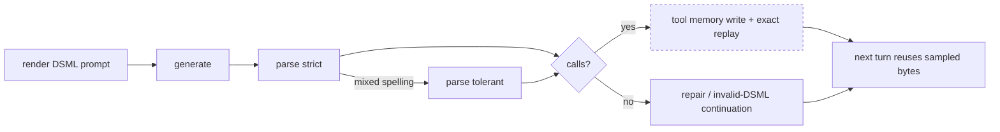

# DS41-DSML-CTR-R1 — DSML tool-call conformance test report

Conformance Test Report (CTR) for the DeepSeek V4.1 Flash (ds41) DSML
tool-call carriage, prepared in the clause structure of ISO/IEC Directives
Part 2 (document structure) with the conformance-testing vocabulary of
ISO/IEC 9646-1 (implementation under test, test purpose, verdict, conformance
test report).

| Field | Value |
| --- | --- |
| Document | DS41-DSML-CTR-R1 |
| Revision | R7 (a stray image placeholder in text is refused, 2026-10-19: the residual oracle surface is probed on the served artifact, the divergence from the engine is measured, and the port now mirrors the oracle on every message surface) |
| Date | 2026-10-19 |
| Status | Issued — conformance on every port unit of this line: replay fidelity is met by measurement, diagnostics are closed, the truncation signal is met as of R4, recovery of a cut block (NC-02, TP-11) is CLOSED at R6 as reference-absent on the served route by the operator's decision (clause 8.2) rather than carried as an open nonconformity, and a user-supplied image placeholder in a textual field is refused as of R7 (NC-09, clause 8.9) on every message surface. What remains open is out of this line by the operator's scope instruction: the cached-token gain reserved by clause 3 and the static NC-04 (checkpoint canonicalization, the Responses visible suffix's consuming store) and NC-06 (thinking-scope probes) |
| Implementation under test | `ds4-dfm-rs` ds41 serving path, binary `/home/leandro/ds4-dfm-rs/ds4-server`, md5 `9e1e73c9df3be9daf6aae39c2aa53066` (R7, rebuilt from this branch's tip); the R6 binary was `2ae013787860e07c7f0e81291d870c2f`, the R4 one `7ab03b73654a67fd27ca25cd81d69afe`, and the R3 one `e672f6f3633cf99a179437bd4354ecf9` |
| Branch under assessment | R1: `feat/ds41-dsml-complete` base `c942523` (the served binary precedes the line). R2: `feat/ds41-dsml-carriage`, base `c942523`. R3: `feat/ds41-dsml-carriage` at `eb67d493`, served on 2026-10-19. R4: the same branch at `9f441876`, served on 2026-10-19. R5: no code change (the served binary of R4 stands; the reference was read again). R6: the same branch at `498bd1a2`, rebuilt and served on 2026-10-19. R7: the same branch at `04a0ab1f`, rebuilt and served on 2026-10-19 |
| Normative reference | `tests/ds41_ref/oracle/encoding.py` (vendored, sha256 `13231c59…e2`); the C tree it was first read from is no longer consulted |
| Client of record | `/data/open-grok` at `27b48a6`, the configured consumer of this server (clause 2.3) |
| Prepared by | ds4-dfm-rs work session (Spark gate line) |
| Acceptance regime | operator decision 2026-10-18: this Spark conformance suite replaces the rule 19 QA gate for this line |

### Revision history

| Revision | Change |
| --- | --- |
| R1 | Baseline: the conformance requirements, the test purposes and the measured nonconformities of the ds41 carriage as served. Clause 7.1 records that run. |
| R2 | Scope restated at the operator's instruction: this line ports DSML carriage only and touches no KV, session or context code. Clause 1.3 replaces R1's "the KV store is in scope" claim, which was the assessor's own reading and not the operator's instruction, and is what admitted an invented checkpoint change into R1's planned phase P1. Clause 3 restates the replay acceptance as prompt byte fidelity and records the arithmetic ceiling that makes a cached-token criterion unreachable without the excluded KV work. Clause 6.3 reserves TP-07..TP-10 to the KV-carrier unit and adds TP-15..TP-18, including the client-bound test purposes. Clause 8 adds NC-07 and NC-08; clause 9 replaces the R1 phase table. NC-07 was raised as an illegal wire value and withdrawn the same day once `generate.rs:3324` was read; clause 8.7 keeps both halves of that record. |
| R3 | Post-port re-measurement at `eb67d493` (2026-10-19): clause 7.4 carries the served results of the whole suite, the compliance gate and the client leg; clause 7.5 the replay kill-switch A/B that decides TP-15/TP-16; NC-03 (diagnostics) is closed, NC-01's fidelity half is met by measurement and its gain half stays reserved, NC-02 and TP-11 are unchanged, and NC-07 is decided by measurement — the truncation-signal loss IS reachable on the served artifact, so the clause 8.7 change is now warranted. Clause 9's phase table records the closures and the one acceptance that the repair contract alone cannot reach, and clause 9.1 carries the per-function verdict table that P5 owed. Two corrections came out of that pass and are recorded there: the repair unit's refuse comment sits at `:6707-6712` of the reference and not at `:6697-6700`, and the pre-fix low-effort render measures 1281 bytes against the oracle's 1372, not the 1311 the unit's message recorded. |
| R4 | The NC-07 change landed and was re-measured at `9f441876` (2026-10-19), so clause 7.6 carries the served re-run and clause 8.7 is now implemented rather than warranted: TP-17 passes both halves (C-02/C-03 report `length` at budgets 8/16/24 with every value inside the client's enum; TP-11/NC-02 and C-01 are unchanged, the raw cut block still reaching the client as content). The compliance gate is unchanged at 22/0 and the client leg at 3/3, so no A/C/D row regressed. The change is a named deviation from the engine's unreadable `v41_finish`, justified against the C reference's `tool_parse_failure_recovery_finish`. |
| R5 | Citation correction of R4's own basis, with no code change and no re-measurement. R4 called the engine's `v41_finish` unreadable; it is present in the reference tree at the port's pin (`git cat-file -e 7fb26cc:src/server/server_generate_v41.c`), and it says the opposite of what R4 assumed: the route overwrites an unterminated tool block with `error` on purpose (`:258-263`, "the V4 route feeds a tool error so the model reissues; this route has no session, so it reports the error honestly"), and because that `error` also bypasses the parse-failure mapper (`server_http.c:45`), the reference's v41 route puts the literal `error` on the OpenAI wire. Clause 8.2 now carries the reference position on the continuation and re-scopes NC-02 accordingly; clause 8.7 keeps R4's measured behavior and re-names it against the readable source. |
| R6 | The reference-boundary closure of NC-02, plus one citation correction. The operator decided (a) (clause 8.2): the boundary is recorded, so NC-02 closes as reference-absent on the served route, C-01 is re-scoped from the V4 pull route's criterion to the contract this route does owe its client (`finish_reason=length`, no call fabricated from a cut block) and TP-11 is struck as inapplicable to this surface. The gate was re-run against the branch tip rebuilt on the Spark (clause 7.7): conformance 11/4, where the four are the reserved gain rows of clause 3; compliance 22/0; client leg 3/3; and every row but C-01 is byte-identical to R4, which is what makes the rebuilt binary's behaviour identity measured rather than assumed. Citation correction: the `continue_after_invalid_dsml` declaration is `server_internal.h:277`, not the `:290` R5 gave, and R5's mapper range `server_http.c:5-13` tightens to `:5-12`. No code change on this revision. |

| R7 | The residual oracle surface, probed and closed. The function map's last open validation row was the oracle's refusal of a user-supplied image placeholder in a textual field (`_validate_no_image_sp_tokens`, `encoding.py:355-367`), which the map recorded as "not located | none | OPEN, no case" and the matrix's part E prose as the one item still needing the served artifact. Probed on the R6 binary: the two text-only injections were accepted with `200` and the literal reached the prompt as token `129264` (clause 7.8), while a request that also carried an image was refused by the placeholder count instead. The engine at `/data/YoungAi` behaves like this port — `ds4_v41_images_prepare` counts placeholders against images only (`src/core/core_v41_vision.c:189-193`) and the server writes the placeholder itself (`src/server/server_parse_tools.c:290`) — so the divergence measured was oracle-versus-engine, and the operator chose to mirror the oracle (clause 8.9). The fix (`04a0ab1f`) refuses the literal in message content (string and text blocks), in `reasoning_content`, in a tool result's text and in the Responses text blocks, with the oracle's own two sentences; `tests/stray_image_token.rs` was written first and observed failing on all eight cases. The gate was re-run against the tip rebuilt on the Spark (clause 7.8): conformance 14/4 — the eleven R6 rows plus three new input-validation rows, all three passing — compliance 22/0 with the witness `adf7157c8a5bbb4b`, client leg 3/3. The suite gained the E group (`tests/spark/dsml_conformance.sh`) so TP-19 is gated rather than evidence-only. New: TP-19, NC-09 |
| R8 | The client-facing gaps the open-grok checklist left open are decided, and one is closed in code. (a) The named tool choice joins the served surface: `{"type":"function","function":{"name":"x"}}` narrows the request's tool set to that function and then requires the call (`parse.rs` `prepare_tool_choice` / `narrow_tool_schemas`), which is the wire's own `allowed_tools` mechanism for the same intent. The engine and the parity oracle still refuse the form, so this is a named divergence and `tests/parse.rs::named_tool_choice_narrows_to_the_forced_function` pins both sides rather than hiding the difference; the form reaches the wire today with a one-tool list (`session_summary.rs:99-116`). (b) `response_format` keeps its refusal by the operator's decision: the field carries `strict: true`, a guarantee only a decode-time constraint can give, and the function map's section 5 records why a prompt-side substitute was rejected instead of served. (c) Clause 2.3.8's parenthetical that the client sends `parallel_tool_calls` on the chat path was wrong and is corrected with the measurement that the field exists only on the Responses/Codex path. The live re-measure of (a) awaits a serve rebuilt from this revision. |

## 1 Scope

### 1.1 Purpose

This report establishes, by measurement on the reference Spark host, which of
the DSML carriage requirements the ds41 serving path currently satisfies, and
which it does not. The nonconforming requirement list in clause 8 is the
port checklist; clause 9 assigns each nonconformity to a port phase.

### 1.2 Subject of the assessment

The DSML (DeepSeek markup-language) tool-call carriage of the ds41 family on
four client surfaces:

- OpenAI chat completions, non-stream and stream;
- OpenAI responses;
- Anthropic messages;
- the continuation turn of each surface (a second request carrying the tool
  result).

### 1.3 Out of scope

- Kernel, prefill and decode performance outside the DSML path.
- The VQ codec and the Engram tables, covered only as regression witnesses
  (clause 7.3).
- The GLM and Qwen tool syntaxes.
- Model quality of the emitted tool calls (argument correctness beyond the
  assertion of a request-named value).

The KV store is out of scope. R1 declared it in scope as the carrier of the
sampled DSML block; that was the assessor's reading, not the operator's
instruction, and it is retracted here. Operator instruction, verbatim,
2026-10-18: "You need to make a new branch with the DSML port that is missing
and not touch any kv or context etc." A nonconformity whose remedy requires the
checkpoint to cover generated tokens (cached-token replay gain) is therefore
recorded and reserved to a separate unit, not carried by this line. What this
line does assess is what the DSML carriage alone decides: the shape served to
the client, the legality of every value on the wire, the bytes of the next
turn's prompt, the repair contract, and the diagnostics that make those
measurable.

## 2 Normative references

### 2.1 Reference implementation

`tests/ds41_ref/oracle/encoding.py`, vendored into this repo on 2026-10-18 and
pinned by sha256 in `tests/ds41_ref/ref_drive.py`. It is the authority for the
carriage assessed here.

The line numbers in the table below are quoted from the C implementation these
requirements were first written from. That tree is no longer consulted and the
numbers are historical quotation, kept so the clause texts stay traceable to
where they came from. Where the two references disagreed, the delta rows of
`docs/ds41-dsml-reference-matrix.md` part D carry both citations, and a row is
decided by the oracle. The clauses that state the requirements assessed here:

| Clause | Reference mechanism | Line |
| --- | --- | --- |
| 2.1.1 | DS41 tag literals (spaced spelling) | 678–683 |
| 2.1.2 | Parse: style detection, invokes, parameters | 6116–6320 |
| 2.1.3 | Repair contract (wrapper only, never an unfinished invocation) | 6707–6774 |
| 2.1.4 | Live stream tracker and payload-vs-structure sampling | 7339–8015 |
| 2.1.5 | Exact sampled DSML replay: tool memory and attach per surface | 10653, 10679, 4272, 4498, 5529 |
| 2.1.6 | Tool-checkpoint suffix and canonicalization | 12800, 12976, 13150 |
| 2.1.7 | Invalid-DSML tool-error continuation | 12260, 12611, 14344, 14446 |
| 2.1.8 | Diagnostics: `--disable-exact-dsml-tool-replay`, `--tool-memory-max-ids`, `--trace` | `ds4_help.c` 378–379, 323 |

### 2.2 Client protocol references

- OpenAI chat completions: `tool_calls` on `choices[].message`, `finish_reason`
  value `tool_calls`, streaming `delta.tool_calls`, `data: [DONE]` terminator.
- OpenAI responses: `output[]` item of type `function_call` with `call_id`,
  `name`, `arguments`; continuation input item `function_call_output`.
- Anthropic messages: `content[]` block of type `tool_use` with `id`, `name`,
  `input`; `stop_reason` value `tool_use`; continuation `tool_result`.

### 2.3 Client of record

`/data/open-grok` at `27b48a6`. The server on `192.168.1.91:8008` is the model
entry `deepseek-v4.1-1017-flash-ds4` in `~/.opengrok/config.toml`
(`base_url = "http://192.168.1.91:8008/v1"`,
`api_backend = "chat_completions"`), so this client is the party the carriage
must satisfy. It is a scoping choice, not a dependency: the server ships no
client and must serve any compatible caller, so a requirement below binds once
it is OpenAI-wire behavior and is treated as this client's own preference when
it is not (AGENTS.md, the carriage section). Its requirements, each read from
its source, are normative for clauses 6.3 and 8:

| Clause | Requirement as the client implements it | Line |
| --- | --- | --- |
| 2.3.1 | Streaming tool calls are assembled by `index`; an omitted index defaults to 0, collapsing distinct calls into one | `chat_completions.rs` 74-77, 199-231, 246-253; `types.rs` 495-499 |
| 2.3.2 | `id` may arrive on any delta (last wins); absent, the call id is the empty string | `chat_completions.rs` 208-211 |
| 2.3.3 | `finish_reason` is a closed enum: `stop`, `length`, `tool_calls`, `content_filter`, `function_call`. Any other value fails chunk deserialization and the stream is a hard error | `types.rs` 373-380; `client.rs` 1988-1995 |
| 2.3.4 | A non-empty tool call forces `stop_reason = ToolCalls`, overriding `length`, so a truncated call is executed rather than reported as truncation | `chat_completions.rs` 257-260; `request_task.rs` 657-662 |
| 2.3.5 | The next request echoes `function.arguments` as the raw string received, never re-serialized; invalid JSON is replaced by `{}` | `conversation.rs` 3516-3527, 3412-3451 |
| 2.3.6 | Unknown fields in a replayed assistant message are tolerated (the client sends a nonstandard `model_id`) | `types.rs` 197-198 |
| 2.3.7 | Reasoning is read from `reasoning_content` only; when thinking is active every assistant message must carry it, even empty | `types.rs` 526-538; `conversation.rs` 3691-3740 |
| 2.3.8 | Tool results are appended in completion order, not call order. The chat wire carries no `parallel_tool_calls`: `ChatCompletionRequest` has no such field (`types.rs` 63-110) and the conversion sets none (`conversation.rs` 4071-4148); the `Some(true)` at `client.rs` 2032 belongs to the Responses/Codex path | `tool_calls.rs` 577-596 |
| 2.3.9 | The named tool choice `{"type":"function","function":{"name":"x"}}` forces that tool (OpenAI chat reference, `tool_choice`); a caller may send it with a one-tool list | OpenAI chat reference, `tool_choice`; `conversation.rs` 4101; `session_summary.rs` 99-116 |

Requirement-to-IUT status at R2, each checked against the source:

| Clause | Status | Evidence |
| --- | --- | --- |
| 2.3.1 index on every tool delta | satisfied | `stream.rs:663`/`:670` (`start_invoke`), `:681`/`:691` (`args_fragment`); reference `ds4_server.c:7270-7285` |
| 2.3.2 a non-empty call id | satisfied | `stream.use_random_ids()` on both routes; reference `:10743` |
| 2.3.3 a closed `finish_reason` enum | satisfied on the ds41 route | `generate.rs:3398-3400` remaps `error` to `stop` before every writer, with the client's own rejection recorded in the comment there. See NC-07, which R2 first raised and then withdrew |
| 2.3.4 a truncated call is executed as complete | risk noted | the same remap turned a lost truncation signal into `stop`; C-02/C-03 measured it at R3 and measure `length` at R4 (7.6, NC-07 closed) |
| 2.3.5 arguments echoed raw | satisfied | `conversation.rs:3516-3527` is client-side; the server-side consequence is the re-render, which is NC-01 |
| 2.3.6 unknown message fields tolerated | satisfied | `parse.rs:1223` skips an unknown key (`json_skip_value`) |
| 2.3.7 `reasoning_content` on every assistant turn | satisfied server-side 2026-10-18 | the parse neither requires the field nor rejects an empty one, and the render sees exactly what the message carried (`tests/parse.rs::assistant_reasoning_is_optional_and_may_be_empty`); the client-side half is E-09's host leg |
| 2.3.8 tool results in completion order | open, deferred | reference counterpart `live_tool_call_order` `:10580` applies to Anthropic/Responses only, not the chat path this client uses |
| 2.3.9 named tool choice served | satisfied 2026-10-20 on both OpenAI surfaces | the request's tool set is narrowed to the named function and the call is then required (`parse.rs` `prepare_tool_choice` / `narrow_tool_schemas`), which is the wire's own allowed_tools mechanism for the same intent; the C engine and the parity oracle still refuse the form and `tests/parse.rs::named_tool_choice_narrows_to_the_forced_function` pins that difference instead of hiding it |

### 2.4 Project-internal references

- `docs/ds41-dsml-port-inventory.md` — static review: the function-by-function
  comparison of the reference and the Rust host (clause 5 of this report is the
  summary of that review).
- `docs/ds41-dsml-reference-matrix.md` — the reference leg: the coverage
  matrix that pairs every requirement in clause 6.3 and every gap in the
  inventory with the case that exercises it, over the official V4.1 encoding
  oracle vendored at `tests/ds41_ref/oracle/encoding.py`.  Revision R3 folds it
  in whole as this report's reference section, so it is maintained as the third
  document of this line.
- `docs/deepseek41-port-plan.md` — the ds41 port's own record.

## 3 Terms and definitions

- DSML: the tool-call markup the DeepSeek family emits, a block opened by a
  `tool_calls` marker containing one or more `invoke` elements, each carrying
  `parameter` elements with a `string="true|false"` type attribute.
- sampled DSML: the exact byte sequence the model emitted for a tool call,
  including its tag spelling and argument order.
- exact replay: reusing that byte sequence verbatim when the next request's
  prompt is re-rendered, instead of re-rendering the call from client JSON.
- tool memory: the map from tool-call id to sampled DSML, held in RAM and in a
  KV trailer.
- tool checkpoint: the live KV state after a tool-call turn.
- canonicalization: rewriting the live checkpoint so it matches what the next
  request will render.
- continuation turn: a request that carries the result of a previous turn's
  tool call.
- replay gain G (diagnostic, R2): `prefill_cached_tokens(turn 2) −
  prefill_tokens(turn 1)` for one surface and one slot, turn 1 measured
  immediately before turn 2. G counts tokens of the sampled assistant block the
  server reused instead of re-prefilling. On this route G has an arithmetic
  ceiling that no DSML-only change can raise: the engine writes its checkpoint
  once, at the prompt end (`ds4_ds41_draft.inc:804`, `v41_kvreuse_save(&st,
  prompt, np, ...)`), so turn 2 can at most reuse turn 1's prompt, which is what
  the R1 measurements show (`cached = 347 / 351` against turn-1 prompts of the
  same size). G therefore cannot exceed 0 for the assistant block without the
  checkpoint covering generated tokens, which clause 1.3 excludes. G is recorded
  as status, never as this line's acceptance.
- prompt byte fidelity (R2 acceptance for exact replay): the second turn's
  rendered prompt carries the sampled DSML block byte-for-byte as the model
  produced it, instead of a block re-rendered from the client's JSON. This is
  the reference's own criterion: its replay tests assert message bytes
  (`ds4_server.c:19933`, `:19996`), not cached tokens.
- replay miss: an attach that found no sampled bytes for an id and fell back to
  canonical rendering, counted by the reference (`ds4_server.c:10684-10692`).
- legal finish (R2): a `finish_reason` (OpenAI surfaces) or `stop_reason`
  (Anthropic) drawn only from the values the client's closed enum accepts
  (clause 2.3.3).
- IUT: implementation under test.
- TP: test purpose; TC: test case; verdict: pass, fail or inconclusive.

## 4 Abbreviations

DSML, IUT, TP, TC, CTR, KV, SLOT (a server slot holding one live session),
VQ (vector-quantised weights), MTP (multi-token prediction), SSE (Server-Sent
Events).

## 5 Conformance requirements (static review)

Static review is the function-level comparison recorded in
`docs/ds41-dsml-port-inventory.md`: the render side, the parse side (including
the tolerant recovery of loose nested parameters), the live decode tracker, the
tool stream emitters and the SSE projections for all three surfaces are present
in the Rust host. Absent or narrowed, in the same review: the replay attach on
two of three surfaces, the checkpoint canonicalization, the invalid-DSML
continuation, the Responses visible suffix, the in-thinking completion probe,
the two replay flags and the trace surface. Clause 7 measures the
client-visible consequence of these absences.

One row of that review sat outside both lists because the map could name no
counterpart at all: the oracle's refusal of a user-supplied image placeholder
in a textual field (`docs/ds41-dsml-function-map.md:53`, "not located | none |
OPEN, no case"). R7 measured it on the served artifact (clause 7.8), found the
port accepting it, and closed it by mirroring the oracle (clause 8.9).

One candidate nonconformity raised at R2 was withdrawn on the same day: the
finish path was read only as far as the writers, and the remap that guards them
was missed. Clause 8.7 records both the retraction and the smaller defect the
reading did establish, which is measured before it is acted on.

The structural fact that decides the replay requirements: the reference serves
ds41 on the shared session path, so a `ds4_session` exists for it and every
session-addressed mechanism applies (`ds4_server.c:15981`, syntax at `:1218`,
render at `:3366`/`:3438`). The Rust host declares ds41 a no-session engine
(`crates/ds4-server/src/generate.rs:144`) and dispatches it to a push route
whose own documentation lists what it drops (`generate.rs:3042-3046`).



Dashed: the stages the measured nonconformities fall in.

## 6 Test purposes, methods and instrumentation

### 6.1 Instrumentation

| Item | Value |
| --- | --- |
| Test suite (ATS) | `tests/spark/dsml_conformance.sh` |
| Means of testing | `curl` and `jq` against the served HTTP surface; no in-process hooks |
| Execution host | analysis host, over the LAN to the Spark |
| IUT host | `gx10-e1d2` (Spark), `192.168.1.91`, port 8008 |
| Evidence | per-probe request and response bodies, `results.tsv`, `header.txt` |

### 6.2 Method rules

1. Every probe carries a unique reference token inside the user text, so a
   cached-token count cannot be attributed to another probe's session.
2. Replay probes are pairs: turn 1 immediately followed by turn 2 on the same
   slot. A turn 2 separated from its turn 1 by another request is not a valid
   measurement of replay.
3. Verdicts are mechanical (`jq` expressions); the observed values are recorded
   verbatim in `results.tsv`.
4. Regression probes (plain-text KV reuse, temperature-0 determinism) are
   outside DSML by construction; their purpose is to detect collateral damage to
   the VQ/KV path.

### 6.3 Test purposes

| TP | Requirement | Method | Pass criterion |
| --- | --- | --- | --- |
| TP-01 | R-01 OpenAI chat serves one DSML call as `tool_calls` | A-01 | `finish_reason=tool_calls`, name `read_file`, `arguments.target_file = /tmp/x.txt` |
| TP-02 | R-02 typed parameters survive as JSON types | A-02 | `arguments.limit` is a JSON number |
| TP-03 | R-03 two invokes in one block | A-03 | two `tool_calls` |
| TP-04 | R-04 streaming carries the call | A-04 | a `tool_calls` delta and `finish_reason=tool_calls` |
| TP-05 | R-05 Anthropic serves `tool_use` | A-05 | `toolu_` id, name, input object, `stop_reason=tool_use` |
| TP-06 | R-06 Responses serves `function_call` | A-06 | one item with `call_id`, name, arguments |
| TP-07 | R-07 chat turn 2 reuses the sampled block | B-01 | RESERVED to the KV-carrier unit (G > 0). Clause 3 proves the ceiling; recorded here, not scored |
| TP-08 | R-08 replay survives a differently spelled client echo | B-02 | RESERVED as TP-07; recorded |
| TP-09 | R-09 Anthropic turn 2 reuses the sampled block | B-03 | RESERVED as TP-07; recorded |
| TP-10 | R-10 Responses continuation reuses the sampled call | B-04 | RESERVED as TP-07; recorded |
| TP-11 | R-11 a cut block is not served as assistant content | C-01 (re-scoped) | STRUCK as inapplicable to this surface (R6, operator decision, clause 8.2): the criterion — a call is recovered, or no raw DSML markup in content — describes the V4 pull route, which this artifact never enters because no `ds4_session` exists for it. The served route is scored instead on the contract it does owe its client, asserted by C-01: `finish_reason=length` and no call fabricated from a cut block |
| TP-12 | R-12 replay and trace diagnostics are available | static, flags | all three flags advertised by `--help` |
| TP-13 | R-13 plain-text KV reuse intact | D-01 | second read reuses a prefix |
| TP-14 | R-14 determinism witness reproducible | D-02 | two calls identical; witness hash recorded |
| TP-15 | R-15 exact replay reaches every chat-shaped surface (2.3.5) | B-01, B-02, B-03, B-04 with `--trace` | turn 2's traced prompt carries the sampled DSML block verbatim on chat, Anthropic and Responses |
| TP-16 | R-16 the replay path has a kill switch | B-01 with `--disable-exact-dsml-tool-replay` | switch on: sampled bytes in the traced prompt; switch off: the canonical re-render |
| TP-17 | R-17 a cut turn keeps its truncation signal and a legal finish (2.3.3, 2.3.4) | C-01, C-02, C-03 | every `finish_reason` inside the client's closed enum (holds on main: `generate.rs:3324`), and a turn cut inside its block reports `length`; the change lands only if the probe shows the signal is lost |
| TP-18 | R-18 the client of record completes a real tool loop | client leg (6.4) | one-tool and two-tool turns complete end to end under `/data/open-grok`; the malformed turn does not fail the stream |
| TP-19 | R-19 a user-supplied image placeholder in a textual field is refused (2.1) | E-01..E-03 (`tests/spark/dsml_conformance.sh`) and `p1`..`p5` (clause 7.8) | message content and `reasoning_content` each answer `400` naming the token, the stray-plus-image case is refused for the same reason, and the text and image controls still answer `200` |

The tool pair every probe drives changed on 2026-10-20: the invented schema
pair was replaced by `read_file` (`target_file`) and `list_dir`
(`target_directory`), so a probe reads through the tools a real caller sends.
The per-TP observations recorded before that date were scored through the
earlier pair, so they are not reproduced here; 7.1 and 7.4 keep the run
identity, the evidence directory and the verdict counts, and the next gate
re-measures every TP through the new pair.

### 6.4 Client-of-record leg

TP-18 is measured by driving `/data/open-grok` itself, headless, against the
IUT, using the model entry that names this server (clause 2.3). `curl` probes
establish the wire shape; they cannot establish that the one client that
actually consumes this server survives the turn. The ATS is
`tests/spark/open_grok_leg.sh`, run with the config's model id:

`bin/open-grok -m deepseek-v4.1-1017-flash-ds4 --always-approve
--output-format json --max-turns 4 -p <prompt forcing the tool>`

in a scratch working directory. Its legs: G1 one tool call whose result must
reach the model, G2 two tool calls in one turn (the client returns the results
in completion order; its chat request carries no `parallel_tool_calls`, clause
2.3.8), and G3 the
malformed-turn request shape re-run beside the client evidence. The truncation
point of the malformed case is not client-controllable, so TP-17 is scored by the
conformance suite's C-02/C-03 probes; G3 repeats their request shape so the
evidence sits with the client run. The leg consumes the served model and needs
the IUT on port 8008 (clause 6.1), so it runs at the gate, not ad hoc.

## 7 Results

### 7.1 Dynamic results (IUT as served on 2026-10-18 11:36, revision `416d4f5a` build)

Evidence: `docs/evidence/ds41-dsml-gate/iso-baseline-20261018-113636/`.

Of 14 test purposes: 8 pass, 6 fail, 0 inconclusive.  The per-TP observations
of this run were scored through the probe pair since replaced, so they are not
reproduced here; the evidence directory holds the raw run.

### 7.2 Verdict summary

R1 (seven test purposes did not exist yet): 8 pass, 6 fail, 0 inconclusive, of 14
test purposes. At the gate (7.4, R3): 12 pass, 6 fail, 0 inconclusive, of 18 —
TP-12, TP-15, TP-16 and TP-18 added to the pass set (TP-12 was `fail` at R1),
TP-07..TP-11 unchanged, TP-17 newly measured and failing on its signal half.

### 7.3 Regression status

TP-13 and TP-14 are outside the DSML path by construction and both pass: the
plain-text KV prefix reuse still reuses (19 of 19 tokens on the second read) and
temperature-0 text is reproducible with witness `adf7157c8a5bbb4b`, which is the
value every later revision must reproduce. No collateral damage to the VQ/KV
path is observed at this revision.

### 7.4 Dynamic results at the gate (IUT as served on 2026-10-19 06:55, revision `eb67d493` build)

Evidence: `docs/evidence/ds41-dsml-gate/conformance-eb67d493-20261019-065549/`
(conformance), `compliance-eb67d493-20261019-065835/` (compliance),
`client-eb67d493-20261019-070016/` (client leg),
`trace-ab-20261019-071811/` (the A/B of 7.5).

Of 18 test purposes: 12 pass, 6 fail, 0 inconclusive.  The per-TP observations
were scored through the probe pair since replaced, so they are not reproduced
here; the evidence directories above hold the raw runs.

Compliance gate: 22 pass, 0 fail; openai turn-2 `prefill_cached_tokens` 334 of
395; plain-KV second read 19; witness `adf7157c8a5bbb4b`; truncated-block
finish `stop`.

### 7.5 The replay kill-switch A/B (TP-15, TP-16)

Two launches of the same argv on `eb67d493`, differing only by
`--disable-exact-dsml-tool-replay` and the trace file, with the suite re-run
against each (`trace-on-conformance-20261019-070602`,
`trace-off-conformance-20261019-071449`; every row identical to the 7.4 run in both
arms except the turn-2 prompt count).

| Probe (surface) | replay ON | replay OFF |
| --- | --- | --- |
| B-01 (OpenAI chat) | 396 prompt tokens | 403 |
| B-02 (chat, re-spelled echo) | 396 | 403 |
| B-03 (Anthropic) | 400 | 407 |
| B-04 (Responses) | 396 | 403 |

The OFF column reproduces clause 8.1's R1 measurement exactly (403 / 407, the
56-token canonical block), so the OFF arm is the pre-replay render and the ON
arm re-prefills a 49-token block instead. Byte comparison of the extracted
turn-2 prompts: the arms diverge inside the assistant block (first differing
byte 1482 of 1762/1800 for B-01, B-02 and B-04; 1486 for B-03), where the
canonical render writes the parameter's `string="true"` attribute and the
sampled bytes do not. Under `ExactReplay::Off` the store's `put` is a no-op and
`attach` returns 0 (`tool_memory.rs:230`, host test `:7311-7316`), so the ON
bytes are the sampled bytes by construction of the switch.

Limitation, recorded rather than papered over: TP-15's strict form ("the traced
prompt carries the sampled DSML block verbatim") cannot be asserted from this
trace, because `--- generated text ---` prints reasoning plus content and a pure
tool-call turn's content is empty; the sampled bytes live in the tool memory and
the KV trailer. The port action, if the strict assertion is wanted, is a raw
completion (or tool-memory) line in the trace, not a new mechanism.

### 7.6 Dynamic results after the NC-07 fix (IUT as served on 2026-10-19 08:11, revision `9f441876` build)

The clause 8.7 change was built on the Spark from `9f441876` (binary md5
`7ab03b73654a67fd27ca25cd81d69afe`, build log
`~/cuda-spark-dsml-9f441876-build.log`, `BUILD_EXIT=0`) and the whole gate was
re-run against it: conformance
`docs/evidence/ds41-dsml-gate/conformance-9f441876-20261019-081135` (10 pass /
5 fail), compliance `…/compliance-9f441876-20261019-081433` (22 pass / 0 fail)
and the client leg `…/client-9f441876-20261019-081500` (3 / 3).

| Probe | At `eb67d493` (7.4) | At `9f441876` |
| --- | --- | --- |
| C-02 budgets | `8:stop 16:stop 24:stop 32:tool_calls 48:tool_calls` | `8:length 16:length 24:length 32:tool_calls 48:tool_calls` |
| C-03 budgets (SSE) | same, all legal | same, all legal |
| C-01 | `finish=stop calls=0 raw-DSML lines in content=2` | `finish=length calls=0 raw-DSML lines in content=2` |
| compliance truncated-block finish | `stop` | `length` |

Both halves of TP-17 now hold: a turn cut inside its block reports `length` and
every value stays inside the client's closed enum. The five conformances that
were already fail are unchanged and for the same reasons — B-01..B-04 at gain 0
(the arithmetic ceiling of clause 3) and C-01, whose raw block still reaches the
client and whose fix is the reserved continuation of clause 8.2, not this unit.
Nothing else moved: the A, B and D rows are byte-identical to the 7.4 run apart from the
turn-2 counts each arm carries, the compliance gate's 22 assertions and the
witness `adf7157c8a5bbb4b` are unchanged, and the client leg is 3/3.

### 7.7 Dynamic results at the branch tip (IUT rebuilt from `498bd1a2`, revision R6)

The tip was carried to the Spark by bundle and the IUT rebuilt there —
`make -B cuda-spark CUDA_ARCH=sm_121 -j12`, `BUILD_EXIT=0`, log
`~/cuda-spark-dsml-498bd1a2-build.log` — because R6's own change is in the ATS
and the served binary should be the one this branch builds. The binary is md5
`2ae013787860e07c7f0e81291d870c2f` (10:21:31, 46,174,896 bytes; the R4 binary is
kept as `ds4-server.pre-498bd1a2`, md5 `7ab03b73654a67fd27ca25cd81d69afe`).
Nothing between `9f441876` and `498bd1a2` changes any code the binary contains —
those four commits are documentation and the two shell suites — so the md5
difference is a rebuild identity, not a behaviour claim. Behaviour identity is
what the rows establish, and they are identical to 7.6 everywhere except C-01.

Served by the operator's launcher on the R3/R4 argv (Annex A), then the whole
gate re-run from the analysis host: conformance
`docs/evidence/ds41-dsml-gate/conformance-498bd1a2-20261019-102548` (**11 pass /
4 fail**), compliance `…/compliance-498bd1a2-20261019-102706` (**22 pass / 0
fail**) and the client leg `…/client-498bd1a2-20261019-102725` (**3 / 3**).

The four remaining fails are exactly B-01..B-04, the reserved gain rows of
clause 3: on this route the checkpoint still stops at the prompt end, so turn 2
reads `cached = turn-1 prompt` (347 of 396 on chat and Responses, 351 of 400 on
Anthropic) and the gain is 0 by arithmetic, not by regression. The suite's own
verdict line counts them as fail by construction; the acceptance signal for
TP-07..TP-10 stays clause 3's fidelity measurement (7.5), which holds.

| Probe | At `9f441876` (7.6) | At `498bd1a2` (R6) |
| --- | --- | --- |
| C-01 row | "a truncated DSML block is not served as assistant content", criterion "call recovered, or no raw DSML markup in content" → FAIL | "a cut DSML block reports length and fabricates no call", criterion "`finish=length`, 0 `tool_calls`" → PASS |
| C-01 observed | `finish=length calls=0 raw-DSML lines in content=2` | identical |
| every other conformance row (A, B, C-02, C-03, D) | — | byte-identical, including every turn-2 count |
| verdict line | `pass=10 fail=5` | `pass=11 fail=4` |
| compliance gate | 22/0, truncated-block finish `length` | 22/0, `length`; witness `adf7157c8a5bbb4b`; plain-KV second read cached 19 |
| client leg | 3/3 | 3/3 (G1, G2, G3) |

The exactness is checked rather than asserted: `diff` over fields 1..5 of the two
`results.tsv` files (the artifact-path column excluded, since the run directory
names differ) returns the C-01 row and the verdict line, and nothing else.

### 7.8 The residual oracle surface, and the R7 gate (IUT rebuilt from `04a0ab1f`)

The item probed is the one the function map could not place: the oracle refuses
a user-supplied image placeholder in a textual field — message `content` as a
string, the same literal inside a text content block (`encoding.py:346-352`,
nested tool-result text included), and `reasoning_content` — with two distinct
sentences (`encoding.py:357-366`), reached from `encode_messages:826`. Read on
this host, the oracle raises on both halves:

```
$ python3 tests/ds41_ref/ref_drive.py encode /tmp/dsml-probe/px-content.json chat
ValueError: Message content contains image special token '<|deepseek_image|>'. Images should be provided as image content blocks.
$ python3 tests/ds41_ref/ref_drive.py encode /tmp/dsml-probe/px-reasoning.json chat
ValueError: reasoning_content contains image special token '<|deepseek_image|>'
```

Five probes were then served against the R6 binary
(`probe-placeholder-498bd1a2-20261019`, 10:56:22): a text control, the literal
in user content with no image, the literal in an assistant message's
`reasoning_content`, the literal plus one real image, and an image control.

| Probe | At `498bd1a2` (R6, before) | At `04a0ab1f` (R7, after) |
| --- | --- | --- |
| `p1` text control | `200`, `finish=stop`, "ok" | identical |
| `p2` literal in content, no image | **`200`, `finish=stop`, "ok"** | `400`, the oracle's content sentence |
| `p3` literal in `reasoning_content` | **`200`, `finish=stop`, "Hi!"** | `400`, the oracle's reasoning sentence |
| `p4` literal plus one image | `400`, the placeholder-count message | `400`, the oracle's content sentence |
| `p5` image control | `200`, `finish=stop` | identical |

Why the two accepted probes are a nonconformity rather than a cosmetic
difference: the literal tokenizes into the prompt as the placeholder id. On the
built CLI, rendering `hi <|deepseek_image|> bye` reports `TOKENS 6366 223 129264
104903`, against `TOKENS 6366 5212 121559 41629 104903` for the same text with
plain ASCII bars — one image token at a text position. Nothing then counted it:
the V4.1 image expansion, which is the only caller of the placeholder count
(`crates/ds4-core/src/v41_media.rs:590` through
`crates/ds4-server/src/generate.rs:3121-3126`), is skipped whenever the request
carries no image (`generate.rs:3107`). The engine behaves the same way
(`core_v41_vision.c:189-193`, `server_parse_tools.c:290`), so the divergence the
probe measured is oracle-versus-engine and the operator chose the oracle
(clause 8.9).

The fix refuses the literal at the boundary where the client's own text is
read, on every message surface: message content as a string and as text blocks,
`reasoning_content`, a tool result's text, and the Responses text blocks. The
anchors, all in `crates/ds4-server/src/parse.rs`: the content rule at `:560` and
the reasoning rule at `:571`; `append_text_part` at `:580` with its four call
sites `:1101`, `:1158`, `:1635`, `:1682`; the two string forms at `:1081` and
`:1662`; the tool-result text at `:1392` and `:1475`; the reasoning at `:1273`
and `:1640`; the Responses text at `:2500` and `:2562`. The wording is the
oracle's own, so the client sees the reference's message rather than ours. The
tests were written first and observed failing on all eight refusals
(`tests/stray_image_token.rs`), with a control that pins the server's own
placeholder writing (`parse.rs:631` `write_tool_image_placeholders`) as still
accepted. The legacy `/v1/completions` `prompt` field is untouched: it is a
pre-rendered prompt the client owns, and the oracle's rule is stated over
messages.

Served by the operator's launcher on the R3/R4 argv (Annex A), rebuilt as
`make -B cuda-spark CUDA_ARCH=sm_121 -j12`, `BUILD_EXIT=0`, log
`~/cuda-spark-dsml-04a0ab1f-build.log`, binary md5
`9e1e73c9df3be9daf6aae39c2aa53066` (11:17, 46,241,608 bytes; the R6 binary is
kept as `ds4-server.pre-04a0ab1f`). The new text is in the served binary
(`strings ds4-server | grep -c "image special token"` = 2), which is what makes
the probe rows an artifact measurement rather than a source claim. Gate:
conformance `…/conformance-04a0ab1f-20261019-112314` (**14 pass / 4 fail**),
compliance `…/compliance-04a0ab1f-20261019-112314` (**22 pass / 0 fail**, plain
KV second read cached 19, determinism witness `adf7157c8a5bbb4b` as the suite
labels it) and the client leg
`…/client-04a0ab1f-20261019-112314` (**3 / 3**).

The four remaining fails are the reserved gain rows of clause 3, as at R6, and
no requirement row moved: `diff` over fields 1..5 of the R6 and R7 `results.tsv`
files, with the three new rows removed, returns the verdict line and nothing
else, i.e. all fifteen A/B/C/D rows are byte-identical across the fix and the
counter reads 14/4 only because the suite gained the three input-validation
rows. Those three are the suite's own measurement now, not evidence-only:
E-01 answers `400` with "Message content contains image special token", E-02
`400` with "reasoning_content contains image special token", and E-03, the plain
text control, `200` with "ok". Host suites at
`04a0ab1f`: `ds4-server` lib 345 passed / 1 failed (the known
`cache_identity::tests::bounded_sidecar_and_ple` tmpfs flake, re-confirmed at
R7 by running it on a stashed tree of `966c7462`, where it fails identically),
and every integration target green: `parse` 24, `dsml` 12, `tools` 36,
`render` 40, `generate` 77, `ref_encoding` 9, `ref_decode` 7, plus the new
`stray_image_token` 9.

## 8 Nonconformities

### 8.1 NC-01 (TP-07, TP-08, TP-09, TP-10) — no exact DSML replay on any surface

Observed: replay gain is exactly 0 on all four continuations; the second turn's
prompt is 403 (chat, responses) and 407 (Anthropic) tokens with only the turn-1
prompt (347 / 351) reused. The 56-token assistant DSML block is re-prefilled
from the canonical re-render instead of being replayed from the sampled bytes.

Root cause: exact replay is gated to OpenAI chat, non-thinking, with no live
call ids (`crates/ds4-server/src/generate.rs:1367-1369`, with the caller's
emptiness conditions at `:2342-2345`), and the attach and
remember wiring exists only on the session route
(`generate.rs:4538`, `:4549`, `:4557`, call sites `:2347`, `:2459`, `:2694`).
The ds41 route attaches nothing at all (`generate.rs:3042-3046`).

R2 reading. The carriage landed after this assessment (8891d3e, matrix G1/G2):
the scope is now `kind == Chat` and the attach is wired per chat-shaped
surface, so the last two sentences describe the assessed revision, not HEAD.

R3 measurement (7.5). The fidelity half is met and the gain half is unchanged.
The kill switch moves turn-2 from 396 to 403 prompt tokens (chat, Responses)
and from 400 to 407 (Anthropic), and the two arms' turn-2 prompts diverge
inside the assistant block; with the switch off the canonical render writes
the parameter's `string="true"` attribute, with it on the sampled bytes do not.
The OFF column is R1's own number, so the re-measurement is continuous with the
baseline. The gain stays exactly 0 because the ceiling of clause 3 is unchanged
(the checkpoint still stops at the prompt end), which is why the requirement is
scored as fidelity and the cached-token gain as status.

Why it matters: 56 tokens of re-prefill per tool continuation, on a box whose
measured prefill rate in these runs was 560–600 tokens/s, so roughly 0.1 s
amplified by every tool turn in an agent loop; and, the reason the reference
keeps the sampled bytes at all, the re-render is not what the model produced, so
the prompt and the live frontier drift apart exactly where hidden reasoning is
carried (`ds4_server.c:10679-10737`, `:12800`). The measured gain is the
authoritative number; the wall-time figure is derived, not measured.

### 8.2 NC-02 (TP-11) — a truncated DSML block is served as assistant content

Observed: with the output budget cut mid-block the turn returns `tool_calls`
empty and two raw DSML lines in `content`, so the client cannot execute it and
the turn ends without the model knowing. The finish reported alongside it is
`length` as of R4 (`stop` at R1–R3).

Root cause: this route has no continuation, and the route's own reference
says that is a design property rather than a gap. `server_generate_v41.c:10`
lists the tool-error continuation (`continue_after_invalid_dsml`,
`ds4_server.c:12611`, call sites `:14344`, `:14446`) among the four things the
V4.1 route does not have — it needs a session, and the V4.1 forward has none. Its
finish code pins the same decision at `:258-263`: the V4 route feeds the model a
tool error so it reissues, while this route has no session and reports the error
honestly. Because that `error` also fails the parse-failure mapper's own guard
(`server_http.c:45`, mapper `:5-12`, the same function as `ds4_server.c:6777-6784`),
the reference's v41 route puts the literal `error` on the OpenAI wire for a cut
or unparseable block — the value this port already remaps at
`generate.rs:3392-3400` (client rejection, 2026-10-10).

Reference grep (2026-10-19, whole tree at the port's pin, re-read at R6 with
`git grep -n continue_after_invalid_dsml 7fb26cc`): the symbol appears only in
the V4 pull loop (`server_generate_body3.inc:322`, `:403`; defined
`server_gen_log.c:170`, declared `server_internal.h:277`) and in the v41
header's list of absent features. Nothing on the v41 route calls it. R6 corrects
the declaration citation, which R5 gave as `server_internal.h:290`: at the pin
that line is `uint64_t trace_id;` inside the `v41_gen` struct, and the
declaration sits eleven lines above it, beside `build_invalid_dsml_tool_error_suffix`
(`:276`) and `should_remember_thinking_checkpoint` (`:278`).

Consequence for TP-11: its criterion — a call is recovered, or no raw DSML markup
in content (the row at `tests/spark/dsml_conformance.sh:260-263` before R6) —
cannot be reached on the served route by mirroring the reference, because the
reference's answer here is to report the failure and return the block as text.
The criterion describes the V4 pull route, which the ds41 artifact never enters
(no `ds4_session` exists for it — the same reason the reference gives). R6
re-scoped the row to the served contract
(`tests/spark/dsml_conformance.sh:270`, its decision note at `:264-269`), and
clause 7.7 carries the re-measured verdict.

Decision (operator, 2026-10-19, R6): (a), the boundary is recorded. NC-02 closes
as reference-absent on the served route, C-01 is re-scoped to what this route
owes its client instead of to the V4 criterion, and TP-11 is struck as
inapplicable to this surface. The declined alternative (b) was to build the
continuation as a named deviation — append the model-visible tool-error suffix
(`retry.rs:358`) and re-enter `v41_generate` once inside the remaining budget,
where the v41 KV reuse anchors at the previous prompt's end
(`core_v41_kvreuse.c`) so the generated span re-prefills — and it was declined
because it adds a behaviour the reference's own route deliberately omits. The
inventory recorded the fork as a context decision rather than a carriage detail
(`docs/ds41-dsml-port-inventory.md:455`), and R6 closes that row.

R3 measurement. Unchanged and now attributable: the repair contract landed at
P3 (`0bf8c79d`) and refuses a block cut inside an invocation, which is the
reference's own rule (`ds4_server.c:6707-6712`, `:6771-6774`), so the repair
path cannot turn TP-11 green by construction. What recovers a cut turn is the
V4 route's continuation, which the v41 route deliberately lacks (above). TP-11
stayed `fail` until the operator decided between (a) and (b); R6 records the
decision (above) and clause 7.7 carries the re-measured row.

R6 status: CLOSED as reference-absent, by the operator's decision. The
nonconformity was never a defect of this artifact against its own reference —
the reference's v41 route reports the failure and returns the block as text by
design — so nothing is built and nothing is reverted. What the client receives
on a cut block is the R4 shape: `finish_reason=length`, `tool_calls` empty, the
raw block as `content`. The signal that carries the truncation is `length`, which
is the one value the agent loop needs to know its output was cut (clause 2.3.4);
`stop` was the loss NC-07 named and R4 removed. C-01 asserts that shape as a
regression check (7.7).

### 8.3 NC-03 (TP-12) — replay and trace diagnostics unavailable

Observed at R1: `--disable-exact-dsml-tool-replay`, `--tool-memory-max-ids` and
`--trace` are all absent from the served binary (0 of 3).

Root cause: not ported; the reference documents all three (`ds4_help.c:378-379`,
`:323`).

R3 status: CLOSED. The served binary at `eb67d493` advertises all three
(`bin/ds4-server-rs.rs:225`, `:226`, `:236`); TP-12 passes at 7.4, and the trace
was exercised end to end twice (7.5), each launch writing one section per
request with the rendered prompt, the prompt tokens with the engine's text, and
the parsed message. The flag is consulted by the store itself
(`tool_memory.rs:230`), so a disabled server stores nothing and replays nothing.

Why it mattered: without the disable flag a replay effect cannot be isolated in
an A/B run, and without `--trace` the rendered prompt bytes cannot be asserted
directly. Both are now measured, not argued (7.5).

### 8.4 NC-04 (static, not separately measurable black-box) — checkpoint
canonicalization and the Responses visible suffix

Not directly observable over the HTTP surface; recorded from the static review:
`build_tool_checkpoint_suffix` (`:12800`), `should_canonicalize_tool_checkpoint`
(`:13150`) and `canonicalize_tool_checkpoint` (`:12976`) have no Rust
counterpart, and neither does `build_responses_visible_assistant_suffix`
(`:12821`). Their client-visible effect is the same class as NC-01; they are
listed separately because their port action and their test method differ (they
need a session and a scripted harness, not a black-box probe).

### 8.5 NC-05 (static) — repair contract narrower than the reference

`crates/ds4-server/src/retry.rs:137-225` closes unbalanced parameter and invoke
tags, which the reference refuses (`ds4_server.c:6697-6700`, `:6771-6773`), and
it does not recognise the spaced DS41 tag spelling that the reference tries
first (`:6731`). A cut spaced block is therefore never repaired, and a repair
that should be refused may be applied.

### 8.6 NC-06 (static) — thinking-scope and in-thinking completion

`find_tool_structural_text` (`:5890`) and
`complete_tool_call_inside_thinking` (`:12211`, used at `:14145`) have no Rust
counterpart; the parse-side wrapper-aware scan and the Anthropic live decision
are unverified. Not measured here.

### 8.7 NC-07 (TP-17) — raised at R2 as an illegal wire value, then withdrawn;
restated as a lost truncation signal

Raised: R2 read the ds41 route's `finish = "error"` assignment
(`crates/ds4-server/src/generate.rs:3282-3289`) together with the writers that
emit the finish verbatim (`stream.rs:2360-2375`, `:576-591`) and concluded that
the model-output condition would reach the wire, where the client's closed enum
(clause 2.3.3) fails the stream.

Withdrawn, with the evidence that refutes it: `generate.rs:3348` remaps `error`
to `stop` before every writer on this route, and its comment records that the
client's own rejection ("serialization error: unknown variant `error`", session
2026-10-10 23:17) is why. The R2 reading stopped at the writer and missed the
remap between the two. The illegal-value nonconformity does not exist on main.

Restated, because the same code loses information the reference keeps: the
assignment at `:3282-3289` overwrites a true `length` stop with `error`, which
`terminal_finish` (`retry.rs:520-526`) and `intern_finish` (`tools.rs:2103-2109`)
both carry through, and the remap then flattens it to `stop`. The reference
refuses to do that: `tool_parse_failure_recovery_finish` (`:6776-6784`) keeps
`length` because "callers can distinguish truncation from a completed turn", and
the mapping applies only to genuine parse failures, not to a server error.

Client consequence (2.3.4): a turn cut inside its tool block can be presented as
a completed answer instead of a truncated one, so the agent loop does not know
its output was cut. The reference's own truncation discipline is pinned by
`test_incomplete_tool_call_keeps_stop_reason` (`:19613`) and
`test_tool_parse_failure_returns_recoverable_finish` (`:19517`).

Status: not implemented, and deliberately not implemented before measurement.
The C-02/C-03 probes (which sweep output budgets and report every observed
finish) decide whether the loss is reachable on the served artifact; only then
does a change land, and it is a named deviation from the engine's `v41_finish`
(`server_generate_v41.c:230-235`; R4 recorded that source as absent and R5
corrects it — the file is present in the reference at the pin, and its `:258-263`
reports `error` for exactly this case).

R3 measurement: the loss IS reachable, so the change is warranted. Budgets
8/16/24 — inside the block — all report `stop`, and 32/48 report `tool_calls`
(`trace-off-conformance-20261019-071449/results.tsv`, C-02/C-03); the C-01 run
at budget 24 reports `stop` with no call. The mechanism is at HEAD as read:
`generate.rs:2548` pre-sets `finish = "length"`, the truncation outcome
overwrites it with `"error"` at `:2612` and `:2615`, and `:3389-3391` remaps
`"error"` to `"stop"` before every writer. The reference keeps `length` for
exactly this case (`tool_parse_failure_recovery_finish`, `:6776-6784`), so the
deviation is named against that function and, as R5 adds, against the engine's
own v41 mapping, which reports `error` on the OpenAI wire for this case
(`server_generate_v41.c:258-263` together with the mapper's `server_http.c:45`).
The change is a new unit: it reclassifies a server-error finish that
came from a budget cut, and it must not widen the `error` remap that clause 2.3.3
relies on.

R4 outcome — implemented and measured. The guard that classifies an
unterminated tool call as `error` now excludes a finish already set to `length`
(`generate.rs:3323-3334`), so a budget cut reaches
`parse_generated_for_response` with its signal intact and that function's own
mapping — the port of `tool_parse_failure_recovery_finish` at `tools.rs:2078-2091`
— keeps `length` and answers `stop` for every other non-error finish. The
`error` → `stop` remap at `:3389-3391` is untouched, so a genuine server error
still reaches the client as `stop` and clause 2.3.3 is not widened. Host tests:
`generate.rs::v41_budget_cut_inside_the_block_reports_length` (the cut reported
`stop` before the change and reports `length` after) and
`::v41_unterminated_block_on_eos_still_reports_stop` (the model-ended
unterminated block still reports `stop`). Served re-run: clause 7.6.

Direction of the deviation (R5). On a block cut inside its invocation the
engine's v41 route reports `error`; R1–R3 reported `stop`, this port's remap of
that value; R4 reports `length`. R4 therefore departs from the reference's own
finish by one more step than R3 did, in the direction of the V4 route's mapper
arm, whose comment justifies it ("callers can distinguish truncation from a
completed turn"). Both values are inside the client's closed enum (clause 2.3.3)
and only `length` tells the agent loop its output was cut, so the landed behavior
stands on the measurement of 7.6; this paragraph exists so the step is a recorded
deviation and not an unnoticed one, and reverting it is one commit.

Correction to the R3 reading: the mechanism paragraph above cites
`generate.rs:2548`, `:2612` and `:2615`, and those lines are in
`generate_terminal_at`'s serial path, which the served artifact never enters —
the dispatch at `:2431-2444` returns to `generate_terminal_v41` for a V4.1
engine. The v41 route carries the same shape at `:3240` (the pre-set `length`),
`:3323-3330` (the `error` assignment) and `:3389-3391` (the remap, correctly
cited). The symptom and the remap line were right and the overwrite lines were
not; the fix is therefore at `:3323-3330`, not at the serial pair, which stays
outside this line as clause 8.8 records.

### 8.8 Recorded outside this line — the serial route can serve `error`

Found while checking 8.7, and recorded rather than acted on: the serial path
also reaches `finish = "error"` (`generate.rs:2611`, `:2614`) and has no remap,
and the terminal body is written before the settlement decision that reads it
(`serve.rs:1748`). That path serves families other than ds41, so it is outside
this line's scope; it is listed here because it fails the same clause 2.3.3 for
the same client.

### 8.9 NC-09 (TP-19) — raised and closed at R7: a stray image placeholder in text

Raised by the R7 probe (clause 7.8), not by the static review: the oracle
refuses a user-supplied image placeholder in a textual field
(`_validate_no_image_sp_tokens`, `encoding.py:355-367`, called from
`encode_messages:826`; the text-block half at `:346-352`), and this port
accepted it on the two text-only shapes while refusing only the request that
also carried an image, and then for the count rather than for the fault.

Observed on the R6 binary (`probe-placeholder-498bd1a2-20261019`): the literal
in user content answered `200 finish=stop` with "ok", the literal in an
assistant message's `reasoning_content` answered `200 finish=stop` with "Hi!",
and the literal plus one real image answered `400` with "invalid V4.1 images or
expanded image request exceeds context/memory budget". The consequence is
measured at the byte level rather than argued: the literal collapses to token
`129264` in the rendered prompt (`TOKENS 6366 223 129264 104903` against
`TOKENS 6366 5212 121559 41629 104903` for the ASCII spelling), and the image
expansion which would have counted it is skipped when no image is attached
(`generate.rs:3107`). What is NOT claimed: that the answers were degraded. Both
accepted probes answered normally inside an 8-token budget, so the finding is
that the served prompt bytes lie outside the contract the authority defines,
not that the model misbehaved.

The two references disagree here, and that is why the decision was the
operator's. The oracle refuses. The engine does not: `ds4_v41_images_prepare`
compares the placeholder count against the image count only
(`/data/YoungAi/src/core/core_v41_vision.c:189-193`) and the server writes the
placeholder itself (`src/server/server_parse_tools.c:290`); a grep of that tree
finds no validation of user-supplied placeholders.

Decision (operator, 2026-10-19, R7): mirror the oracle, because it is the
authority this line declared for the carriage (`tests/ds41_ref/README.md`) and
because the accepting path produced prompt bytes no reference defines. Landed as
`04a0ab1f`: the refusal sits where the client's own text is read, on all four
message surfaces, with the oracle's two sentences, and `tests/stray_image_token.rs`
pins it — eight refusal cases, written and observed failing first, plus a control
that the server's own tool-image placeholder is still accepted. The ATS gained
the E group (`tests/spark/dsml_conformance.sh`), so the refusal is a gated row
rather than an evidence-only probe: E-01 and E-02 assert the two refusals and
E-03 that a plain text turn is still admitted. Re-measured on
the R7 binary: `p2`, `p3` and `p4` answer `400` with the oracle's wording, `p1`
and `p5` stay `200`, and every one of the R6 conformance rows is byte-identical
(clause 7.8). NC-09 is CLOSED at R7; TP-19 passes both halves.

The boundary kept deliberately: the legacy `/v1/completions` `prompt` field is a
pre-rendered prompt the client owns and is not validated, because the oracle's
rule is stated over messages. The function map's row for this validation
(`docs/ds41-dsml-function-map.md:53`) now records the counterpart and the case
instead of "not located | none | OPEN".

## 9 Determination and required port work

The IUT conforms for DSML decoding and client-visible shape on all four surfaces
(TP-01..TP-06), for replay fidelity on every chat-shaped surface and its kill
switch (TP-15, TP-16, measured at 7.5), for diagnostics (TP-12, NC-03 closed),
for the truncation signal and its wire legality on the ds41 route (TP-17 both
halves; NC-07 landed at 9f441876, 7.6) and for the client
of record completing a real tool loop (TP-18). It does not conform for the
cached-token replay gain (TP-07..TP-10, reserved by clause 3), for checkpoint
canonicalization and the Responses visible
suffix (NC-04), and for the thinking-scope probes (NC-06); recovery of a cut
block (TP-11, NC-02) is no longer a gap this route can close by mirroring the
reference — clause 8.2 records why — and at R6 the operator closed it as
reference-absent: TP-11 is struck as inapplicable and C-01 asserts the contract
the served route does owe instead (clauses 7.7 and 8.2). NC-05 is closed by
P3: the repair contract now refuses what the reference refuses. NC-09 is closed
at R7 by P8: a user-supplied image placeholder in a textual field is refused on
every message surface, with the oracle's own wording (clause 8.9).
The port work is phased as follows; each phase names the nonconformities it
closes and the test purposes it must flip, and each is re-verified by re-running
the whole suite so that the pass set can only grow.

| Phase | Scope | Closes | Acceptance |
| --- | --- | --- | --- |
| P0 | Restore the instruments: this report, the inventory, both suites, the client leg of 6.4, and the C-02/C-03 probes | NC-03 (instrument half) | DONE (903bcf0): the suites and the client leg ran against a served binary and recorded a baseline |
| P1 | Diagnostics: `--disable-exact-dsml-tool-replay` and `--tool-memory-max-ids` (`ds4_help.c:378-379`, parsed `:15700-15703`), on both the serial engine and the continuous lane | NC-03 | DONE at the gate: TP-12 passes (7.4); TP-01..TP-06, TP-13, TP-14 unchanged (witness identical) |
| P2 | Exact replay carriage on every chat-shaped surface: attach at the request-parse stage and remember at the finish (`:4272`, `:4498`, `:5529`, `:14524`), the scope widened to the reference's rule (`generate.rs:1368`), bounded and gated by P1's switches; the `--trace FILE` instrument (`ds4_help.c:323`, reference write points `ds4_server.c:11976-12017`) lands here because it is what makes the prompt bytes assertable | NC-01 (fidelity half only) | DONE at the gate: TP-15 and TP-16 pass (7.5), the OFF arm reproducing R1's own counts; TP-07..TP-10 recorded and still reserved. Carriage landed at 8891d3e, `--trace` at 2debe05c |
| P3 | The repair contract (`:6707-6774`): refuse unfinished invocations and parameters, supply only the wrapper, accept the spaced DS41 spelling, choose the style by earliest occurrence; the structural scan (`:5894`) only if this exposes it | NC-02 (repair half), NC-05, NC-06 | LANDED (0bf8c79d) but TP-11 stays `fail`: the reference's own contract refuses a block cut inside an invocation, so the repair path cannot recover C-01; NC-05 and G9's repair half are closed by the reference's self-test (`:19322`) and four C-Rust tapes. TP-11 belongs to the continuation question of 8.2 (R5: the served route's own reference has no continuation by design) |
| P4 | The Responses visible suffix (`:12821`) with `:20386`; the reasoning_content check of 2.3.7; and the truncation-signal deviation of 8.7 | NC-04 (suffix half) | Suffix builder and the reference's test LANDED (54afd0bc; its consuming store is reserved); the 2.3.7 server-side check is measured. 8.7 LANDED at 9f441876 (7.6): the reclassification keeps a budget-cut finish as `length` while leaving the `error` remap that clause 2.3.3 relies on |
| P5 | Per-function verdict, then revision R3 of this report from re-measured results with the evidence pack | — | DONE: R3's re-measurement is 7.4/7.5 of this revision and the per-function table is 9.1. Host re-run at `b02ef086`: `ds4-server` lib 345 passed / 1 failed (the known `cache_identity::tests::bounded_sidecar_and_ple` tmpfs flake), `ref_encoding` 9, `render` 40, `retry` 5, `parse` 21. Every landed function keeps; nothing is reverted |
| P6 | The truncation-signal reclassification (8.7 / NC-07): keep a budget-cut finish as `length` while leaving the `error` → `stop` remap clause 2.3.3 relies on | NC-07, TP-17's signal half | DONE at `9f441876`: the guard at the v41 finish excludes `length` (`generate.rs:3323-3335`), host tests green (lib 345/1 known flake, `generate` 77), and the served re-run is 7.6 — C-02/C-03 report `length` at 8/16/24, compliance 22/0 with the truncated-block finish `length`, client leg 3/3. C-01 unchanged (the continuation question of 8.2) |
| P7 | The reference-boundary closure of NC-02 (8.2, R6): record the operator's decision, re-scope C-01 to the contract the served route owes, strike TP-11, and re-run the whole gate against the tip rebuilt from this branch | NC-02 (closure; no port work) | DONE at `498bd1a2` with this report at R6: conformance 11/4, compliance 22/0, client leg 3/3 (7.7). The row re-scope is `tests/spark/dsml_conformance.sh:264-270`; the four remaining fails are the reserved gain rows, so no port unit is owed by this line |
| P8 | The stray image placeholder (8.9, NC-09, TP-19): probe the residual oracle surface on the served artifact, then refuse the literal in text on every message surface, mirroring the oracle | NC-09 | DONE at `04a0ab1f` with this report at R7: tests first (all eight refusals observed failing, `tests/stray_image_token.rs` 9), the probe re-run as `…/probe-placeholder-04a0ab1f-20261019`, the E group added to the ATS (`tests/spark/dsml_conformance.sh`) and the gate re-run against the tip rebuilt on the Spark — conformance 14/4 (E-01..E-03 pass; every A/B/C/D row byte-identical to R6), compliance 22/0 with the witness, client leg 3/3 (7.8) |

### 9.1 Per-function verdict (P5)

One row per function this line landed, in unit order. Two sources, named
exactly: the prompt and completion grammar is cited against the normative
vendored oracle `tests/ds41_ref/oracle/encoding.py` (sha256 `13231c59…e2`,
`cmp`-identical to `/data/ds4/test/encoding.py` in this pass); the carriage's
control flow is cited against the C server it was ported from,
`/data/ds4/ds4_server.c` and `ds4_help.c` at `fc80bd6` (v0.6.5-dfm, the version
`tests/parity/retry_c_oracle.c` names in its header), with the engine's collapse
read at the `/data/YoungAi` pin `7fb26cc` (`src/server/server_msgs.c`; that tree's
HEAD has since moved to `a4e6d31`, so cite the pin, never the working tree).
"Before" is re-measured where this pass could re-measure it; where the only
record is the unit's own message that is said so, and the one figure that did not
survive re-measurement is corrected below the table rather than repeated.

| Unit | Function (at `b02ef086`) | Reference citation | Test | Measured before → after | Verdict |
| --- | --- | --- | --- | --- | --- |
| 356d52b | `ExactReplay` (`tool_memory.rs:135`), `ToolMemoryConfig` (`:144`), `ToolMemory::{with_replay :203, from_config :199, put :228}` | the two boot switches and every per-site check: `ds4_help.c:378-379`, parsed `ds4_server.c:15700-15703`, both fields on the one server struct `:15435-15436`, checks at `:10635` (has_id), `:10654` (remember), `:10666` (put), `:10682` (attach), `:10976`/`:10987` (trailer measure/write), `:11041` (load), `:11095` (restore), bound default `:10264` | `tool_memory.rs::disabled_replay_stores_nothing_replays_nothing_and_keeps_the_checkpoint` (`:834`), `::config_max_ids_bounds_the_map` (`:866`) | before: neither flag existed (R1: 0 of 3 advertised) and the RAM map had no bound; after: 3 of 3 advertised (TP-12) and the switch moves the served turn on all four probes (TP-16, 7.5) | keep |
| 356d52b | `NativeDecode::with_tool_memory` (`generate.rs:4127`), `ContLane::with_tool_memory` (`serve_cont.rs:2347`) | one server struct, so both lanes take the config (`ds4_server.c:15435-15436`) | the CLI parse, `bin/ds4-server-rs.rs:225-236` | before: the CLI had no arm for either switch; after: the OFF arm served from the continuous lane and its prompt counts changed | keep |
| 8891d3e | `tool_replay_scope` (`generate.rs:1368`), `tool_replay_disk_cache_eligible` (`:1372`), `tool_replay_producer_eligible` (`:1381`) | attach in all three chat-shaped parsers (`ds4_server.c:4272`, `:4498`, `:5529`); the attach refuses nothing but the switch (`:10682`) | `generate.rs::sampled_bytes_reach_the_prompt_on_every_chat_surface` (`:7263`), `::the_disable_switch_leaves_the_canonical_render` | before: the scope refused Anthropic, Responses, thinking mode and live call ids, so those turns were re-rendered canonically; after: only `kind == Chat` is kept | keep |
| 8891d3e | the ds41 remember (`generate.rs:3566`, after the wire bytes) | `tool_memory_remember` after `assign_tool_call_ids` (`ds4_server.c:14524`, `:10743`) | as above, plus the A/B of 7.5 | before: the map stayed empty on this route, so the widened attach had nothing to read; after: ON 396/400 prompt tokens against OFF 403/407 — a 49-token replayed block where the canonical render is 56 | keep |
| 8891d3e | `parse_dsml_tolerant`'s span end (`tools.rs:566`) | `raw_block_end = p + strlen(tool_calls_end)` (`ds4_server.c:6218-6219`) | the ds41 test that observed the truncated span on the artifact's mixed spelling | before: the span stopped at the last invocation, which would replay an unclosed tool block; after: the span ends at the closing wrapper | keep |
| a2937a4c | `RequestedEffort` (`route/mod.rs:383`), `mode_budget` (`:368`), `ParsedRequest::effort` | the oracle renders the requested budget: a name maps to 50/75/100, an integer in [1,100] as itself, only in thinking mode at index 0 (`tests/ds41_ref/oracle/encoding.py:443-473` — template `:443`, the 50/75/100 map `:448`, `render_reasoning_effort` `:456`, the budget written `:473`), and its `type(effort) is int` refuses a fraction; the engine's collapse `think_mode_from_enabled` (`server_msgs.c:189-192` at the pin) | `ref_encoding.rs::thinking_low_effort_matches_official_encoding` (`:200`), `::thinking_numeric_effort_matches_official_encoding` (`:214`), `parse.rs::requested_effort_budget_survives_the_engine_collapse` (`:781`) | before, re-measured at `2fbdf100`: the low case rendered 1281 B against the oracle's 1372, first difference at byte 43 — no budget line at all; after: fixture equality, the oracle's `Reasoning Effort: 50` | keep |
| a2937a4c | `DsmlHead::V41 { effort }`, `with_effort` (`render.rs:66`), `head_effort_prefix` (`:97`) | as above | as above | before: the head's arm wrote nothing for `Low` and its fixed 75 prefix for `High`, so the requested number never reached the prompt; after: the head writes the request's own number and the engine's mode, cap and sampling do not move | keep |
| a2937a4c | `parse_reasoning_effort_value` (`format.rs:100`), `parse_output_config_effort` (`:139`) | as above | the effort tests in `parse.rs` | before: a numeric `reasoning_effort` was refused at the parse (the parent read a string name only, `2fbdf100:format.rs:96-102`); after: both shapes parse and the engine still gets the collapsed mode | keep |
| 0bf8c79d | `repair_tags`, `find_any_tool_start`, `find_last_structural`, `try_repair_dsml` (`retry.rs:144`) | the refuse rule (`ds4_server.c:6707-6712`), wrapper only (`:6771-6774`), style from the earliest tool start (`:6727-6745`), the structural scan (`:5894`), the reference's own self-test (`:19323`) | `retry.rs::dsml_repair_matches_the_reference_balance_contract` (`:120`), the C-Rust tapes in `tests/parity/retry_c_oracle.c` | before (the unit's own record): a truncated parameter came back with `</…parameter></…invoke></…tool_calls>` appended and the spaced spelling was not recognised at all; after: 5/5 retry tests and the tapes hold. Served, TP-11 stays `fail` (C-01: `finish=stop`, 0 calls, 2 raw-DSML lines) | keep — the contract matches the reference; TP-11 belongs to the continuation unit |
| 54afd0bc | `responses_visible_assistant_suffix` (`render.rs:1651`) | `build_responses_visible_assistant_suffix` (`ds4_server.c:12821-12855`) with its own test (`:20393`); the consuming store (`:10502`, called at `:14566`) | `render.rs::responses_visible_suffix_matches_client_replay` (`:1060`) | before: no builder existed; after: 40 `render` tests pass and the client of record completes its loop (TP-18, 3/3) | keep |
| 54afd0bc | the `reasoning_content` tolerance in the chat parse (2.3.7) | a client may echo it on every assistant message, empty included; the reference requires nothing of it | the two client shapes in `parse.rs` | before: the echo shape was unmeasured from the server's side; after: both shapes parse (21 `parse` tests) | keep |
| 2debe05c | `trace::{set_path :38, enabled :42, write_request :120}` and the two finish-path call sites (`generate.rs:2838`, `:3569`) | `--trace FILE` (`ds4_help.c:323`); the reference's write points (`ds4_server.c:11967` trace_begin, `:11936-11941` the live/prompt token pair, `:12044` trace_finish) | `trace.rs::a_section_carries_the_prompt_tokens_and_parsed_message` (`:211`) | before: TP-15 and TP-16 were not assertable at all — no counter stands in for a prompt's bytes; after: both are decided by the A/B of 7.5 and the flag row passes | keep, with the limitation recorded in 7.5 (the section carries no raw sampled bytes) |
| 04a0ab1f (this unit's own lines) | `reject_stray_image_in_content` (`parse.rs:560`), `reject_stray_image_in_reasoning` (`:571`), and the call sites that carry the client's own text: `append_text_part` (`:580`) with `:1081`, `:1101`, `:1158`, `:1392`, `:1475`, `:1635`, `:1640`, `:1662`, `:2500`, `:2562` | the oracle's refusal `_validate_no_image_sp_tokens` (`encoding.py:355-367`, reached from `:826`; the text-block half `:346-352`), which the engine does not implement (`/data/YoungAi/src/core/core_v41_vision.c:189-193` counts placeholders against images only, and `src/server/server_parse_tools.c:290` writes the placeholder itself) | `stray_image_token.rs` (9 cases, written and observed failing first, one control for the server's own placeholder) and the served probes in `…/probe-placeholder-04a0ab1f-20261019` | before, on the R6 binary: the two text-only injections answered `200` and the literal reached the prompt as token `129264`; after: both answer `400` with the oracle's own sentences, the stray-plus-image case is refused for the same reason, both controls stay `200`, and every R6 conformance row is byte-identical (7.8) | keep |

Citation corrections from that re-read:

- The repair unit's message cites `ds4_server.c:6697-6700` for the comment that
  refuses to close an unfinished invocation; in the tree read here the comment
  is at `:6707-6712`, its operative line at `:6711`.
- The effort unit's message records the pre-fix low render as 1311 bytes against
  the fixture's 1372. Re-measured at `2fbdf100` in a scratch worktree it is 1281
  (first difference at byte 43, the absent budget line). 1311 is not reproduced.
- `54afd0bc`'s `:20386` is the comment above the reference's test; the test
  function itself is at `:20393`. `2debe05c`'s three ranges and all eight of
  `356d52b`'s per-site checks re-read exact at `fc80bd6`.
- The P2 row of the phase table cited `generate.rs:1350-1359` for the replay
  scope; at `b02ef086` the scope is `:1368` and its disk-cache companion `:1372`.

Scope note on the two sources, because two standing statements read wider than
the practice of these units. The matrix's "that external tree is no longer
consulted" and the handoff's "both external trees are retired" are true of the
grammar's external copy, and it is retired only because the vendored one is
byte-identical. The carriage's C lines are cited by the landed code comments, by
`tests/parity/retry_c_oracle.c`'s header and by clause 9's phase table, so this
pass re-read them at the pinned commit rather than repeat them. Retiring those
citations wholesale is a rewrite of the code comments and of clause 9, not of
this table, and it should be decided rather than assumed.

Reserved, not performed by this line: TP-07..TP-10 (cached-token replay gain),
checkpoint canonicalization, the invalid-DSML in-turn continuation, and the ds41
per-slot session. Each is recorded in the inventory with the reason, and belongs
to a unit that may alter KV state. The one question that waited on the operator
rather than on a unit is now answered: the invalid-DSML continuation that NC-02
names as reference-absent on the served route is CLOSED without a unit (8.2,
R6), so the list above is exactly what remains reserved. The truncation-signal
reclassification that NC-07's measurement warranted landed at 9f441876 (7.6,
8.7).

## Annex A — Environment record

Rows 1–7 are R1's environment (2026-10-18 11:30–11:37 CEST); rows 8–14 are the
R3 gate (2026-10-19 06:34–07:17 CEST); rows 15–18 are the R4 re-run
(2026-10-19 08:02–08:16 CEST); rows 19–23 are the R6 re-run against the tip
rebuilt from this branch (2026-10-19 10:17–10:29 CEST); rows 24–27 are the R7
probe and gate (2026-10-19 11:18–11:26 CEST).

| Item | Value |
| --- | --- |
| Host | `gx10-e1d2`, `192.168.1.91`, NVIDIA GB10, driver 580.178.04 |
| Memory | 121.6 GiB unified; about 9.9 GiB available with the model resident |
| Server | `/home/leandro/ds4-dfm-rs/ds4-server --cuda -m /mnt/models/ds41-1017/DeepSeek-V4.1-Flash-vq8sh14-q4k-mtpnative.gguf --engram-dir /home/leandro/models/ds41-1017-engram --mtp-mode auto --mem-budget-mb 110000 --host 0.0.0.0 --port 8008 --vision-gguf /mnt/models/ds41-1017/DeepSeek-V4.1-Flash.vision.gguf` |
| Model id | `DeepSeek-V4.1-Flash-vq8sh14-q4k-mtpnative`, context 1048576 |
| Served binary build | branch `fix/glm53-vq-penalties`, commit `416d4f5a` |
| Worktree for this line | `/home/leandro/ds41-dsml` at `c942523`, branch `feat/ds41-dsml-complete` |
| Observation window | 2026-10-18 11:30–11:37 CEST |
| Measured rates | prefill 434–2137 tokens/s, decode 30–46 tokens/s, 2.0–4.0 tokens per step (MTP) |
| Gate host state | same Spark, no other `ds4-server` process, `MemAvailable` 122281 MB before the first launch |
| Gate server | `/home/leandro/ds4-dfm-rs/ds4-server --cuda -m /mnt/models/ds41flash-1017/DeepSeek-V4.1-Flash-1017-vq8sh14-q4k-mtpnative.gguf --engram-dir /home/leandro/models/ds41flash-1017/deepseek-engram --mtp-mode auto --mem-budget-mb 110000 --host 0.0.0.0 --port 8008 --zchain …-grrb-vqfin41_vqhalf_a_n8192-engine --vision-gguf …/DeepSeek-V4.1-Flash-1017.vision.gguf`, started by `~/dgx-recipe/scripts/ds41flash_1017_install.sh start`, plus `--trace` and `--disable-exact-dsml-tool-replay` for the A/B arms |
| Gate model id | `DeepSeek-V4.1-Flash-1017-vq8sh14-q4k-mtpnative` (the 1017 artifact; the R1 baseline used the earlier `vq8sh14` one) |
| Gate binary | branch `feat/ds41-dsml-carriage`, commit `eb67d493`, md5 `e672f6f3633cf99a179437bd4354ecf9`, built on the Spark with `make -B … ds4-server CUDA_ARCH=sm_121` |
| Gate worktree | Spark `~/ds4-dfm-rs` at `eb67d493` (fast-forwarded from `23eb6b2`; the previous binary kept as `ds4-server.pre-eb67d493`) |
| Gate window and rates | 2026-10-19 06:34–07:17 CEST; 39 s per full conformance pass, 12 s for the compliance gate, 62 s for the client leg; load to ready 190–200 s cold, 180 s warm |
| R4 host state | same Spark, no other `ds4-server` process, 8008 free, `MemAvailable` 122283 MB before the launch |
| R4 server | the R3 argv again on the operator's launcher, without `--trace` and without `--disable-exact-dsml-tool-replay` (neither bears on this unit) |
| R4 binary | branch `feat/ds41-dsml-carriage`, commit `9f441876`, md5 `7ab03b73654a67fd27ca25cd81d69afe`, built on the Spark with `make -B … CUDA_ARCH=sm_121` (`BUILD_EXIT=0`, log `~/cuda-spark-dsml-9f441876-build.log`); the previous binary kept as `ds4-server.pre-9f441876` |
| R4 window and rates | 2026-10-19 08:02–08:16 CEST; 39 s for the conformance pass, 12 s for the compliance gate, 58 s for the client leg; load to ready about 3 min |
| R6 host state | same Spark, 8008 free and no other `ds4-server` before the launch; the R4 server left by the first `start` attempt was stopped first (pid 23280) |
| R6 tree | Spark `~/ds4-dfm-rs` fast-forwarded to `498bd1a2` from a bundle over the gvfs mount (`git bundle create … 9f441876..feat/ds41-dsml-carriage`), the three fixture generators modified as every build leaves them |
| R6 server | the R3/R4 argv again on the operator's launcher (`ds41flash_1017_install.sh start`), without `--trace` and without the replay kill switch; watchdog pid 24107; loaded in 3.5 min, 10,993 MB left |
| R6 binary | branch `feat/ds41-dsml-carriage`, commit `498bd1a2`, md5 `2ae013787860e07c7f0e81291d870c2f`, built on the Spark with `make -B cuda-spark CUDA_ARCH=sm_121 -j12` (`BUILD_EXIT=0`, log `~/cuda-spark-dsml-498bd1a2-build.log`); the R4 binary kept as `ds4-server.pre-498bd1a2` (md5 `7ab03b73…`) |
| R6 window and rates | 2026-10-19 10:17–10:29 CEST; 39 s for the conformance pass, 12 s for the compliance gate, 63 s for the client leg; load to ready 3.5 min |
| R7 host state | same Spark, 8008 free and no other `ds4-server` before the launch, `MemAvailable` 122267 MB; the server was stopped after the gate (pid 25916) and the box left idle at 122256 MB |
| R7 tree | Spark `~/ds4-dfm-rs` fast-forwarded to `04a0ab1f` from a bundle over the gvfs mount (`git bundle create … 498bd1a2..feat/ds41-dsml-carriage`), the three fixture generators modified as every build leaves them |
| R7 binary | branch `feat/ds41-dsml-carriage`, commit `04a0ab1f`, md5 `9e1e73c9df3be9daf6aae39c2aa53066` (46,241,608 bytes, 11:17), built on the Spark with `make -B cuda-spark CUDA_ARCH=sm_121 -j12` (`BUILD_EXIT=0`, log `~/cuda-spark-dsml-04a0ab1f-build.log`); the R6 binary kept as `ds4-server.pre-04a0ab1f` (md5 `2ae01378…`); the new refusal text present in the binary (`strings … | grep -c "image special token"` = 2) |
| R7 server and window | the R3/R4 argv again on the operator's launcher (`ds41flash_1017_install.sh start`, `NO_BUILD=1`), watchdog pid 25918, loaded in 3.5 min; probe 11:22:50, conformance 11:23:14 and again at 11:36:03 once the E group was added, compliance 11:24:02, client leg to 11:25:39; 39 s per conformance pass, 12 s for the compliance gate, 66 s for the client leg |

## Annex B — Evidence index

| Path | Content |
| --- | --- |
| `docs/evidence/ds41-dsml-gate/iso-baseline-20261018-113636/` | results.tsv, header.txt, per-probe request and response bodies (this report's dynamic results) |
| `docs/evidence/ds41-dsml-gate/baseline-lan-20261018-113202/` | first LAN run of the benefit/regression gate (22/22 pass) |
| `docs/evidence/ds41-dsml-gate/flags-baseline-20261018.txt` | R-12 flag check |
| `~/ds41-dsml-gate/out-baseline-20261018-113023` (on the Spark) | loopback run of the benefit gate, independent of the LAN route |
| `docs/evidence/ds41-dsml-gate/conformance-eb67d493-20261019-065549/` | R3 conformance rows, header and per-probe bodies |
| `docs/evidence/ds41-dsml-gate/compliance-eb67d493-20261019-065835/` | R3 compliance gate (22/0) with the timings and the witness |
| `docs/evidence/ds41-dsml-gate/client-eb67d493-20261019-070016/` | R3 client-of-record leg (G1/G2/G3, 3/3) |
| `docs/evidence/ds41-dsml-gate/trace-on-conformance-20261019-070602/`, `trace-off-conformance-20261019-071449/` | the two A/B arms' suite runs |
| `docs/evidence/ds41-dsml-gate/trace-ab-20261019-071811/` | both arms' traces (gzipped), the extracted turn-1/turn-2 prompts, and `COMPARISON.md` with the method, the numbers and the discarded first OFF launch |
| `~/ds41-trace-on.keep.txt`, `~/ds41-trace-off.txt` (on the Spark) | the raw trace files as written by each arm |
| `docs/evidence/ds41-dsml-gate/conformance-9f441876-20261019-081135/`, `compliance-9f441876-20261019-081433/`, `client-9f441876-20261019-081500/` | the R4 re-run after the NC-07 fix: conformance rows (10/5), compliance gate summary (22/0, truncated-block finish `length`) and the client leg (3/3) |
| `docs/evidence/ds41-dsml-gate/conformance-498bd1a2-20261019-102548/`, `compliance-498bd1a2-20261019-102706/`, `client-498bd1a2-20261019-102725/` | the R6 re-run against the tip rebuilt from this branch: conformance rows (11/4, C-01 re-scoped and PASS, the other fourteen byte-identical to R4), compliance gate summary (22/0, witness `adf7157c8a5bbb4b`, truncated-block finish `length`) and the client leg (3/3) |
| `~/cuda-spark-dsml-498bd1a2-build.log`, `ds4-server.pre-498bd1a2` (on the Spark) | the R6 build log (`BUILD_EXIT=0`) and the kept R4 binary |
| `docs/evidence/ds41-dsml-gate/probe-placeholder-498bd1a2-20261019/` | the R7 probe against the R6 binary: the five requests and responses, `run.sh`, the transcript of the failing oracle encode (both halves) and of the CLI render showing token `129264`, and `summary.txt` |
| `docs/evidence/ds41-dsml-gate/probe-placeholder-04a0ab1f-20261019/` | the same probe against the R7 binary: `p2`, `p3` and `p4` answering `400` with the oracle's sentences |
| `docs/evidence/ds41-dsml-gate/conformance-04a0ab1f-20261019-112314/`, `compliance-04a0ab1f-20261019-112314/`, `client-04a0ab1f-20261019-112314/` | the R7 gate: conformance rows (14/4, the new E-01..E-03 passing and every A/B/C/D row byte-identical to R6), compliance gate summary (22/0, witness `adf7157c8a5bbb4b`, truncated-block finish `length`) and the client leg (3/3) |
| `~/cuda-spark-dsml-04a0ab1f-build.log`, `ds4-server.pre-04a0ab1f` (on the Spark) | the R7 build log (`BUILD_EXIT=0`) and the kept R6 binary |
| `tests/spark/dsml_conformance.sh` | the ATS used for clause 7 |
| `tests/spark/dsml_compliance.sh` | benefit and regression gate used for the per-phase deltas |
| `tests/spark/open_grok_leg.sh` | the client-of-record ATS of 6.4 |

## Annex C — Traceability

Requirement-to-code traceability (reference function, Rust counterpart or its
absence) is maintained in `docs/ds41-dsml-port-inventory.md`, clause 2 to
clause 4. That document is the static half of this report and is not duplicated
here; where the two disagree, the measured result in clause 7 and the reference
artifact win.
