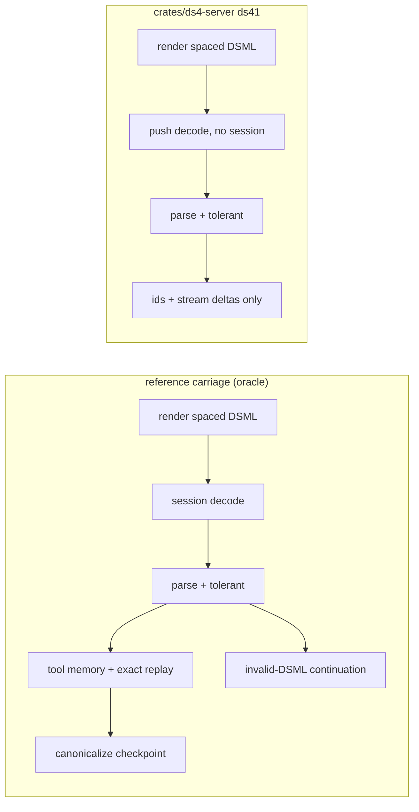

# DS41 DSML port inventory and phase plan

Revision R2 (2026-10-18). R1 was written on `feat/ds41-dsml-complete`. That line
was dropped by the operator — "this branch is made up i told you just to fix the
DSML tools and nothiing more all this kvresue is hallunation is never asked you
for chaing htis" — after the assessor added an invented KV checkpoint change
(R1 section 5, phase P1, and the P1.5 commits). This revision carries the same
reference enumeration, which is the document's durable value, and restates the
scope and the phases.

Scope of the line, operator instruction 2026-10-18: "You need to make a new
branch with the DSML port that is missing and not touch any kv or context etc."
The KV store, the session and the context are therefore PROTECTION requirements,
not work areas: nothing below may alter checkpoint, prefix-reuse or context
behaviour, and the reference's session-addressed mechanisms are recorded as
belonging to a separate unit. The measured client of this work is
`/data/open-grok` (see `docs/ds41-dsml-conformance.md` clause 2.3), the process
that actually consumes the server.

Branch under this revision: `feat/ds41-dsml-carriage`, base `c942523`
(origin/main tip).
Reference: `tests/ds41_ref/oracle/encoding.py`, the official V4.1 encoding
implementation, vendored in this repo and pinned by sha256 in
`tests/ds41_ref/ref_drive.py`. All C line citations in this document are
historical quotation of the implementation these gaps were reviewed against;
that tree is no longer consulted.
Rust citations are into `/data/ds4-dfm-rs` at `c942523`.

Goal of the line: a DS41 (DeepSeek V4.1) serving path whose DSML tool calls are
complete and legal on every client-visible surface — OpenAI chat/completions,
OpenAI responses, Anthropic messages — with exact sampled DSML replay carried as
a host-side map, a repair contract that matches the reference, and the
diagnostics that make both measurable.

Method: read both trees, enumerate the reference mechanisms by stage, then probe
the Rust host for each. Every claim below carries a citation; claims not checked
first-hand are marked UNVERIFIED.

## 1. The structural difference that decides everything else

The reference serves every family, DS41 included, on ONE session path. A
`ds4_session` is created per slot for every engine, DS41 included
(`ds4_server.c:15981`), and the DS41 family changes only four server-side
things: the syntax tag (`SERVER_MODEL_SYNTAX_DEEPSEEK41`, `:1218`), the model
id (`:1223`), the render pair (`render_deepseek41_chat_ordered`, `:3366`;
`render_deepseek41_chat`, `:3438`), and the tools-prompt/system-prompt
placement (`append_tools_prompt_text` v41 arm, `:2563`). There is no DS41
generate route: `grep -n 'generate_v41\|v41_generate\|v41_emit' ds4_server.c`
is empty. Consequently every session-addressed DSML mechanism (tool memory,
exact replay, checkpoint canonicalization, invalid-DSML continuation, thinking
checkpoints) is available to DS41 by construction.

The Rust host does the opposite. `DecodeIo::is_v41` is documented as "this
engine serves the V4.1 (ds41) family: no ds4_session"
(`crates/ds4-server/src/generate.rs:144`), and dispatch hands DS41 to a
separate push route (`generate.rs:2431`, `generate_terminal_v41`,
`generate.rs:3093`). That route's own doc states what it drops: "no
invalid-DSML retry (needs a session), no tool replay / live bindings / thinking
checkpoints (all session-addressed), and no tool-memory write"
(`generate.rs:3042-3046`). Everything in the gap list below is a consequence of
that split, plus three finish-path mechanisms that are missing from the Rust
host on every route.

## 2. Reference inventory (what exists to port)

### 2.1 Tag literals
- DS41 spaced spelling `DS41_TOOL_CALLS_START/_END`, `DS41_INVOKE_*`,
  `DS41_PARAM_*`: `:678-683`.
- Plain `｜DSML｜` and short `DSML｜` spellings, 12 tag defines: `:5826-5840`.
- `find_any_tool_start` (five candidate starts, earliest wins): `:5842-5856`.

### 2.2 Render (tool call -> prompt bytes)
- `append_tools_prompt_text` (the DSML syntax block + escaping contract in the
  system prompt; v41 uses the spaced spelling): `:2563-2600`.
- `append_dsml_attr_escaped` `:2760`, `append_dsml_parameter_text` `:2770`
  (`&lt;` before a closing param tag, v41 aware), `append_dsml_json_literal`
  `:2860`, `append_dsml_arg` `:2873`,
  `append_dsml_arguments_from_json` `:2892` with the single-text-parameter
  fallback at `:2966`.
- `append_tool_result_text` `:2843`, `append_dsml_tool_calls_text` `:2954`,
  `append_tool_calls_text_for_syntax` `:3057`.
- `render_deepseek_chat_prompt_text` `:3141`, `render_deepseek41_chat_ordered`
  `:3366`, `render_deepseek41_chat` `:3438`,
  `render_deepseek_live_tool_tail` `:3744`, `render_live_tool_tail_for_syntax`
  `:3843`, `render_request_live_tool_tail` `:3866`.
- `build_tool_checkpoint_suffix` `:12800`,
  `build_responses_visible_assistant_suffix` `:12821`.

### 2.3 Parse (prompt bytes -> tool calls)
- `find_tool_structural_text` (markers only outside value/key wrappers; think
  scoping) `:5890`.
- `dsml_unescape_text` `:5928`, `dsml_attr` `:5955`,
  `tool_call_json_args_add` `:5969`, `dsml_parse_leaf_param_json` `:5982`,
  `dsml_parse_nested_params_object` `:6032`, `split_reasoning_content` `:6062`.
- `parse_deepseek_generated_message_ex` `:6116` (style detection incl. the v41
  spaced style `:6145-6177`; invoke/parameter scan + `raw_tool_text`
  `:6180-6320`).
- `parse_generated_message_ex_for_syntax` `:6674`,
  `parse_generated_message_ex` `:6692`, `try_repair_dsml` `:6707`,
  `tool_parse_failure_recovery_finish` `:6776`,
  `parse_generated_message_for_response_for_syntax` `:6786`.
- `assign_tool_call_ids` `:10743` (random ids, `call_`/`toolu_` prefix by API,
  uniqueness against the turn).

### 2.4 Live streaming
- Trackers and helpers: `dsml_tool_stream_state` `:7145`, `openai_tool_stream`
  `:7160`, `sse_chat_tool_call_start_delta` `:7270`,
  `sse_chat_tool_call_args_delta_n` `:7292`, `raw_full_lit` /
  `raw_partial_lit` / `raw_partial_any` `:7311`, `find_lit_bounded` `:7326`,
  enums + `dsml_syntax` + `dsml_syntaxes[]` `:7338-7394` (DS41 spaced first),
  `dsml_decode_tracker` `:7397`, `dsml_max_tool_start_len` `:7406`,
  `dsml_find_tool_start(_from)` `:7415/:7433`, `dsml_attr_is_string_true`
  `:7446`, `dsml_decode_scan_json_param` `:7469`, `dsml_decode_state_for_text`
  `:7499`, `dsml_decode_tracker_init/update` `:7579/:7589`,
  `observe_tool_markers` `:7755`, `tool_param_value_stream_safe_len` `:7764`.
- OpenAI live emitter: `openai_tool_emit_args_fragment` `:7788`,
  `openai_tool_stream_init/fail` `:7823`,
  `openai_tool_start_invoke/start_param/finish_param` `:7871-7938`,
  `openai_tool_stream_update` `:7940`, `openai_sse_stream_update` `:8015`.

### 2.5 Exact sampled DSML replay (the DSML/KV bridge)
- Tool memory types `:9896-9934`; `responses_live_remember` `:10502`,
  `anthropic_live_remember` `:10523`, `anthropic_live_clear` `:10543`,
  `request_live_state_clear` `:10550`.
- `tool_memory_remember` `:10653`, `tool_memory_put_source` `:10664`,
  `tool_memory_attach_to_messages` `:10679` (per tool id, exact bytes; falls
  back to canonical rendering and counts the miss).
- KV trailer: `KV_EXT_TOOL_MAP` `:10826`, `find_next_dsml_tool_block` `:10907`,
  `kv_tool_map_measure_locked` `:10937`, serializer `:10973`,
  `kv_tool_map_load_from_pos` `:11040`,
  `kv_cache_restore_tool_memory_for_messages` `:11092`.
- Attach points, one per protocol surface:
  `parse_chat_request` `:4099` -> attach `:4272`;
  `parse_anthropic_request` `:4296` -> attach `:4498` plus
  `anthropic_prepare_live_continuation`;
  `parse_responses_request` `:5285` -> attach `:5529`.
- Remember point, shared finish path: `:14519-14524`
  (`apply_openai_stream_tool_ids` / `apply_anthropic_stream_tool_ids`,
  `assign_tool_call_ids`, `tool_memory_remember`).

### 2.6 Finish-path decisions
- `complete_tool_call_inside_thinking` `:12211` (called from the live loop at
  `:14145`).
- `build_invalid_dsml_tool_error_suffix` `:12260` (system-prompt reminder,
  `</think>` handling, tool-result turn), `build_invalid_tool_call_error_suffix`
  `:12355`, `continue_after_invalid_dsml` `:12611`, called from the non-stream
  loop `:14344` and the stream loop `:14446` ("unterminated tool call;
  continuing with model-visible tool error").
- `canonicalize_tool_checkpoint` `:12976`, gated by
  `should_canonicalize_tool_checkpoint` `:13150` and called at `:14586-14594`;
  skipped for Responses by design (its `previous_response_id` binds the next
  turn to live state) and skipped for image requests.
- Live registries at the same finish point: `responses_live_remember` `:14566`,
  `anthropic_live_remember` `:14578`.

### 2.7 Flags
- `--disable-exact-dsml-tool-replay` (`ds4_help.c:378`, parsed `:15700`),
  `--tool-memory-max-ids N` default 100000 (`ds4_help.c:379`), `--trace`
  (`ds4_help.c:323`) for the prompt/token/DSML trace.

### 2.8 Tests that pin the contract (all in `ds4_server.c`)
`test_dsml_tool_args_preserve_call_order` `:19164`,
`test_openai_tool_args_preserve_call_order` `:19180`,
`test_anthropic_thinking_and_tool_args_preserve_call_order` `:19200`,
`test_parse_short_dsml_and_canonical_suffix` `:19225`,
`test_dsml_parser_recovers_loose_nested_parameters` `:19291`,
`test_dsml_repair_produces_parseable_calls` `:19322`,
`test_tool_parse_failure_returns_recoverable_finish` `:19517`,
`test_invalid_dsml_tool_error_suffix_includes_system_prompt` `:19554`,
`test_tool_recovery_output_budget` `:19597`,
`test_incomplete_tool_call_keeps_stop_reason` `:19613`,
`test_thinking_dsml_is_not_executable_before_think_close` `:19661`,
`test_thinking_dsml_after_think_close_is_executable` `:19685`,
`test_tool_checkpoint_suffix_is_future_prompt_canonical` `:19710`,
`test_tool_checkpoint_minifies_json_parameters` `:19859`,
`test_tool_memory_replays_sampled_dsml` `:19933`,
`test_anthropic_tool_memory_replays_sampled_dsml` `:19996`,
`test_anthropic_live_tail_renders_tool_results_only` `:20050`,
`test_anthropic_tool_result_id_validation` `:20095`,
`test_anthropic_full_replay_allows_unknown_live_id` `:20130`,
`test_anthropic_tool_use_parses_before_role` `:20161`,
`test_tool_checkpoint_canonicalization_gate_exact_replay` `:20209`,
`test_responses_live_tail_renders_tool_outputs_only` `:20238`,
`test_responses_tool_output_id_validation` `:20275`,
`test_responses_stateless_tool_replay_requires_reasoning` `:20310`,
`test_responses_visible_suffix_matches_client_replay` `:20386`,
`test_exact_dsml_tool_replay_can_be_disabled` `:20418`,
`test_dsml_decode_state_separates_structure_and_payload` `:20459`,
`test_tool_memory_max_ids_prunes_oldest` `:20522`,
`test_decode_tracker_split_parameter_close` `:20552`,
`test_tool_control_text_inside_arguments` `:20617`,
`test_tool_body_escape_round_trip` `:20686`,
`test_tool_separator_whitespace_is_not_content` `:20740`,
`test_dsml_prompt_escapes_tool_supplied_text` `:20763`.
DS41-specific: `test_deepseek41_server_stream` `:22759`,
`test_deepseek41_server_tools` `:22812`,
`test_deepseek41_anthropic_results` `:22853`,
`test_deepseek41_live_result_order` `:22891`.

## 3. Rust host inventory (what exists)

### 3.1 Present and equivalent
- Tag literals incl. the spaced v41 set: `crates/ds4-server/src/tools.rs:25-49`.
- Parse: `dsml_parse_leaf_param` `tools.rs:204`,
  `dsml_parse_nested_params_object` `tools.rs:242`, `dsml_find_block`
  `tools.rs:330`, `parse_dsml_generated` `tools.rs:376`, `dsml_normalize`
  `tools.rs:512`, `dsml_clean_name` `tools.rs:549`, `parse_dsml_tolerant`
  `tools.rs:566` (+ tool-root scan `:702`, param `:797`, declared coercion
  `:884`, child binding `:912`), `split_reasoning_content` `tools.rs:169`,
  `parse_generated_message` `tools.rs:1941`,
  `parse_generated_for_response` `tools.rs:2032`, `find_tool_start` `:2155`,
  `find_tool_end` `:2200`, `observe_tool_markers` `:2229`,
  `assign_tool_ids` `:2369` (random seed, uniqueness),
  `tool_marker_stream_safe_len` `:2408`, `SemAccum` `:2447`.
- Decode tracker: `DsmlDecodeState` `crates/ds4-server/src/dsml.rs:21`,
  `dsml_decode_state_is_syntax` `:54`, `SYNTAXES` incl. the spaced v41 entry
  `:95-134`, `DsmlDecodeTracker` `:137-372`, `dsml_decode_scan_json_param`
  `:513`, `dsml_decode_state_for_text` `:550`, `sampling_override` `:669`.
- Live tool stream: `DsmlToolStream` `tool_stream.rs:81` (struct), `:115-371`
  (impl), `dsml_entity_stream_safe_len` `:485`, `tool_param_value_stream_safe_len`
  `:544`, `partial_invoke_index` `:180`.
- SSE surfaces: `append_tool_calls_json` `stream.rs:173`,
  `append_tool_call_deltas_json` `:196`, `append_anthropic_tool_use` `:240`,
  `openai_sse_stream_update` `:808`, `openai_sse_finish_live` `:954`,
  `anthropic_sse_start_live` `:1121`, `anthropic_sse_stream_update` `:1158`,
  `anthropic_sse_finish_live` `:1401`, `anthropic_sse_tool_blocks_live`
  `:1428`, `responses_sse_function_calls` `:1866`,
  `responses_sse_stream_update` `:2045`.
- Repair and retry helpers: `try_repair_dsml` `retry.rs:137`,
  `try_repair_tool_call_format` `:262`, truncation decision `:452`
  (`truncation_outcome` `:460`), plus the
  session-route retry `retry_chat` at `generate.rs:1694` (`:2599`, `:2650`).
- Tool memory: `remember` `tool_memory.rs:283`, `checkpoint` `:345`,
  `restore_store` `:443`, `lookup` `:482`, KTM trailer codec, `EXT_TOOL_MAP`
  (`ds4-kv/src/format.rs:19`), loaded only on the tool-replay lane
  (`generate.rs:1096`).
- Session primitives for canonicalization: `common_prefix` /
  `rewrite_from_common` (`ds4-core/src/session.rs:143/:170`,
  `ds4-core/src/lib.rs:3038`), `Restore`/`RewriteKind`.
- DS41 host surface: push route `generate.rs:3093`, KV checkpoint/prefix reuse
  bridge (`ds4_bridge_v41_kvreuse_*`, used `v41_run.rs:1812-1840`), streaming
  state for all three surfaces `generate.rs:3125-3140`.

### 3.2 Present but gated narrower than the reference
- `tool_replay_scope` (`generate.rs:1367`) admits only
  `api == Api::Openai`, `kind == Chat`, NOT think mode, no live call ids, and
  syntax DeepSeek / Solar / Qwen4 — the R2 reading. The carriage (matrix G1/G2)
  narrowed it to `kind == Chat` alone, so the other arms are gone; the reference
  attaches exact DSML on chat,
  Anthropic and Responses, thinking included (`:4272`, `:4498`, `:5529`).
  DS41 is a `ModelSyntax::DeepSeek` on that axis, so the syntax arm passes; the
  route does not.
- Attach/remember are wired only into the session route
  (`restore_tool_replay` `generate.rs:4538`, `sync_tool_replay_prompt` `:4549`,
  `remember_tool_replay` `:4557`, call sites `:2347/:2459/:2694`); the carriage
  moved the attach to every chat-shaped surface (matrix R-15).

## 4. Gap list: what we do not have

G1. DS41 has no session, so it has no exact DSML replay, no tool-memory write,
no invalid-DSML continuation, no tool-checkpoint canonicalization and no
thinking checkpoint.
Evidence: `generate.rs:144`, `:2431`, `:3042-3046`; reference creates a session
for every engine `ds4_server.c:15981` and attaches tool memory on all surfaces
`:4272/:4498/:5529`. Consequence: the next turn re-renders canonical DSML
instead of replaying the sampled bytes, so the DS41 prompt/KV alignment that
the reference buys with replay is unavailable, and a
malformed or unterminated DSML block ends the turn with raw text.

G2. Exact DSML replay is OpenAI-chat-only and disabled under thinking and under
live continuations. Evidence: `generate.rs:1367-1369`. Missing versus
`ds4_server.c:4272` (chat), `:4498` (Anthropic), `:5529` (Responses), and
`:14566/:14578` (live registries).

G3. No tool-checkpoint canonicalization. Evidence: no Rust counterpart for
`build_tool_checkpoint_suffix` (`ds4_server.c:12800`),
`should_canonicalize_tool_checkpoint` (`:13150`) or
`canonicalize_tool_checkpoint` (`:12976`); `grep canonical` in
`crates/ds4-server/src` returns only the unrelated disk-sync naming around
`generate.rs:893-1160`. The session primitives it would use exist
(`ds4-core/src/session.rs:170`).

G4. No invalid-DSML tool-error continuation on any route with the reference's
shape. The reference builds a model-visible tool error that carries the system
prompt reminder and appends it to the LIVE session, then keeps decoding in the
same turn (`ds4_server.c:12260`, `:12611`, call sites `:14344`, `:14446`), with
an output-budget rule (`:19597`). The Rust retry restarts a chat turn
(`generate.rs:1694`, called at `:2599`/`:2650`), and the v41 finish carries the
budget-cut signal instead (`generate.rs:3323-3335`, R4). R5: on DS41 the
continuation is not merely unported — the served route's own reference documents
it as absent by design, because it needs a session (`server_generate_v41.c:10`
lists it among the route's missing features and `:258-263` reports `error` for a
cut block there), so porting it would be a named, measured deviation rather than
a mirror (CTR 8.2).

G5. No `complete_tool_call_inside_thinking` equivalent
(`ds4_server.c:12211`, used `:14145`). UNVERIFIED whether the Rust Anthropic
live path needs it for the same case; the docs record that a tool block emitted
inside thinking still streams as reasoning, mirroring the engine
(`docs/deepseek41-port-plan.md:1719-1722`, `:1810-1812`).

G6. No `build_responses_visible_assistant_suffix`
(`ds4_server.c:12821`) and no Responses stateless-replay pairing
(`test_responses_visible_suffix_matches_client_replay` `:20386`;
`test_responses_stateless_tool_replay_requires_reasoning` `:20310`).

G7. No `--disable-exact-dsml-tool-replay` and no `--tool-memory-max-ids`.
Closed 2026-10-18 (356d52b): both flags exist on the Rust host and the usage
help lists them (`crates/ds4-server/src/bin/ds4-server-rs.rs:225-231`, help at
`:1329`). As recorded at R2, the evidence was `grep -rn
'disable-exact\|tool-memory' crates/` matching only a comment; `ToolMemory` had
`DEFAULT_MAX_IDS = 100_000` (`tool_memory.rs:14`) without exposing it.
Served check 2026-10-19 (CTR 7.4): all three flags, `--trace` included (added at
2debe05c), are advertised by the served binary, and TP-12 passes; `--trace` then
captured a full suite run (29 sections).

G8. `try_repair_dsml` deviates from the reference in two ways. CLOSED
2026-10-18 (0bf8c79d), and kept as the record of what was wrong.
Evidence: `retry.rs` against `ds4_server.c:6707-6776`.
(a) It closed unbalanced parameter and invoke tags as well as the wrapper
(`retry.rs` appended `pe`, `ie`, `te`), while the reference refuses any repair
unless the invocations and parameters are already balanced and then supplies
only the wrapper (`:6768-6776`; the comment at `:6697-6700` states that closing
an unfinished invocation or value "would invent an executable action").  The
port now refuses both and supplies the wrapper alone; measured before the fix,
the truncated-parameter input came back with
`</…parameter></…invoke></…tool_calls>` appended.
(b) It omitted the DS41 spaced style: it tested DSML full, DSML short and plain
`<tool_calls>`, while the reference tries `DS41_TOOL_CALLS_START` first
(`:6731`).  So a truncated spaced DS41 block was never repaired.  The port now
takes the style from the earliest tool start.
(c) Style detection differed: reference picks the earliest tag occurrence
(`find_any_tool_start` `:5842`, `:6730`), the old port picked by presence
priority.  Fixed with (b).

G9. `find_tool_structural_text` (`ds4_server.c:5890`) has no Rust counterpart:
markers inside parameter values or keys must not be treated as structure, and
the think-scope rule (only after the last `</think>`) lives in it.  The repair
path now carries the port (`retry.rs` `find_last_structural`, used for the think
scope, closed with G8); `stream.rs::text_stream_stray` covers the streaming
shape; the parse-side wrapper-aware scan is still UNVERIFIED as covered.

## 5. Phase plan

The authoritative phase table for this revision is
`docs/ds41-dsml-conformance.md` clause 9 (P0..P5, closing NC-01..NC-07). The
entries below are R1's wording, kept because they carry the per-phase reference
citations; where they conflict with clause 9 or with section 5.1, clause 9 and
section 5.1 win.

Each phase ends with a runnable gate and a rollback that is a plain
`git revert` of that phase's commits; no phase touches a protected branch.
Work happens on `feat/ds41-dsml-carriage`.

### Phase 0 - the instruments (R2) and this inventory (R1)
Deliverable: this document. Gate: every gap cites both trees.

### Phase 1 - exact DSML replay on every surface (host-only; applies to DS41)
Scope: widen `tool_replay_scope` (`generate.rs:1367`) to the reference's rule
(any surface, thinking included, live continuations included where the
reference attaches), wire attach/remember for the Anthropic and Responses parse
paths (counterparts of `ds4_server.c:4498` and `:5529`), add the
`--disable-exact-dsml-tool-replay` and `--tool-memory-max-ids` flags
(`ds4_server.c:15700`, `ds4_help.c:378-379`), and give the DS41 route the
host-side attach and tool-memory write (no session needed: rendering and
memory are host concerns).
Files: `crates/ds4-server/src/generate.rs`, `tool_memory.rs`,
`crates/ds4-server/src/bin/ds4-server-rs.rs`, `serve.rs`.
Gate: a scripted two-turn test per surface (chat, Anthropic, Responses) on
DS41 where turn two's prompt bytes equal turn one's sampled DSML bytes; the
C-side analogue is `test_tool_memory_replays_sampled_dsml` `:19933` and
`test_anthropic_tool_memory_replays_sampled_dsml` `:19996`. Port both.
Risk: widening the scope changes prompt bytes for requests that today render
canonically; gate on `test_tool_checkpoint_canonicalization_gate_exact_replay`
`:20209` semantics.

### Phase 2 - tool-checkpoint canonicalization and the Responses visible suffix
Scope: port `build_tool_checkpoint_suffix` (`:12800`),
`build_responses_visible_assistant_suffix` (`:12821`),
`should_canonicalize_tool_checkpoint` (`:13150`) and
`canonicalize_tool_checkpoint` (`:12976`) onto the Rust session route, reusing
`common_prefix`/`rewrite_from_common` (`ds4-core/src/session.rs:170`) and the
disk-cache fallback path; keep the Responses and image-request exemptions.
Gate: port `test_tool_checkpoint_suffix_is_future_prompt_canonical` `:19710`,
`test_tool_checkpoint_minifies_json_parameters` `:19859`, and the gate test
`:20209`; plus a live check that a chat tool turn leaves a checkpoint whose
token prefix equals the next request's render.

### Phase 3 - the invalid-DSML continuation
Scope: port `build_invalid_dsml_tool_error_suffix` (`:12260`),
`continue_after_invalid_dsml` (`:12611`), the output-budget rule and the
`dsml_recovery_attempted` bookkeeping for both the stream and non-stream loops
(`:14344`, `:14446`); fix `try_repair_dsml` to the reference contract (G8:
refuse unbalanced invocation/parameter closes, add the spaced DS41 style,
earliest-occurrence style detection).
Gate: port `test_dsml_repair_produces_parseable_calls` `:19322`,
`test_invalid_dsml_tool_error_suffix_includes_system_prompt` `:19554`,
`test_tool_recovery_output_budget` `:19597`,
`test_incomplete_tool_call_keeps_stop_reason` `:19613`,
`test_tool_parse_failure_returns_recoverable_finish` `:19517`. The existing Rust
`try_repair_dsml` deviation must be re-pinned by its own test before the fix
(rule: write the failing test first).

### Phase 4 - DS41 consumes the above
Scope: decide and implement the DS41 shape for the pieces that are genuinely
session-addressed. Two sub-decisions to probe first (section 6):
replay attach and tool-memory write are host work and land in Phase 1; the
continuation needs either a live session on the DS41 route or a second generate
call with the tool-error suffix appended (with the native KV checkpoint, now
`ds4_bridge_v41_kvreuse_*`, covering the shared prefix); canonicalization has
no meaning without a session, so for DS41 the phase's gate is that the sampled
bytes ARE the next render (replay), which removes the need to canonicalize.
Deliverable: a written decision with the measured re-prefill cost of the second
call, then the implementation.
Gate: DS41 end-to-end tool gate per surface, concepts borrowed from
`test_deepseek41_server_tools` `:22812`,
`test_deepseek41_anthropic_results` `:22853`,
`test_deepseek41_live_result_order` `:22891`.

### Phase 5 - gates and QA
Scope: port the remaining reference DSML tests as the parity suite (section
2.8) and extend the existing C-oracle harness (`crates/ds4-server/tests/dsml.rs`,
`tool_stream.rs`, which already compare against a C oracle binary). Rule 19 QA is
replaced for this line by the Spark suites and the client leg
(`docs/ds41-dsml-conformance.md` clauses 6.1-6.4); the rule 10 OSV scan still
runs before the unit is offered for merge.

## 5.1 Reserved: the mechanisms this line does not carry

Each of these is a reference mechanism that genuinely needs KV, session or
context state, so it is out of this line's scope by the operator's instruction.
They are recorded here so the gap stays visible, not so it can be re-entered by
stealth.

| Reserved | Reference | Why it is out of scope |
| --- | --- | --- |
| Cached-token replay gain (the reported G) | the whole DSML/KV bridge, section 2.5 | requires the checkpoint to cover generated tokens; the engine writes it at the prompt end only (`ds4_ds41_draft.inc:804`) |
| Tool-checkpoint canonicalization | `build_tool_checkpoint_suffix` `:12800`, `should_canonicalize_tool_checkpoint` `:13150`, `canonicalize_tool_checkpoint` `:12976` | requires a live session to rewrite |
| In-turn invalid-DSML continuation | `build_invalid_dsml_tool_error_suffix` `:12260`, `continue_after_invalid_dsml` `:12611`, call sites `:14344`, `:14446` | appends to the live session and keeps decoding in the same turn; without a session it becomes a second generate call, i.e. a context decision. R5: the reference's own v41 route omits it by design (`server_generate_v41.c:10`, `:258-263`), so the DS41 form is a deviation, not a mirror (CTR 8.2). R6: the operator recorded the boundary, so this row is CLOSED as reference-absent — it is not carried as a gap and no continuation is built |
| The DS41 per-slot session | `ds4_server.c:15981` | the architectural unit that would make all of the above available; a separate line, not a DSML port |
| Live result ordering on Anthropic/Responses | `live_tool_call_order` `:10580`, used `:3873` | session-addressed; also not on the chat path the client of record uses |

## 6. Open questions to settle before Phase 1

Q1. Does the DS41 route already participate in the continuation registry
(`serve.rs:790`, `:934`, `crates/ds4-server/src/cont.rs`)? If yes, G2's live
continuation half is narrower than it looks and Phase 1 shrinks.
Q2. What does the native DS41 KV checkpoint do about a re-generate after a
tool error: is the prefix reuse (`ds4-core/src/v41_run.rs:1819-1840`) enough to
make the second call cheap? Measure before choosing Phase 4's shape.
Q3. Is exact DSML replay wanted under thinking on this artifact, or is the
reference's thinking scoping (`find_tool_structural_text`, `:19661`, `:19685`)
the contract we port as-is?
Q4. Does the DS41 artifact ever emit the plain (non-spaced) spellings, which
decides whether Phase 3's repair needs both styles (today the Rust tracker
carries all four syntaxes but the repair carries three).
