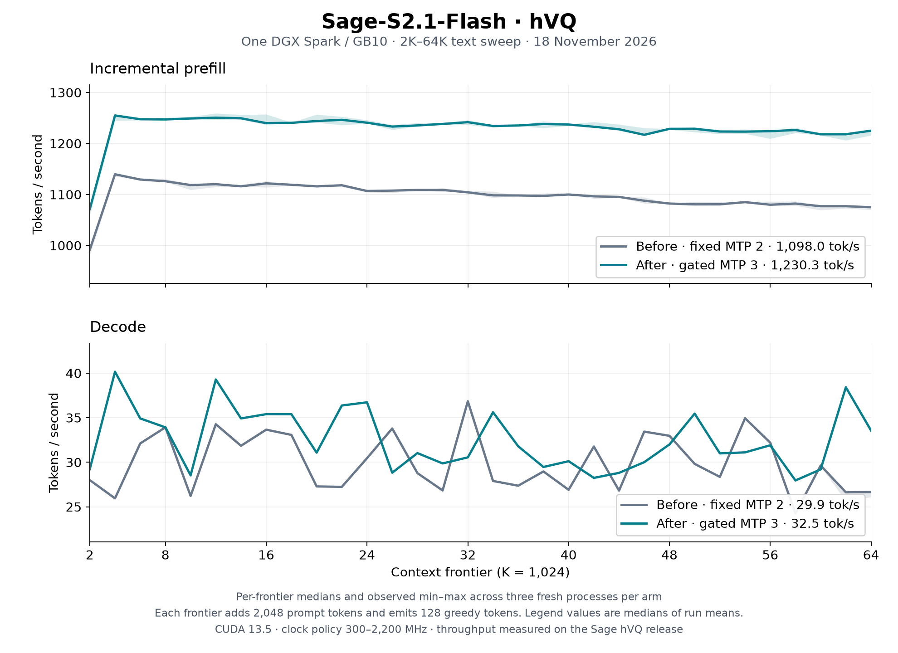

# GLM-5.3-Flash VQ: prefill and decode rounds, November 18

The benchmark used Sage-S2.1-Flash hVQ on `feat/perf-glm-vq`, based on
`0374fed5` (PR #155). GLM-5.3-Flash VQ, Swift1.5 and Nex-N2.6 hVQ share
its tensor shapes, kernels and memory plan. [Derivatives](glm53-vq.md#derivatives).

## Result

On Sage hVQ, four prefill improvements and three decode improvements
raised median 2K–64K throughput by **12.0% for prefill and 8.6% for
decode**. Radix selection contributes to both counts. The baseline
uses the release media patch on `0374fed5` and two fixed MTP drafts.
The final build uses `60268312`, at most three drafts and a margin of
3.0. Each of the six processes added 2,048 prompt tokens and generated
128 greedy tokens at each of 32 frontiers.

| 2K–64K text sweep (tok/s) | Prefill before | Prefill after | Decode before | Decode after |
|---|---:|---:|---:|---:|
| Median of three run means | 1,098.0 | 1,230.3 | 29.94 | 32.51 |
| Individual run means | 1,100.3, 1,098.0, 1,096.4 | 1,230.3, 1,226.6, 1,234.2 | 30.01, 29.94, 29.91 | 32.51, 32.50, 32.57 |
| 2K frontier | 991.8 | 1,071.4 | 28.00 | 29.24 |
| 8K frontier | 1,126.0 | 1,247.2 | 33.92 | 33.92 |
| 16K frontier | 1,121.8 | 1,239.9 | 33.66 | 35.40 |
| 32K frontier | 1,104.2 | 1,241.8 | 36.85 | 30.55 |
| 64K frontier | 1,075.0 | 1,225.1 | 26.66 | 33.56 |

Before runs [1](../speed-bench/gb10_spark_sage_hvq_28a08b4a_1.csv), [2](../speed-bench/gb10_spark_sage_hvq_28a08b4a_2.csv), [3](../speed-bench/gb10_spark_sage_hvq_28a08b4a_3.csv).
After runs [1](../speed-bench/gb10_spark_sage_hvq_ed42e39d_1.csv), [2](../speed-bench/gb10_spark_sage_hvq_ed42e39d_2.csv), [3](../speed-bench/gb10_spark_sage_hvq_ed42e39d_3.csv).

Prefill improved at all 32 frontiers. Decode improved at 23, tied at
one and fell at eight. The 32K continuation ran at 36.85 → 30.55 tok/s.
Absolute decode speed depends on both the verify cost and the tokens
accepted per cycle. The baseline has throughput records only. Each
final run took 2,038 verify cycles for 4,096 generated tokens. All three
matched every saved logit and all 128 token IDs at each frontier.
[Binary hashes, flags, per-run clocks and memory](../speed-bench/gb10_spark_sage_hvq_ed42e39d.meta.txt) ·
[Final throughput as SVG](../speed-bench/gb10_spark_sage_hvq_ed42e39d_ts.svg).

### Long-context prefill

Each build extended one Sage session to 1,040,384 tokens with the same
repeated corpus and 2,048-row native chunk. The benchmark emitted zero
tokens and kept the live state throughout. Each rate measures just the
new text added at that frontier.

| Context tokens | Added tokens | Before (tok/s) | After (tok/s) | Change |
|---:|---:|---:|---:|---:|
| 65,536 | 65,536 | 1,094.32 | 1,231.29 | +12.5% |
| 262,144 | 65,536 | 962.91 | 1,134.58 | +17.8% |
| 524,288 | 65,536 | 745.86 | 1,015.46 | +36.1% |
| 786,432 | 65,536 | 635.10 | 927.49 | +46.0% |
| 1,040,384 | 57,344 | 556.61 | 856.73 | +53.9% |

Summing each increment's token count divided by its rate gives
1,399.1 → 1,032.0 seconds of prefill (−26.2%), or 743.6 → 1,008.1 tok/s
over the full prompt. End-to-end process time, including model load and
tokenization, was 1,458.1 → 1,092.0 seconds. Both runs observed
2,177–2,190 MHz busy clocks and at least 10.91 GiB available. This
curve has one continuous process per build.
[Before CSV](../speed-bench/gb10_spark_sage_hvq_28a08b4a_long.csv) ·
[After CSV](../speed-bench/gb10_spark_sage_hvq_ed42e39d_long.csv) ·
[Run conditions](../speed-bench/gb10_spark_sage_hvq_ed42e39d_long.meta.json).

## Conditions

One DGX Spark (GB10, `sm_121a`, driver 620.70.06, CUDA 13.5.37) ran Rust
1.100.0 with the clock policy at 300–2,200 MHz (busy 2,177–2,190 MHz).
Each benchmark started a fresh `ds4-bench` process on cores 5–9 and
15–19 after `clear_cache`, under `tools/host_memory_guard.py` with a
2 GiB reserve and trip and a full-memory PSI limit of 40. The prompt
was `speed-bench/promessi_sposi.txt`, truncated to each frontier.
Individual switch comparisons interleaved arms. The final comparison
used three baseline processes before the rounds and three afterward.
Kernel times were summed inside the `ds4.prefill` and `ds4.decode`
NVTX ranges with `nsys --trace=cuda,nvtx` and `DS4_GLMVQ_PDL=0`.

Value changes are gated on teacher-forced NLL (`tests/glm53_nll`, 512
targets after 16,384- and 61,440-token prefixes) against a noise floor from
an existing configuration change on this host, 2,048- against 4,096-row
prefill chunks:

| Pair against the reference | 16K paired NLL difference ± SE | mean \|diff\| | target hit changes | 61K paired NLL difference ± SE | mean \|diff\| | target hit changes |
|---|---:|---:|---:|---:|---:|---:|
| Floor: 2,048-row chunks | −0.0018 ± 0.0070 | 0.093 | 9 | −0.0009 ± 0.0059 | 0.081 | 8 |
| Radix top pools (round 4) | +0.0004 ± 0.0055 | 0.075 | 6 | −0.0051 ± 0.0063 | 0.077 | 10 |
| TF32 router (rejected) | +0.0036 ± 0.0070 | 0.089 | 12 | +0.0109 ± 0.0066 | 0.085 | 9 |

A target hit changes when only one arm ranks the teacher token first.

## Where the time went

Baseline, 8K prefill (two 4,096-row chunks, 6,541 ms, GPU busy 99.6%):

| Piece | Share | Note |
|---|---:|---|
| Routed experts (`glmvq_mma8_kernel`) | 40.1% | 8.7–9.1 ms per R13 launch, 12.2–12.4 ms per R13+8 launch: conversion and MMA bursts alternate |
| Q4_K projections (`glmvq_q4p` and its input pass) | 26.5% | 82–84 of the 108 TFLOPS F16 peak |
| Flash attention | 6.5% | constant in context (2,051 selected keys) |
| mHC expand and split | 8.2% | split wrote 67 MB of collapsed rows nobody read |
| KDA chunks | 7.8% | |
| Expert reduce | 2.3% | |
| cuBLAS BF16 and F32 leftovers, conversions | 5.5% | small BF16 projections, router, absorb |
| Top pools | 0.7% | 2.9 ms per DSA layer at 2,048 pools |

Two costs grow with context, both per DSA layer (11) and 4,096-row chunk:

| Context | Index scores (fused) | Top pools | kernel |
|---|---:|---:|---|
| 8K | 2.3 ms | 3.0 ms | `indexer_topk_pow2<2048>` |
| 16K | 4.3 ms | 6.1 ms | `indexer_topk_pow2<4096>` |
| 32K | 8.0 ms | 3.9 ms | `indexer_topk_8192_cub` |
| 64K | 14.6 ms | 6.0 ms | `indexer_topk_stream512` |

At 64K they were 7.2% of a chunk; extrapolated to 1M (262,144 pools, where
the 67 MB of keys leave L2) the index scores alone exceed the rest of the
chunk.

Plain decode, 64K frontier (43.7 ms per token): Q4_K streams 46.0% at
231–263 GB/s, routed experts 25.2%, 259 small BF16 dots 5.7%, KDA 2.9%,
absorb 4.6%, top pools 2.2% (88 µs per DSA layer), mHC 3.5%. A token reads
about 8 GB: 34 ms at the 235 GB/s DRAM rate, so decode sits at 78% of its
streaming bound and the rest is latency-bound kernels.

Two-draft decode, 2K frontier (71.1 ms per three-row cycle, 2.0 tokens):
verify-width Q4_K 34.4%, verify experts 34.6%, BF16 dots 5.8%, draft heads
4.7%, the draft layer's FP8 dots 3.9%, KDA 3.3%. The Q4_K pass costs the same
for one row or three; each further row adds 8.2 ms of experts.

## Rounds

### 1. Warp-specialized routed experts (prefill)

`glmvq_mma8_kernel` gave sixteen warps the same job: gather codewords,
transpose residual words, issue MMAs, one barrier per stage. 4,096-row
chunks now take MiniMax's `mw_kernel` (`cuda/minimax_mma8w.cuh`): four
producer warps write each stage's A fragments into a ring, four consumer
warps load and multiply, one persistent CTA per SM. Gate and up are two
launches over one E4M3 input and a pass quantizes SwiGLU with GLM's gate
clamp. Same promotion, gain and reduce order.

- Harness (`make test-minimax-mma8w`, GLM shape, 4,096 rows): R13 layer
  26.5 → 19.9 ms, R13+8 layer 35.0 → 28.0 ms, outputs equal.
- 8K prefill, three interleaved pairs: 1,256.4 → 1,334.6 tok/s (+6.2%);
  decode 23.62 → 23.63; frontier logits identical.
- `DS4_GLMVQ_MMA8W=0` keeps the previous kernel.

### 2. The mHC split's unread rows (prefill)

Every split also applies the next norm and its consumers read only those
rows. The kernel keeps the collapsed rows in registers when the caller
passes no output: 67 MB less per 4,096-row call, 90 calls per chunk.

- Kernel 1,163 → 857 µs per call.
- 8K prefill, three pairs: 1,334.1 → 1,351.1 tok/s (+1.3%), every run above
  every baseline run; decode 23.92 → 23.91; logits and 64 greedy tokens
  identical.
- `DS4_GLMVQ_SPLIT_CUR=1` writes the rows.

### 3. Index scores walk the pools (prefill, long context)

The fused kernel gave a CTA 4 rows and 128 pools: each pool tile restaged
65 KB of F32 query, and every row group streamed all keys again. A CTA now
holds sixteen rows as B fragments in registers (254 registers, no spill)
and walks all pools in double-buffered cp.async tiles, pools as the A
operand through one `ldmatrix` per eight MMAs. All CTAs walk in one order:
a tile leaves DRAM once and the others meet it in L2. The k order and the
head sum are the fused kernel's: equal scores bit for bit.

| `make test-glm-vq-index-walk`, ms per layer | Fused | Walk | TFLOPS |
|---|---:|---:|---:|
| 4,096 rows, 8K (2,048 pools) | 2.37 | 1.26 | 27.6 → 57.5 |
| 4,096 rows, 32K | 7.73 | 3.88 | 35.6 → 70.8 |
| 4,096 rows, 64K | 15.38 | 7.40 | 35.7 → 74.3 |
| 4,096 rows, 256K | 59.32 | 28.62 | 37.1 → 76.8 |
| 2,048 rows, 1M | 154.26 | 56.97 | 28.5 → 77.2 |

- Three interleaved runs per arm: a 61K cold prefill 1,301.6 → 1,322.5 tok/s
  (+1.6%), the next 4,096 rows at that depth 1,269.9 → 1,307.5 (+3.0%),
  every run above every baseline run; frontier logits identical.
- One row per warp ran even to 256K and 10% slower at 1M.
- `DS4_GLMVQ_INDEX_WALK=0` keeps the fused kernel.

Four-row MTP verifies exposed a size regression. A single block walked
every pool, taking 1.37 ms per DSA layer at 64K. Dispatching four rows
to the fused kernel takes 19 µs. Appends with at least sixteen rows split
the pool tiles across blocks until the SMs fill. At 128 rows and 64K the
split walk takes 0.217 ms against 0.489 ms for the fused kernel.

### 4. Radix selection of the top 512 pools (prefill and decode)

At 64K each DSA layer spent 87.8 µs selecting the best 512 of 16,384
pools for one decode row. The radix kernel finds the threshold in four
digit passes and writes the selected indices in pool order. The set
stays the same. Attention accumulates in the new order, which accounts
for the change in the teacher-forced logits above.

- At 64K, selection took 16.1 µs per decode row and plain decode took
  43.09 ms/token, down from 43.70. Selection for a 4,096-row chunk fell
  from 6.19 to 1.75 ms per layer.
- At 16K, three interleaved pairs averaged 1,339.6 → 1,353.4 tok/s
  prefill and 24.62 → 24.72 tok/s decode.
- Above 65,536 pools streaming selection reads fewer bytes when the
  scores leave L2. `DS4_GLMVQ_TOPK_RADIX=0` selects the prior kernels
  at all depths.

### 5. Stop drafting at a low-margin proposal (decode)

Across 660 fixed-depth cycles, proposals whose top two draft logits
differed by less than 0.5 were accepted 19–36% of the time. At margins
of 3–4, acceptance reached 94–96%. The target verifies the low-margin
proposal, then the next cycle starts from the accepted prefix. This
saves drafting and verifying proposals that depend on an unlikely pick.
`--mtp-margin 0` requests fixed depth. The default margin is 3.0.

With two drafts, 384 greedy tokens at each of five frontiers from 2K
through 64K, two fresh runs per arm gave 35.69–35.72 tok/s at fixed
depth and 36.95–37.00 with the gate (+3.57% pooled). A verify cycle
fell from 69.3 to 65.0 ms and yielded 2.474 → 2.403 tokens. Both arms
verify every emitted token with the target. Changing verify width can
change a near-tied greedy continuation. At 64K these particular
continuations ran at 36.2 and 34.5 tok/s respectively.

After the short-append fix, two fresh runs per cap on the same binary
gave 36.84–36.90 tok/s at depth two and 37.89–37.93 at depth three
(+2.82% pooled). Tokens per cycle rose from 2.403 to 2.591, with the
cycle cost rising from 65.2 to 68.4 ms. Depth three reached four verify
rows on 36.4% of cycles. It won at three of five frontiers. The final
sweep uses `--mtp-draft 3` with the default margin.

### 6. Group the Q4_K projections of one decode row

One KDA row reads three 18.9 MB matrices for q, k and v. The three
dense FFN layers also read gate and up from the same activation. Each
set now uses the existing grouped Q4_K kernel when every matrix would
take the staged kernel with the same split. Each output keeps its own
dot order. The change adds no weight copy or workspace.

- On the model-free KDA harness, Nsight Compute with cold caches and the
  host clock policy timed the three separate projections at 101.4, 99.0
  and 97.8 µs. The group took 242.6 µs for the same 56.6 MB of weights.
  `tests/test_glm_vq_verify --q4-group` compares all 24,576 outputs.
- At 8K with 256 generated tokens, three fresh interleaved pairs gave
  24.90 → 25.36, 23.88 → 25.38 and 24.11 → 25.27 tok/s. The means
  were 24.30 → 25.34 (+4.28%). Prefill averaged 1,355.5 → 1,355.9 tok/s.
  The first pair matched all 154,880 frontier logits and 256 greedy IDs.
- With PDL off, the 32-token decode range took 1,395.1 → 1,355.7 ms.
  The two Q4_K stream kernels together took 647.85 → 609.65 ms.
  Grouping removed 71 launches per token, saving 1.19 ms in those
  kernels and 1.23 ms end to end. The grouped kernel read 56.6 MB in
  261.5 µs per call, about 217 GB/s against the 235 GB/s streaming
  reference. The plain decode A/B used default PDL.
- Busy clocks were 2,184–2,190 MHz for all six runs. All retained at
  least 21.18 GiB available and recorded zero full-memory PSI avg10.
  The separate-launch arm varied more. Every grouped run exceeded the
  fastest separate-launch run. `DS4_GLMVQ_Q4_GROUP=0` selects separate launches.

## Serving and memory

The 56 GGUF parts total 94,491,696,768 bytes for Sage and
94,491,697,792 bytes for Swift. With MTP depth two at the native
1,048,576-token context, the pre-fix plans for both releases were:

| Prefix and banks | Floor | Native rows | Total GiB | Result on 118.46–118.56 GiB available |
|---|---:|---:|---:|---|
| Auto text bank and serial media | 4 GiB | 1,024 | 129.46 | Refused |
| Auto text bank and serial media | 2 GiB | 1,024 | 127.46 | Refused |
| Serial, reuse off | 4 GiB | 2,048 | 114.67 | Admitted |
| Serial, reuse off | 2 GiB | 4,096 | 117.98 | Admitted |

The bank and media path reserved 20.02 GiB beside the text graph. A
single serial graph reserved 3.75 GiB for the same image allowance. Both
models also admitted the original conversion-host flags, which fixed
1,024 rows, disabled banks and reuse, and quoted 112.02 GiB at floor 4.
The planner now tries the serial layout after the smallest banked chunk
exceeds available memory under automatic bank count and reuse. Explicit
bank counts and partial reuse keep their full two-graph memory check.

On the corrected runtime with the automatic lane and a 4 GiB floor,
both releases served real requests in a 1,048,576-token context with
2,048 native prefill rows. With a 2 GiB floor, Sage's corrected automatic
plan selected 4,096 rows and quoted 117.98 GiB against 118.60 GiB
available. The server runs below kept the 4 GiB floor.

| Direct GB10 check | Sage-S2.1-Flash | Swift1.5-GLM-5.3-Flash |
|---|---:|---:|
| Maximum MTP drafts in the HTTP run | 3 | 2 |
| CLI reuse, disk, snapshot and bank checks at 8,192 context | 10/10 | 10/10 |
| HTTP checks at native context | 11/11 | 11/11 |
| Cached tokens in a 641-token re-rendered continuation | 633 | 634 |
| Tool-result continuation, cached tokens / 255 | 235 | 235 |
| High-margin reference probes, matching first tokens | 3/3 | 3/3 |
| Greedy text vs equivalent BF16 input rows | 12/12 IDs | 12/12 IDs |
| Projected video vs conversion-host continuation | 24/24 IDs | 24/24 IDs |
| Embedded MTP, accepted / proposed at the end of the HTTP suite | 223/287 | 1,101/1,335 |

The suite covered chat with thinking on and off, UTF-8 Korean SSE through
`[DONE]` with usage, a tool call and its result, an inline PNG, prefix
reuse, messages, responses, plain completions and a 5,577-token planted
fact. The MTP counters include Swift's preceding media requests. Both
identified a red circle, blue square and green triangle. Swift also
read an OCR label and classified six solid colors. Sage called the
112-pixel solid blue image black. The client-projected silicon CIF on
Sage produced a 24-token continuation that differed from the
conversion-host sequence. Nex has a conversion-host serving record
and verified Hub shard hashes. This campaign ran Sage and Swift on GB10.

Sage streamed the same 35-token request at temperatures 0, 1, 1 and 0,
with a fixed seed, 128 output tokens and separate requests. Throughput
after the first token was 33.16 / 33.26 tok/s at temperature 0 and
31.34 / 31.22 tok/s at temperature 1. Each greedy request accepted
66/92 drafts in 62 decode steps. Each sampled request accepted 63/93
in 65 steps. The observed difference includes both sampling and the
change in speculative acceptance.

In a separate cold chat turn, the server reported 900,068 input tokens
and zero cached tokens. It returned the identifier planted midway
through repeated passages of `speed-bench/promessi_sposi.txt`,
`ORCHID-7324`, in seven tokens and finished with
`stop`. Time to first token was 873.9 seconds and total HTTP time
was 874.0 seconds. Minimum available memory over the Sage server run
was 8.82 GiB and peak full-memory PSI avg10 was 0.00.

## Rejected

- **TF32 router.** The router's F32 GEMM on TF32 tensor cores: 1.02 → 0.56 ms
  per layer and 4,096 rows, +0.4% on an 8K prefill (1,347.5 → 1,352.7, one
  run below every baseline run). TF32 represents the BF16 operands exactly,
  but the tensor-core accumulator truncates over K = 4,096, and the 61K NLL
  pair moved +0.011 ± 0.007 where the chunk-size floor moved −0.001 ± 0.006.
  Not worth an unresolved shift for 0.4%.
- **One query row per warp in the index walk.** Even to 256K, 10% slower at
  1M (twice the passes over the keys).
- **Dropping low-margin drafts unverified.** Simulated on the recorded
  margins: verifying a draft whose margin is under the threshold and stopping
  there beats dropping it (a 0.5–3 margin still accepts 19–83%).

## Left

Measured shares of a 4,096-row chunk after a 61,440-token prefix, with
radix selection enabled (3,133.5 ms in the prefill NVTX range).

| Lever | Share | Note |
|---|---:|---|
| Routed expert GEMMs | 33.1% | SwiGLU is another 1.8% (1.34 ms per routed layer), and expert reduction takes 2.4% |
| Q4_K projections | 29.0% | near the practical F16 peak |
| Flash attention | 6.9% | 56 TFLOPS |
| mHC | 7.7% | 178 GB/s over 335 MB per expand |
| KDA | 8.1% | |
| Small BF16 projections, conversions, absorb, router | 5.9% | cuBLAS at 21–33 TFLOPS. The 64-row and 32-row matrices do not fit `glmvq_q4p`'s 128-row tiles. |
| Index scores and top pools | 3.2% | fusing the selection into the walk would drop the rows x pools score matrix (4.3 GiB at 1M and 4,096 rows) and its streaming top-k past 65,536 pools |

Decode: a three-row verify writes two full KDA state snapshots per layer
(8.4 MB, 285 MB per cycle); replaying the rank-1 updates of the kept rows at
commit would write none. Grouping the BF16 gate projections like the Q4_K
ones needs a BF16 group kernel.
