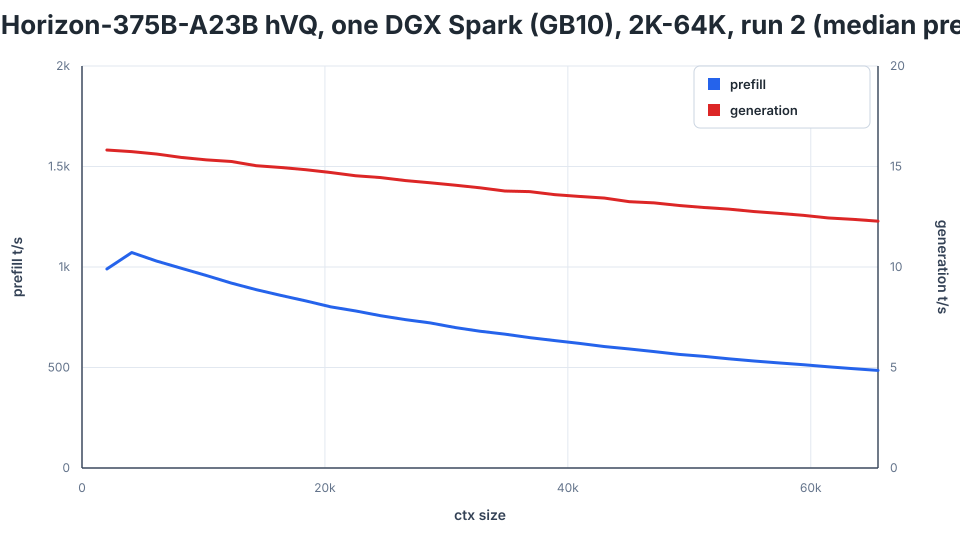

# K2-Horizon hVQ: format, execution and serving

K2-Horizon hVQ (family `K2hVq`, architecture `k2_horizon_vq`) is a GVQ1
conversion of
[IFM/K2-Horizon-375B-A23B](https://huggingface.co/IFM/K2-Horizon-375B-A23B/tree/d33e3ae45281865ebf9f044b12d3635b1d1e17fe):
[Baekpica/K2-Horizon-375B-A23B-hVQ-GGUF](https://huggingface.co/Baekpica/K2-Horizon-375B-A23B-hVQ-GGUF)
(recipe `k2-horizon-hvq8-r13x58-q8-nvfp4kv-v1`). This page describes how the
CUDA backend runs it on one DGX Spark (GB10), how much of its native
524,288-token context fits beside 79.69 GiB of resident weights, and what
was measured. The
graph is the [MQ87 release's](ds4-dfm-model-families.md#k2-horizon-375b-release-scope);
the GVQ1 decode kernels are GLM VQ's ([GLM-5.3 Flash VQ](glm53-vq.md)), the
13-bit prefill experts MiniMax's ([MiniMax-M3.1 VQ](minimax-vq.md)), the
NVFP4 K/V pages and attention tiles Inkling-2's ([Inkling-2-Small VQ](inkling2-vq.md)),
and the serving plumbing A.X-K2's ([A.X-K2 VQ](axk2-vq.md)).

## Model and format

```
embed ─▶ [ rms ─▶ GQA (NVFP4 K/V) ─▶ +h ─▶ rms ─▶ dense SwiGLU (0–2) | shared + top-8 of 192 (3–60) ─▶ +h ] × 61 ─▶ rms ─▶ head
```

| Part | Shape | Storage |
|---|---|---|
| Attention | 61 full causal GQA layers, 48 query / 8 KV heads × 128, no Q/K norm; RoPE θ 10⁷ on dimension pairs (j, j + 64), j < 32 (the source's split/interleave round trip of its first 64 interleaved dims); scale 128^-½ | Q8_0 q/k/v/o |
| Dense FFN | layers 0–2, 16,384 wide, SwiGLU | Q8_0 |
| Routed experts | layers 3–60, 192 × top-8, FFN 1,792; sigmoid scores, `score + bias` selects, weights 2.5 × score / Σ selected scores; one shared expert (1,792) | GVQ1 K8192 13-bit hVQ on all 58 layers, one E4M3 book per layer |
| Router | 192 × 6,144 per layer, bias 192 | F32 (BF16 values) |
| Norms | RMSNorm, ε 10⁻⁶ | F32 (BF16 values) |
| Embedding | 250,624 × 6,144 | Q8_0 `embedding` part, read by the host one 6,528-byte row per token |
| Head | 250,624 × 6,144 | Q8_0 |

The release is a directory: `release.json` names 60 independent GGUF parts
(58 expert parts, `body-nonexpert.gguf`, `embed-tokens-q8_0.gguf`;
87,197,637,632 bytes). The host checks the pinned recipe and source revision,
every part's SHA-256 (read with `O_DIRECT`, Q8_0 scales scanned), the 13-bit
GVQ1 headers and book links, then binds the HF tensor names. The tokenizer,
template and configs beside the parts are pinned by SHA-256; the
`chat_template.jinja` is IFM's at `7a17b47a`, the weights' revision
`d33e3ae4` with a text-part normalization macro added. Engine open copies the
79.69 GiB trunk to the device and keeps the embedding part mapped.

## Execution on GB10

**Decode (one row).** Q8_0 projections stream through a GEMV that stages
each weight row in shared memory by 16-byte copies while its predecessor
drains (programmatic dependent launch) and reads `d · q` exactly in F32
against the F32 input; one launch covers every matrix of a shared input
(q/k/v, gate/up). Routing stays on the device: F32 router logits
(BF16 values), BF16 rounding, sigmoid plus bias, eight warp argmax rounds
(ties to the lower expert), weights `bf16(2.5 · s / Σ s)`. GLM VQ's GVQ1
decode kernels stream the eight selected experts with the layer's book in
shared memory; the BF16 running sum of their outputs adds in ascending
expert order before the shared expert. Attention is a tensor-core split
(`k2a_split`, `cuda/k2h_attn.cuh`): a KV head's six query heads are the
m16 rows of a BF16 MMA, 64-key tiles of its NVFP4 page stream through a
three-stage cp.async ring, each warp keeps its own online softmax over a
16-key quarter of every tile, and a merge folds up to 64 partials per
head. Two decode rows (verify widths) take the verify kernels; K2 has no
drafter, so they serve short prefill tails only.

**Prefill (4,096-row chunks).** Q8_0 projections run MMQ: each input is
quantized to Q8_1 once for all the matrices that read it (q/k/v,
gate/up), outputs skip MMQ's non-finite scrub (the host checked every F16
scale finite) and the down projections take the BF16 boundary in the
scrub's place. Routed experts run MiniMax's warp-specialized FP8 MMA on the
unconverted E4M3 codewords after host grouping (64-pair items), then the
BF16 reduce with the shared expert. Attention is Inkling-2's NVFP4 tile in
a ping-pong form (`k2a_prefill_pp`): a CTA owns 64 queries of two heads
sharing a KV head; two decoded BF16 tiles let one head's warps decode the
next tile's keys before consuming the current one while the other head's
consume first and decode the values after, so each sub-core overlaps one
group's decode and softmax with the other's MMAs (82 TFLOPS at 64K). Key
tiles start at multiples of 64 in absolute position, so a query's result
does not depend on the chunk. The engine halves the rows (down to 512)
before the context when memory is short.

**Numerics.** The engine follows `tools/vq_calib/k2h_ref.py` (the release's
reference forward, bit-identical to transformers' `K2HorizonDecoderLayer` on
the layers checked): RMSNorm in F32 returned as BF16, every projection output
rounded to BF16, RoPE in BF16 tensor arithmetic (each product and sum
rounded, cos/sin of the F32 angle rounded to BF16), router logits rounded to
BF16 before the sigmoid, SwiGLU's `silu(g)` and `silu(g) · u` in BF16, and the
routed sum a BF16 running sum in ascending expert order (the source's BF16
`index_add_`) before the shared expert's BF16 add. K is stored after RoPE.
Decode Q8_0 weights are exact `d · q` in F32 (the reference rounds them to
BF16); prefill activations enter MMQ as Q8_1 and the routed experts as
E4M3. Attention scores stay F32 (SDPA's flash kernels keep S in F32), the
softmax runs online in F32 and BF16 probabilities multiply BF16 V (NVFP4
decodes to BF16 exactly: an E2M1 value times its E4M3 scale has at most
five significant bits).

## Output protocol

Variant 26 maps to the MQ87 release's K2 syntax (`ModelSyntax::K2Horizon`):
the host renders `chat_template.jinja`'s bytes (the
[template corpus](../tests/fixtures/chat-template/README.md) pins them
against Python), a generation prompt ends `<|ifm|im_start|>assistant\n<ifm|think>\n`
with thinking on and adds `</ifm|think>\n` with thinking off, and history
keeps earlier turns' reasoning. Requests think unless they turn it off
(`reasoning_effort: "none"`, Anthropic `thinking: {"type": "disabled"}`);
other effort levels render the same prompt. Tool calls are IFM's
`<ifm|tool_calls>` block, one `<ifm|tool_call>NAME` per call with paired
`<ifm|arg_key>`/`<ifm|arg_value>` tags, parsed into OpenAI tool calls;
tool results render as `tool` turns. `<|ifm|im_end|>` ends a reply.

## Serving

Persistent banks, partial prefix reuse, disk KV and session snapshots
(`K2H1` payloads: whole 128-position K/V blocks per layer) are declared and
qualified by `ds4 --serving-check` ([capabilities](serving-capabilities.md));
the release has no drafter. The context default is `max_position_embeddings`
= 524,288.

**Memory.** The device holds 79.69 GiB of trunk weights (85.56 GB with their
records); the embedding part stays mapped and the host copies one 6,528-byte
row per token. K/V is 70,272 bytes per token (61 layers of NVFP4 K and V
with their scales): 34.31 GiB per bank at 524,288. One graph costs 1.38 GiB
of workspace at 4,096 rows (0.71 GiB at 2,048, 0.21 GiB at 512) plus 26 MiB
of host embedding staging; further banks share graph 0's scratch and add
only their pages.

After the open the trunk and the runtime (CUDA context, kernel images, host
buffers) have taken 81.34 GiB of the ~117.6 GiB a 128 GB Spark reports
available, so the native context's 34.31 GiB bank does not fit beside the
4 GiB floor and the 2 GiB boot burst:

| Command (plus `-m` and the release directory) | Plan / what ran |
|---|---|
| default (524,288 context) | refused: the quote needs 120.21 of 117.65 GiB |
| `--mem-floor-gb 1`, `DS4_BATCH_FIT_BURST_MB=640` | one 524,288-token bank at 512-row chunks passes both quotes (0.14 GiB spare after the open), but allocating its pages pushed the host into reclaim (PSI full 41%) and the guard stopped the server |
| `-c 458752` | the pre-open quote fits it (0.54 GiB spare); the open uses 1.65 GiB beyond the weights and the post-open quote refuses it |
| `-c 425984` | one bank at 4,096-row chunks, 2.25 GiB spare after the open: the gates below |
| `-c 262144` | one bank (13.4 GiB spare; a second needs 17.16) |
| `-c 131072 --max-seqs 3` | three banks at 4,096-row chunks (4.84 GiB spare; `auto` picks two) |
| `-c 65536` | two banks (22.0 GiB spare) |

`ds4-server --check-config` prints the pre-open quote. The server quotes
again after the open against the memory the load left and refuses a plan
the open made too large.

**Gates** (`c089901f`, greedy unless noted). `ds4 --serving-check` with the
first 9,000 tokens of `speed-bench/promessi_sposi.txt` (split 8,192 on the
4,096-row grid): works 10, FAIL 0, WRONG 0 (prefix, rewind, disk and
snapshot exact; continue one near tie inside the noise floor; banks warm,
fork, partial, disk and width). A prompt shorter than the grid puts the
split off it: with 3,943 tokens `banks/width` compared streams whose
prefill the scheduler cut into different chunks (9 of 16 tokens), and the
same prompt at 2,048-row chunks passed 10/10.

Behind `ds4-server -c 425984`, one request per surface, 12 / 12: chat,
thinking (`391` for 17 × 23), SSE streaming, a tool call and its follow-up
with the tool's result, `/v1/messages`, `/v1/responses`,
`/v1/completions`, Korean, a 24,995-token prompt with one planted fact
(27.9 s), the same prompt again from the live state (24,994 cached, 0.6 s)
and a second turn that re-renders the first answer (24,994 of 25,022
cached). A seeded set at temperature 1.0: thinking arithmetic exact 6 / 6
(closed, `stop`), tool calls valid 4 / 4, plain chat `stop` 4 / 4.
A 417,942-token prompt with two codes planted at 15% and 85% of the text
answered both, in order (cold prefill 1,936 s, 215.9 tok/s; decode 5.3
tok/s at that depth); the same request again from the live state cached
417,941 tokens and answered in 0.45 s. MemAvailable stayed at or above
6.95 GiB with PSI 0, busy clocks 2,184–2,190 MHz.

## Performance

The [2K–64K sweep](../speed-bench/gb10_spark_k2h_hvq_aee84ba4.meta.txt)
measures `c089901f` on one GB10 (`sm_121a`, CUDA 13.5.37, driver
620.70.06): three fresh `ds4-bench` processes, 2,048 new tokens per frontier
in one chunk over the cached prefix, 128 forced greedy tokens, all K/V
resident, default PDL. Busy SM clocks are 2,184–2,190 MHz under the
300–2,200 MHz policy; every run kept PSI at 0 with at least 26.1 GiB
available.

| Frontier | Prefill tok/s | Decode tok/s |
|---:|---:|---:|
| 2K | 994.2 | 15.82 |
| 8K | 988.0 | 15.47 |
| 16K | 855.8 | 14.95 |
| 32K | 681.2 | 13.94 |
| 48K | 565.2 | 13.07 |
| 64K | 485.5 | 12.29 |
| 2K–64K, median of run means | 711.9 | 13.96 |

Run means span 711.70–712.13 prefill and 13.94–14.09 decode. Three matched
runs of the first serving commit `56c66463` give 619.4 / 12.26: **+14.9% /
+13.9%** ([report](k2h-vq-optimization-2026-11-25.md)). A frontier's rate is
its last chunk's, so attention, which grows with the frontier, is about two
thirds of the 64K chunk.

**8K + 64** (MQ87's protocol: the first 8,192 tokens of
`speed-bench/promessi_sposi.txt` prefilled in 4,096-row chunks, 64 greedy
tokens, context 8,257), three fresh runs of `c089901f`: 1,060.8–1,064.6
prefill / 15.40–15.72 decode tok/s, against the MQ87 release's
641.94–644.78 / 13.07–13.34.



## Quality

The conversion's held-out set is 64 sequences of 512 tokens (32,768
positions) from its calibration mix, with the reference forward's final
residual streams (`tools/vq_calib/k2h_heldout.py`: the release bytes through
`k2h_ref.py`'s arithmetic with NVFP4 K/V) and the original BF16 model's.
Candidates are scored through the release's norm and Q8_0 head.
`tests/k2h_quality` decodes each sequence token by token (`score --logits`),
or with `--prefill 64` grows one session 64 rows at a time and keeps the
logits after each chunk (`score --frontiers`, positions 64, 128, ..., 512).

| Engine path, against | Positions | KL, mean (median) | Same top-1 | NLL (reference) |
|---|---:|---:|---:|---:|
| 64-row prefill chunks, the reference forward | 512 | 0.0192 (0.0063) | 94.14% | 1.3110 (1.3124) |
| Decoded token by token, the reference forward | 3,072 | 0.0138 | 94.73% | 1.5507 (1.5469) |
| 64-row prefill chunks, the original BF16 model | 512 | 0.1048 (0.0385) | 87.89% | 1.3110 (1.2286) |

At `c089901f` the final hidden rows of every prefilled position (32,768,
one 512-row forward per sequence) gave KL 0.0224 to the reference forward
(94.43% same top-1, NLL 1.3898 against 1.3890) and 0.1337 to the original
(86.71%).

The reference forward itself scores KL 0.1316, same top-1 86.78% and NLL
1.389 against the original, so the engine serves the conversion's quality.
Each adopted optimization was gated on these sets (paired per-sequence NLL
and KL; [report](k2h-vq-optimization-2026-11-25.md)). At `56c66463` the
conversion's three goldens (NVFP4 K/V) gave last-position KL 0.0017
(`raw_paris`), 0.017 (`chat_code`) and 0.023 (`chat_capital`, whose top-1
is a near tie that flips).

## Diagnostic switches

| Variable | Effect |
|---|---|
| `DS4_K2H_PREFILL_CHUNK` | prefill rows per chunk (default 4,096; at most 4,096) |
| `DS4_K2H_ATTN_PP=0` | prefill attention with every warp in step (`k2a_prefill`) instead of the ping-pong tile |
| `DS4_K2H_ATTN_MMA=0` | decode attention as a lane-per-key walk (`k2a_decode`) instead of the tensor-core split |
| `DS4_K2H_Q8_GROUP=0` | one decode GEMV launch per Q8_0 matrix instead of one per shared input (q/k/v, gate/up) |
| `DS4_K2H_GAIN_DOT=0` | decode experts round gain × codeword to BF16 per weight (the restored weights' arithmetic) instead of one multiply after the dot |
| `DS4_GLMVQ_PDL=0` | plain launches for decode (kernel attribution) |

Set diagnostic switches before starting a fresh process.

## Limits and next levers

- Decode is plain: the release has no drafter. A token reads 10.35 GB of
  Q8_0 trunk, 3.11 GB of routed experts and 70,272 bytes of K/V per cached
  position; at 8K that is ~58 ms at 240 GB/s against ~64 ms measured. The
  Q8_0 GEMVs run at 229 GB/s, the expert gate/up and down kernels at 214
  and 190 GB/s (364-byte down rows).
- The native 524,288 tokens do not fit one 128 GB Spark beside the host's
  own memory: the open leaves 36.3 GiB and the bank takes 34.31. The
  largest context qualified here is 425,984 (`-c 425984`).
- `reasoning_effort` `low` and `medium` render the high prompt: the
  template's `<ifm|think_fast>` and `<ifm|think_faster>` spans have no
  parser.
- Prefill Q8_0 projections run MMQ on Q8_1 activations (~59 TOPS, 27% of
  the INT8 peak) where the reference multiplies BF16 activations by
  `bf16(d · q)`; a producer-dequantizing BF16 GEMM is the next prefill
  lever beside the routed experts (FP8 MMA at ~60 TFLOPS on real routes).
- Teacher-forced fidelity and bounded sampled checks only: no task
  benchmark was run.
