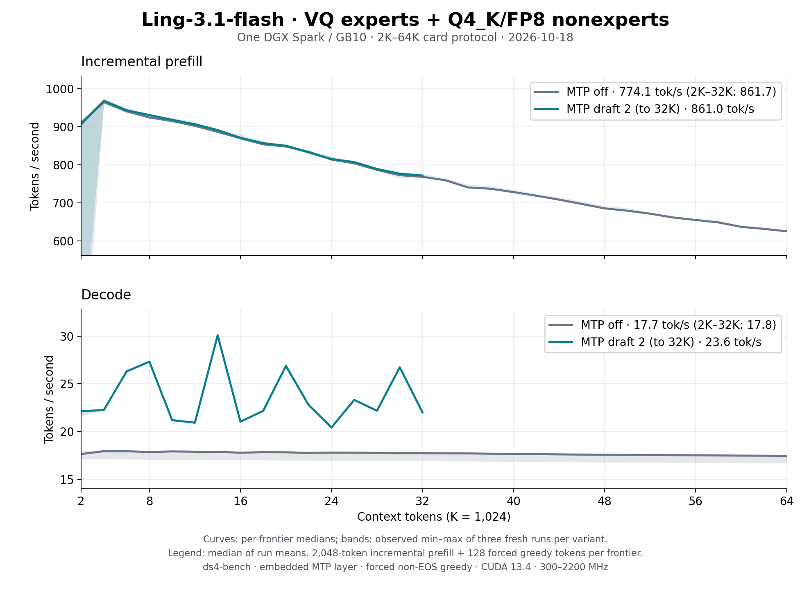

# Ling-3.1-flash VQ: format, execution and serving

Ling-3.1-flash VQ (family `Ling31Vq`, GGUF architecture `ling31_vq`) is a
GVQ1 conversion of the text-only
[inclusionAI/Ling-3.1-flash](https://huggingface.co/inclusionAI/Ling-3.1-flash/tree/a4ccd6b45c002ddb236f9cb77d52cc427482bf19)
checkpoint. The artifact is
[Baekpica/Ling-3.1-flash-VQ-GGUF](https://huggingface.co/Baekpica/Ling-3.1-flash-VQ-GGUF):
VQ routed experts, Q4_K large non-expert projections, Q8_0 embeddings and
source-precision FP8/BF16 elsewhere. This page describes how the CUDA backend
runs it on one DGX Spark (GB10), how serving fits beside its 106 GiB trunk,
and what was measured. The GVQ1 kernels are GLM VQ's ([GLM-5.3 Flash VQ](glm53-vq.md));
Ling's grouped router, MLA rope keys, KDA shapes and MTP block are its own.

## Model and format

```
embed ─▶ [ rms ─▶ KDA | MLA ─▶ +res ─▶ rms ─▶ dense | MoE+shared ─▶ +res ] × 72 ─▶ rms ─▶ head
                                                         layer 72: MTP (MLA + MoE)
```

| Part | Shape | Storage |
|---|---|---|
| KDA blocks | 63 layers, 64 heads × 128, conv 4 | q/k/v/o, decay f and gate g Q4_K (v1: f/g FP8, 128×128 block scales), beta BF16 |
| MLA blocks | 9 layers (every eighth), q rank 1536, latent 512 + rope 64 | q_a/q_b/kv_a/o Q4_K, kv_b FP8, head gate BF16 |
| Dense FFN | layers 0–3, 10,240 wide | Q4_K |
| Routed experts | layers 4–71, 512 × top-8, FFN 1,280 | GVQ1: K4096 12-bit books (60 layers), K8192 13-bit (8 layers) |
| Shared expert | 1,280 wide | Q4_K |
| Output head, embeddings | 157,184 × 4,096 | Q4_K head, Q8_0 embeddings (v1: BF16) |
| MTP block (layer 72) | MLA + 512-expert MoE, own K8192 book | optional parts, source precision |

The release is a directory: `release.json` selects 71 independent GVQ1 GGUF
parts per feature (trunk 113,960,788,096 bytes, v1 116,415,118,208; MTP adds
1,799,825,536). Recipe v2 (`…-q4h-q8e-q4fg-v2`) replaces only
`body-nonexpert.gguf`: [tools/ling31_vq_v2.py](../tools/ling31_vq_v2.py)
re-encodes v1's FP8 f/g and BF16 embeddings with the converter's quantizer,
built with `-ffp-contract=off` so it reproduces v1's Q4_K/Q8_0 fixtures byte
for byte; [tests/ling31_release_check.py](../tests/ling31_release_check.py)
checks that a release's indexes agree. The host accepts both recipes. It
checks the pinned recipe, roles
and SHA-256 of every part, reading
them with `O_DIRECT` and scanning Q4_K scales and FP8 bytes while hashing, so
validation leaves no page cache for the device copy to compete with. The
copy reads split parts with `O_DIRECT` too; a cold load takes about 55 s.
The MTP parts are mapped only when drafting is enabled (`--mtp-draft N` with
N > 1, or `DS4_LING31_MTP=1`), so MTP-off serving never uploads them.

Per decoded token the backend reads about 10.75 GB: KDA projections 7.15 GB
(67%; 9.0 GB with v1's FP8 f/g), routed experts 1.6 GB, the rest MLA, shared
experts and head. At the 230–250 GB/s streaming ceiling that is a ~45 ms
floor; decode measures 56 ms.

## Execution on GB10

**Decode (one row).** Routing stays on the device; the GVQ decode kernels
stream the eight selected experts with the layer book resident in shared
memory. Q4_K projections use the cooperative stream kernel (~190 GB/s), FP8
the direct dot (~250 GB/s). MLA attention scores the absorbed query against
every cached latent and rope key on tensor cores ([cuda/l31_flash.cuh](../cuda/l31_flash.cuh):
GLM VQ's flash tile plus the 64-dim rope keys, keys split over 48 CTAs).
Latent rows are E4M3 with one power-of-two scale per row
([cuda/l31_latent.cuh](../cuda/l31_latent.cuh)): 641 bytes per token and layer
with the BF16 rope key, against 1,152. Each value times its scale is an exact
BF16, so the kernel converts each cp.async-staged tile and keeps the BF16
MMAs: 804 µs per layer at 262K keys against 1,355 from BF16 rows (124 against
216 at 32K; 46 against 42 at 8K). Decode stays near 17.5 tok/s from 2K to
64K. KDA keeps its 276 MiB F32 state on the device. Each residual add, BF16
rounding and following RMS norm run as one pass
([cuda/l31_residual.cuh](../cuda/l31_residual.cuh)).

**Prefill (2,048-row chunks).** Routed experts run the FP8 tensor-core MMA on
E4M3 codewords; with 512 experts a 2,048-row chunk gives each expert about
32 rows, so the per-chunk codeword cost dominates (37% of an 8K prefill).
Q4_K projections, v2's decay and gate included, use the FP16 tensor-core q4p
kernel; v1's FP8 decay/gate pair runs on it too, its producer warps writing
FP16 operands from the E4M3 bytes. It leaves BF16 rows for the tensor-core chunked KDA,
which reads q/k/v as BF16 rows (decode's rounding) and hands the output
projection BF16 heads. MLA expands each key segment of the latent cache into
per-head BF16 K/V; a cp.async-pipelined kernel attends 128 queries per K/V
tile and folds each segment into the running heads through their
log-sum-exp in place.

**Chunk size.** The default chunk is 2,048 rows at every context: with FP8
latent rows one 262,144-token bank fits beside either release. The chunk is
part of the disk-KV identity, so the default never follows free memory;
live-memory halving (down to 512 rows) covers MTP, extra banks and BF16
latents. Once allocated, 4,096-row chunks prefill a whole prompt 10–14%
faster (8K/16K) but need 1.2 GiB more workspace than 2,048 rows;
`DS4_LING31_PREFILL_CHUNK` or `--native-chunk` selects them.

**MTP.** HF `BailingMoeV3MTPLayer`: row p pairs the trunk's final-norm hidden
p with token p + 1; `eh_proj([enorm(embed) | hnorm(hidden)])` feeds layer 72,
then the final norm and the shared head; the normed output is the next
draft's hidden. A verify forward runs the 1 + D rows once, journals each
row's KDA state (one 276 MiB slot per draft) and restores the accepted
prefix; draft-layer latent rows are rebuilt from the true hidden rows, and
prefill fills them too, so drafts attend the whole prompt. Verify rows equal
decode rows up to cross-width FP order; `tests/ling31_mtp_gate` checks every
emitted token against a one-row decode within a BF16 tie margin.

## Serving

The serving surface is GLM VQ's: persistent banks, partial prefix reuse, disk
KV, session snapshots and embedded MTP in both lanes, all present and not
yet release-qualified ([capabilities](serving-capabilities.md)). The native
context default is `max_position_embeddings` = 262,144.

**Memory.** On the 121.6 GiB reference host v1's trunk leaves about 8.1 GiB
after load and v2's 2.3 GiB more; the MTP part takes 1.68 GiB. One graph at
2,048 rows costs 1.26 GiB of workspace, 186 MiB of controls, 276 MiB of KDA
state and 5,769 bytes of FP8 latent rows per token (6,410 with MTP; BF16:
10,368 and 11,520); MTP adds 276 MiB per journal slot. Further banks share
graph 0's scratch and add only their state and latent rows (0.45 GiB at 32K,
1.68 GiB at 262K). Fits keep the 4 GiB floor plus a 640 MiB growth
allowance: the first requests grow the process 0.41–0.48 GiB while the
driver loads cuBLASLt and MMQ kernel images (0.6 GiB more before the MMQ cubin
dropped its line info). The serial gate never spends the floor, so the serial
lane prices the allowance too and halves prefill rows down to 512 to fit.
Checkpoint slots take only what the fit leaves, at most eight, and a capture
past that budget recycles the oldest mapped slot.

| Command (plus `-m` and the release directory) | What runs |
|---|---|
| default (262,144 context), v2 | two banks at 2,048-row chunks (1.0–1.4 GiB spare); a 123,809-token prompt prefilled in 201 s (616 tok/s), the next turn reused 123,856 tokens, and after a restart 123,931 of 123,957 came from disk in 3.7 s |
| default, v1 | one bank at 2,048 rows (0.68 GiB spare); a 20K prompt at 822 tok/s |
| `--mtp-mode on --mtp-draft 2`, v2 | one MTP bank at 262K and 2,048 rows (0.3–0.7 GiB spare) |
| `-c 32768 --max-seqs 2 --prefix-reuse partial` | two banks, prompt-end checkpoint slots |
| `DS4_LING31_LATENT=bf16`, v1 | 262K bank refused (8.12 GiB free); serial lane at 512 rows, a 20K prompt at 562 tok/s |

**Reuse.** A bank continues exactly when the next turn extends its history.
Bailing V3 sets `preserved_thinking`, so a turn's reasoning reappears in the
next render and the bank keeps its exact prompt-plus-generation key; when a
client drops reasoning, the prompt-end checkpoint restores the bank at the
previous prompt. Measured at `-c 32768 --max-seqs 2 --prefix-reuse partial`:
turns two and three reused 1,861/1,882 and 1,955/1,976 tokens; without the
reasoning, 1,766/1,786 and 1,786/1,808. A request that finishes inside an
accepted MTP draft prefix lands only the rows before its last token, as
ordinary decode leaves that token pending: landing it lost 2 of 10 MTP
follow-up reuses at 64K (now 10 of 10, and 6 of 6 at 262K).

**Disk KV.** Bank and session payloads (`LG3F` with FP8 latents, `LG31`
with BF16) hold tokens, logits, the state pool and latent rows (about
276 MiB + 5.8 KB per token: 1.0 GB for a 124K-token bank); banks persist at
shutdown and eviction. The payload holds the KDA state at the end of its
history, so only a prompt that extends that history restores: re-sending an
earlier turn after a restart cannot hit. After a restart the next turn
restored 2,094 of 2,115 tokens from disk (123,931 of 123,957 at 262K).

**MTP use.** Drafting is greedy only: thinking requests sample at the server's
temperature 1.0 and decode without drafts, so MTP speeds up non-thinking
greedy requests (`"think": false`, `temperature: 0`). Two drafts are the best
measured setting (8K prose: 15.6 → 24.2 tok/s; three drafts 22.9). Served,
a 159-token greedy code answer decodes at 26.3–26.6 tok/s in the serial lane
and 25.1–26.1 in the bank lane.

## Performance

The [2K–64K sweep](benchmarks/ling31-vq-spark-64k-v2-2026-10-18/README.md)
with the v2 trunk at `709cf8df`: three fresh `ds4-bench` processes per
variant, 2,048-token incremental prefill and 128 forced greedy tokens per
frontier. The [prefill-round sweep](benchmarks/ling31-vq-spark-64k-prefill-2026-10-18/README.md)
(v1, `a64e323b`) is in the last column.

| Configuration (median of three run means) | Prefill tok/s | Decode tok/s | `a64e323b` |
|---|---:|---:|---:|
| MTP off, 2K–64K | 774.1 | 17.70 | 778.8 / 14.86 |
| MTP off, 2K–32K | 861.7 | 17.83 | 867.1 / 15.02 |
| Two embedded MTP drafts, 2K–32K | 861.0 | 23.58 | 859.8 / 21.15 |



Past 64K the bench frontiers (32K-token steps, 16 tokens) decode at 17.56,
17.29, 17.05, 16.84, 16.59 and 16.22 tok/s from 32K to 192K (v1: 15.34 at
32K, 14.75 at 128K; with BF16 latents 15.23 and 14.36).

## Quality

- Reference receipt (`tests/ling31_quality`, 13 held-out cases against the
  handoff's BF16-source reference A on the same token ids): teacher-forced NLL
  1.043 (v1 1.046) vs 1.117 over the same 642 targets, higher than A in 7 of
  13 cases; top-1 agreement 86.8%. The targets are fixture text, so neither
  side is favoured; 13 cases do not measure a quality gain.
- Long context (teacher-forced 256 tokens after 4K/8K/6K prompts, 768
  targets): NLL 2.273 (v1 2.270). After 32K, 64K and 128K prompts: 2.071
  (v1 2.080; v1 with BF16 latents 2.078).
- MTP gate (two drafts, about 1,050 tokens): 2.33 tokens per verify, no gap
  to the one-row decode over the 0.5 BF16 tie.
- FP8 latents were measured before any reader changed: `DS4_LING31_LATENT=sim`
  stores each row's FP8 values in the BF16 layout. Against BF16 rows the 32K,
  64K, 96K and 128K frontier logits moved by KL 0.0002/0.0059/0.0106/0.0132,
  same argmax; 1,024- vs 2,048-row chunks move them by 0.0002/0.0077/0.0076/0.0815
  (the 128K argmax flips). Only 96K exceeds its chunk noise. FP8 storage then
  matched the simulation bit for bit at all four frontiers.
- v2 against v1 (both FP8 latents): KL 0.0004/0.0103/0.0054/0.0322 at 32K–128K
  and 0.0026/0.00003 at 160K/192K, same argmax; only 64K exceeds its chunk
  noise. Q4_K decay f was screened apart from the embeddings and gate g
  (KL 0.0004–0.0118) because its error enters the KDA recurrence; adding it
  moved the four NLLs by −0.008 to +0.004, mixed in sign.
- Arithmetic changes were judged against the chunk-size noise of the same
  path: 1,024- vs 2,048-row chunks move the 8K/16K frontier logits by KL
  0.0020/0.0146. FP16 decay/gate operands moved the sweep frontiers by KL
  0.0002–0.020 and lowered both NLLs by 0.0015.

## Diagnostic switches

| Variable | Effect |
|---|---|
| `DS4_LING31_PREFILL_CHUNK` | prefill rows per chunk (default 2,048; at most 4,096) |
| `DS4_LING31_LATENT=bf16`, `=sim` | BF16 latent rows; or BF16 rows holding the FP8 values (bit-identical to FP8 storage, for quality A/B) |
| `DS4_LING31_MTP=1` | maps and runs MTP with one draft |
| `DS4_LING31_FUSED=0` | separate residual/norm kernels and F32 decay/gate/heads rows (bit-identical) |
| `DS4_LING31_QKV_BF16=0` | F32 q/k/v prefill rows |
| `DS4_LING31_FLASH=0` | BF16 latent rows and Motif's FP32 decode/verify latent attention |
| `DS4_LING31_FA_PIPE=0` | Ling-3.0's prefill range attention and a separate state merge (bit-identical) |
| `DS4_LING31_FP8_Q4P=0` | BF16 restore + cuBLAS for the FP8 decay/gate projections |
| `DS4_LING31_GAIN_DOT=0`, `DS4_LING31_DECODE_ROUTE=0` | GVQ decode expert variants |
| `DS4_LING31_MOE_RESTORE=1`, `DS4_LING31_MOE_STATS=1` | BF16 restore + cuBLAS experts (reference); expert call counts |

## Limits and next levers

- Memory decides the shape: at 262K v2 fits two banks, or one MTP bank, at
  2,048 rows; v1 one bank. At 512 rows each of the 512 experts sees about
  8 rows: a 10K prompt prefills at 645 tok/s against about 920 with
  2,048-row chunks.
- Prefill falls with context (965 tok/s at 4K, 626 at 64K; 32K-token steps
  run at 487 tok/s at 128K and 376 at 192K): the expanded MLA kernel runs at
  about 58 TFLOPS on a full segment, and every step re-expands the cached
  latent rows. A 124K-token prompt averaged 616 tok/s.
- Routed-expert prefill is bound by per-chunk codeword work at 2,048 rows; a
  4,096-row MoE batch over 2,048-row attention halves would need about
  0.45 GiB more workspace.
- MTP does not draft for sampled (thinking) requests.

## Lessons from the long-context round

- Simulate a cache format before porting readers. `DS4_LING31_LATENT=sim`
  stored quantize→dequantize values in the BF16 layout and answered the
  quality question with no reader changed; power-of-two row scales make
  every FP8 value an exact BF16, so the real storage then matched the
  simulation bit for bit and kept every BF16 kernel.
- Chunk noise grows with context (KL 0.0002 at 32K, 0.08 at 128K). Compare
  against it at the same frontiers and add teacher-forced NLL after 32K–128K
  prompts; the 13-case receipt cannot see cache precision.
- Weight bytes set decode: Q4_K decay/gate removed 1.85 GB of each token's
  reads (+19%), FP8 latents 0.7% at 32K and 2.7% at 128K. The latents
  mattered for memory: they turned 262K from serial 512-row prefill into
  2,048-row banks.
- A restore test must extend the saved history: the payload holds the KDA
  state at its end, so re-sending a turn after a restart always misses.
- Probe MTP reuse across `max_tokens` values so finishes fall at every draft
  position; one conversation hid the finish-inside-prefix miss.
- Tensor-name predicates need HF spellings: the Q8 aligned repack skipped
  `token_embd` but copied v2's `model.word_embeddings` (0.64 GiB) until it
  matched both.
