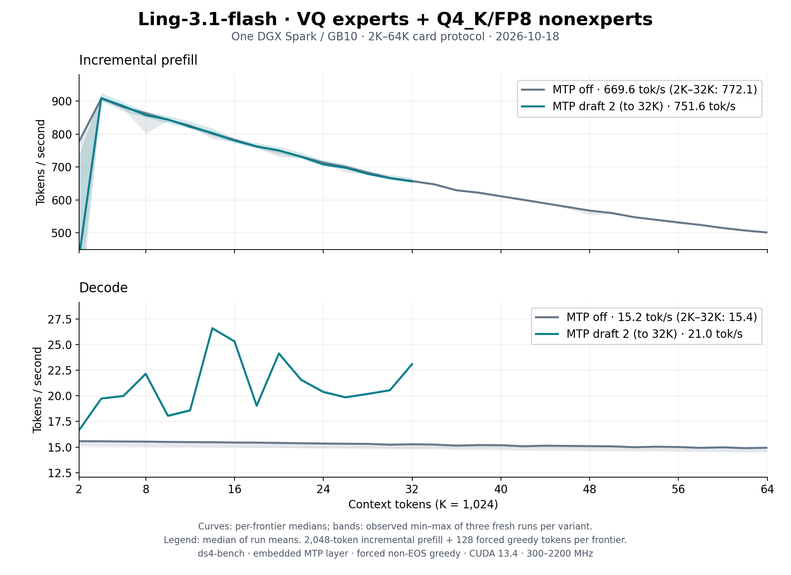

# Ling-3.1-flash VQ: format, execution and serving

Ling-3.1-flash VQ (family `Ling31Vq`, GGUF architecture `ling31_vq`) is a
GVQ1 conversion of the text-only
[inclusionAI/Ling-3.1-flash](https://huggingface.co/inclusionAI/Ling-3.1-flash/tree/a4ccd6b45c002ddb236f9cb77d52cc427482bf19)
checkpoint. The artifact is
[Baekpica/Ling-3.1-flash-VQ-GGUF](https://huggingface.co/Baekpica/Ling-3.1-flash-VQ-GGUF):
VQ routed experts, Q4_K large non-expert projections and source-precision
FP8/BF16 elsewhere. This page describes how the CUDA backend runs it on one
DGX Spark (GB10), how serving fits beside its 108 GiB trunk, and what was
measured. The GVQ1 kernels are GLM VQ's ([GLM-5.3 Flash VQ](glm53-vq.md));
Ling's grouped router, MLA rope keys, KDA shapes and MTP block are its own.

## Model and format

```
embed ─▶ [ rms ─▶ KDA | MLA ─▶ +res ─▶ rms ─▶ dense | MoE+shared ─▶ +res ] × 72 ─▶ rms ─▶ head
                                                         layer 72: MTP (MLA + MoE)
```

| Part | Shape | Storage |
|---|---|---|
| KDA blocks | 63 layers, 64 heads × 128, conv 4 | q/k/v/o Q4_K, decay f and gate g FP8 (128×128 block scales), beta BF16 |
| MLA blocks | 9 layers (every eighth), q rank 1536, latent 512 + rope 64 | q_a/q_b/kv_a/o Q4_K, kv_b FP8, head gate BF16 |
| Dense FFN | layers 0–3, 10,240 wide | Q4_K |
| Routed experts | layers 4–71, 512 × top-8, FFN 1,280 | GVQ1: K4096 12-bit books (60 layers), K8192 13-bit (8 layers) |
| Shared expert | 1,280 wide | Q4_K |
| Output head, embeddings | 157,184 × 4,096 | Q4_K head, BF16 embeddings |
| MTP block (layer 72) | MLA + 512-expert MoE, own K8192 book | optional parts, source precision |

The release is a directory: `release.json` selects 71 independent GVQ1 GGUF
parts per feature (trunk 116,415,118,208 bytes; MTP adds 1,799,825,536). The
Rust host checks the pinned recipe, roles and SHA-256 of every part, reading
them with `O_DIRECT` and scanning Q4_K scales and FP8 bytes while hashing, so
validation leaves no page cache for the device copy to compete with. The
copy reads split parts with `O_DIRECT` too; a cold load takes about 55 s.
The MTP parts are mapped only when drafting is enabled (`--mtp-draft N` with
N > 1, or `DS4_LING31_MTP=1`), so MTP-off serving never uploads them.

Per decoded token the backend reads about 12.6 GB: KDA projections 9.0 GB
(71%), routed experts 1.6 GB, the rest MLA, shared experts and head. At the
230–250 GB/s streaming ceiling that is a ~52 ms floor; decode measures 65 ms.

## Execution on GB10

**Decode (one row).** Routing stays on the device; the GVQ decode kernels
stream the eight selected experts with the layer book resident in shared
memory. Q4_K projections use the cooperative stream kernel (~190 GB/s), FP8
the direct dot (~250 GB/s). MLA attention scores the absorbed query against
every cached latent and rope key on tensor cores ([cuda/l31_flash.cuh](../cuda/l31_flash.cuh):
GLM VQ's flash tile plus the 64-dim rope keys, keys split over 48 CTAs):
0.33 ms per layer at 64K keys against 1.7 ms for the earlier FP32 kernel, so
decode stays near 15 tok/s from 8K to 64K. KDA keeps its 276 MiB F32 state
on the device. Each residual add, BF16 rounding and following RMS norm run
as one pass ([cuda/l31_residual.cuh](../cuda/l31_residual.cuh)).

**Prefill (2,048-row chunks).** Routed experts run the FP8 tensor-core MMA on
E4M3 codewords; with 512 experts a 2,048-row chunk gives each expert about
32 rows, so the per-chunk codeword cost dominates (37% of an 8K prefill).
Q4_K projections use the FP16 tensor-core q4p kernel, the FP8 decay/gate pair
restores BF16 weights once per matrix and leaves cuBLAS's BF16 rows for the
tensor-core chunked KDA, which reads q/k/v as BF16 rows (decode's rounding)
and hands the output projection BF16 heads. MLA expands each key segment of
the latent cache into per-head BF16 K/V and merges segments through their
log-sum-exp.

**Chunk size.** Once allocated, 4,096-row chunks prefill 10–14% faster
(8K/16K) but need 1.2 GiB more workspace than 2,048 rows, which a 128 GB
Spark cannot spare beside the trunk and a bank; `DS4_LING31_PREFILL_CHUNK`
or `--native-chunk` selects them. Cold first allocations of the larger
workspace stalled in page compaction, which once made 4,096 look slower.

**MTP.** HF `BailingMoeV3MTPLayer`: row p pairs the trunk's final-norm hidden
p with token p + 1; `eh_proj([enorm(embed) | hnorm(hidden)])` feeds layer 72,
then the final norm and the shared head; the normed output is the next
draft's hidden. A verify forward runs the 1 + D rows once, journals each
row's KDA state (one 276 MiB slot per draft) and restores the accepted
prefix; draft-layer latent rows are rebuilt from the true hidden rows, and
prefill fills them too, so drafts attend the whole prompt. Verify rows equal
decode rows up to cross-width FP order; `tests/ling31_mtp_gate` checks every
emitted token against a one-row decode within a BF16 tie margin.

## Serving

The serving surface is GLM VQ's: persistent banks, partial prefix reuse, disk
KV, session snapshots and embedded MTP in both lanes, all present and not
yet release-qualified ([capabilities](serving-capabilities.md)). The native
context default is `max_position_embeddings` = 262,144.

**Memory.** On the 121.6 GiB reference host the trunk leaves about 8.1 GiB
after load (6.4 GiB with the MTP part). One graph at 2,048 rows costs
1.26 GiB of workspace, 186 MiB of controls, 276 MiB of KDA state and
10,368 bytes of latent rows per token (11,520 with MTP); MTP adds 276 MiB per
journal slot. Further banks share graph 0's scratch and add only their state
and latent rows (0.59 GiB at 32K). Fits keep the 4 GiB floor plus a 640 MiB
growth allowance: the first requests grow the process 0.41–0.48 GiB while the
driver loads cuBLASLt and MMQ kernel images (0.6 GiB more before the MMQ cubin
dropped its line info). The serial gate never spends the floor, so the serial
lane prices the allowance too and halves prefill rows down to 512 to fit.
Checkpoint slots take only what the fit leaves, at most eight, and a capture
past that budget recycles the oldest mapped slot.

| Command (plus `-m` and the release directory) | What runs |
|---|---|
| default (262,144 context) | bank fit refused → serial lane at 262K with 512-row chunks (1,024 when 8.3 GiB is free after load), exact reuse; a 10,581-token prompt prefills at 591 tok/s |
| `-c 32768 --max-seqs 2 --prefix-reuse partial` | two banks, prompt-end checkpoint slots |
| `-c 16384 --mtp-mode on --mtp-draft 2` | serial MTP; 32K does not fit beside the MTP part |
| `-c 8192 --max-seqs 1 --prefix-reuse partial --mtp-mode on --mtp-draft 2 --native-chunk 1024 --mem-floor-gb 3` | MTP in the bank lane, partial reuse |

**Reuse.** A bank continues exactly when the next turn extends its history.
Bailing V3 sets `preserved_thinking`, so a turn's reasoning reappears in the
next render and the bank keeps its exact prompt-plus-generation key; when a
client drops reasoning, the prompt-end checkpoint restores the bank at the
previous prompt. Measured at `-c 32768 --max-seqs 2 --prefix-reuse partial`:
turns two and three reused 1,861/1,882 and 1,955/1,976 tokens; without the
reasoning, 1,766/1,786 and 1,786/1,808.

**Disk KV.** Bank and session payloads (`LG31`) hold tokens, logits, the
state pool and latent rows (about 276 MiB + 10.4 KB per token); banks persist
at shutdown and eviction. After a restart the next turn restored 2,094 of
2,115 tokens from disk.

**MTP use.** Drafting is greedy only: thinking requests sample at the server's
temperature 1.0 and decode without drafts, so MTP speeds up non-thinking
greedy requests (`"think": false`, `temperature: 0`). Two drafts are the best
measured setting (8K prose: 15.6 → 24.2 tok/s; three drafts 22.9). Served,
a 159-token greedy code answer decodes at 26.3–26.6 tok/s in the serial lane
and 25.1–26.1 in the bank lane.

## Performance

The [2K–64K sweep](benchmarks/ling31-vq-spark-64k-2026-10-18/README.md) at
`4d6f096b`: three fresh `ds4-bench` processes per variant, 2,048-token
incremental prefill and 128 forced greedy tokens per frontier.

| Configuration (median of three run means) | Prefill tok/s | Decode tok/s |
|---|---:|---:|
| MTP off, 2K–64K | 669.6 | 15.24 |
| MTP off, 2K–32K | 772.1 | 15.42 |
| Two embedded MTP drafts, 2K–32K | 751.6 | 20.99 |



## Quality

- Reference receipt (`tests/ling31_quality`, 13 held-out cases against the
  handoff's BF16-source reference A on the same token ids): teacher-forced NLL
  1.052 vs 1.117 over 642 targets, higher than A in 7 of 13 cases; top-1
  agreement 86.4%. The targets are fixture text, so neither side is favoured;
  13 cases do not measure a quality gain.
- Long context (teacher-forced 256 tokens after 4K/8K/6K prompts, 768
  targets): NLL 2.265.
- MTP gate (two drafts, 1,050 tokens): 2.35 tokens per verify, maximum gap
  to the one-row decode 0.25 within the 0.5 BF16 tie.
- Arithmetic changes were judged against the chunk-size noise of the same
  path: 1,024- vs 2,048-row chunks move the 8K/16K frontier logits by KL
  0.0020/0.0146.

## Diagnostic switches

| Variable | Effect |
|---|---|
| `DS4_LING31_PREFILL_CHUNK` | prefill rows per chunk (default 2,048, at most 4,096) |
| `DS4_LING31_MTP=1` | maps and runs MTP with one draft |
| `DS4_LING31_FUSED=0` | separate residual/norm kernels and F32 decay/gate/heads rows (bit-identical) |
| `DS4_LING31_QKV_BF16=0` | F32 q/k/v prefill rows |
| `DS4_LING31_FLASH=0` | Motif's FP32 decode/verify latent attention |
| `DS4_LING31_GAIN_DOT=0`, `DS4_LING31_DECODE_ROUTE=0` | GVQ decode expert variants |
| `DS4_LING31_MOE_RESTORE=1`, `DS4_LING31_MOE_STATS=1` | BF16 restore + cuBLAS experts (reference); expert call counts |

## Limits and next levers

- Memory decides the shape: with the default floor, 262K fits only the serial
  lane at 512-row chunks, and MTP fits 16K serially or 8K in a bank with a
  3 GiB floor.
- Prefill falls with context (892 tok/s at 4K, 497 at 64K): the expanded MLA
  flash kernel runs at about 36 TFLOPS and merges per key segment.
- Routed-expert prefill is bound by per-chunk codeword work at 2,048 rows; a
  4,096-row MoE batch over 2,048-row attention halves would need about
  0.45 GiB more workspace.
- The FP8 decay/gate projections restore BF16 weights before cuBLAS; a direct
  FP8 tensor-core GEMM would remove the restore.
- MTP does not draft for sampled (thinking) requests.
