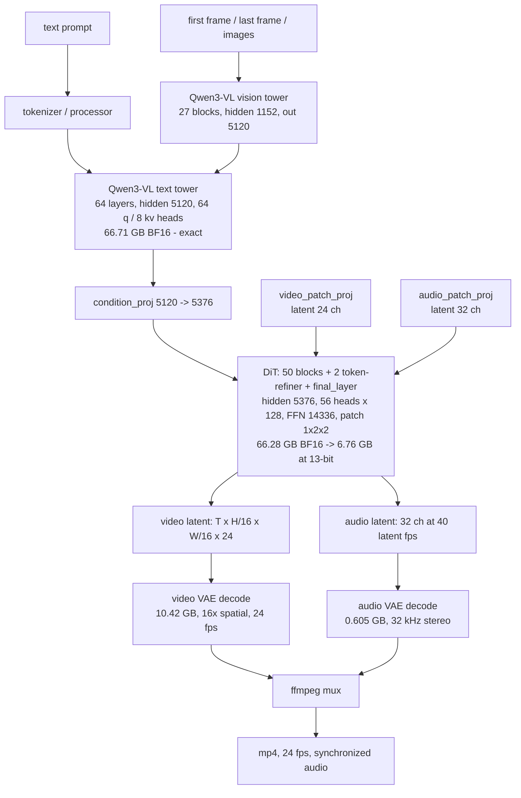
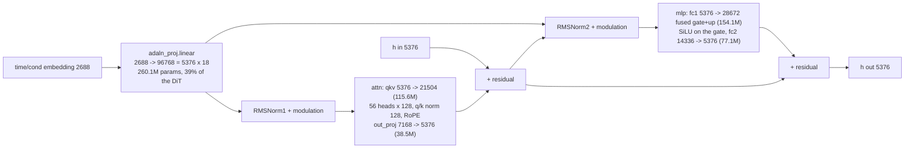

# MiniMax-H3 on the Spark — cheat sheet

[Documentation index](README.md) | [Port plan](minimax-h3-port-plan.md) |
[VQ recipe](minimax-h3-vq-recipe.md)

Sizes, quality, reach, memory and layout for the FL2VA video+audio model on one
DGX Spark (GB10, 121 GiB). Every number is marked **[M]** measured, **[A]**
arithmetic from measured inputs, or **[E]** estimate. Date 2026-10-24; branch
`feature/minimax-h3`.

## 0. On one page

| | |
|---|---|
| Model | MiniMax-H3 / H3-Base, as the card describes it: a **33B-parameter dense, single-stream omni Transformer** that jointly predicts video and audio latents, 768p at 24 fps, released **CFG-distilled** **[M card]** |
| Demanded of it | text → video+audio, optionally conditioned on a first and/or last frame; 4–15 s, 32 kHz stereo audio **[M card]** |
| Hot / cold weight split | **20.1B read at every denoise step** (attention and FFN); **13.0B of AdaLN read once per prompt** to build the modulation cache — the card states those parameters "do not need to be loaded for inference-only deployment" **[M card + A]** |
| Checkpoint (full repo) | 464.2 GiB **[M]**; the FL2VA partition the reference needs is **144.05 GB [M]** |
| DiT | 33.14B params BF16, 66.28 GB on disk, 50 blocks + 2 refiner **[M]** |
| Text encoder | Qwen3-VL, 66.71 GB BF16 **[M]** — kept exact |
| VAEs | video 10.42 GB + audio 0.605 GB **[M]** — kept exact |
| Legal output | width × height ≤ 768×1344, both multiples of 32; frames = 5 + 17n |
| Reach | 22 frames (0.92 s) … 362 frames (15.1 s); 1.03 MP at 107 frames = 18,432 DiT tokens **[A]** |
| Denoise cost | 16.4 s per forward at 1024×576/107f, 50 steps ≈ 13.7 min **[M]** |
| Peak FLOP efficiency | ≈104 TFLOP/s, ~96% of the part's 108 TFLOP/s BF16/F16 peak **[A]** |
| Weights in BF16 | DiT 61.73 + TE 62.13 + VAEs 10.26 = **134.1 GiB — does not fit [A]** |
| Highest-quality tier that fits | **Q0: DiT BF16 resident (61.73 GiB), text encoder and VAEs streamed from SSD — nothing lossy at all [A]** |
| Fast tier that fits | Q1: DiT exact + text encoder at 13-bit + VAEs exact, all resident = 78.8 GiB [A] |
| VQ artifact, if used | DiT at 13-bit: **6.76 GB (6.29 GiB), 9.8× smaller [A]** |
| Load | 96.6 s for BF16 → ≈10 s at 13-bit **[M/A]** |
| Quality | Q0 is bit-exact; Q1/Q2 trade one component, gated on renders |
| Exact fallback | the reference's block streaming: 1.63 GB peak, identical SHA-256, +37.6% time **[M]** |
| Model root | `/mnt/h3` on the Spark (exists, created 2026-10-24; size to confirm) **[M]** |

## 1. Architecture layout

One DiT block, with the sizes that matter (`blocks.N`, 645.5M params each
**[A]**):

The token-refiner pair is the same minus `adaln_proj` (385.4M params each
**[A]**). `final_layer` applies its own modulation (`10752 = 5376 × 2`), a final
norm, and two F32 output heads: video 96 = 24 channels × patch (1,2,2), audio 32.

## 2. Sizes

Shipped, per component **[M]**:

| Component | Files | Bytes | GiB |
|---|---:|---:|---:|
| DiT (BF16, 33.14B params) | 13 | 66,280,430,144 | 61.73 |
| Text encoder (BF16, Qwen3-VL) | 14 + configs | 66,714,780,128 | 62.13 |
| Video VAE | 1 | 10,415,500,000 | 9.70 |
| Audio VAE | 1 | 605,400,000 | 0.56 |
| FL2VA partition total (81 files) | 81 | 144.05 GB | 134.1 |

Converted DiT, by rung **[A]** (260 quantized matrices, 33.10B params, 8.12M
rows, 260 codebooks of 64 KiB):

| Rung | Bits/weight | Artifact | vs BF16 | Projected load |
|---|---:|---:|---:|---:|
| BF16 | 16.0 | 66.28 GB | 1.0× | 96.6 s **[M]** |
| 12-bit | 1.5 | 6.24 GB | 10.6× | ~9 s |
| **13-bit (chosen)** | **1.625** | **6.76 GB** | **9.8×** | **~10 s** |
| 14-bit | 1.75 | 7.27 GB | 9.1× | ~11 s |
| 13-bit + residual on 20 blocks | 1.7 avg | 7.3–7.6 GB | ~9× | ~11 s |
| 13-bit + residual on all 52 blocks | 1.875 | 10.89 GB | 6.1× | ~16 s |

The 6.76 GB splits as 6.723 GB of index streams, 16.2 MB of F16 row gains and
17.2 MB of E4M3 codebooks. Class shares: `adaln_proj` 2.64 GB,
`mlp.fc1` 1.56 GB, `attn.qkv` 1.17 GB, `mlp.fc2` 0.78 GB, `attn.out` 0.39 GB,
refiner/head 0.17 GB **[A]**.

## 3. Quality

| Element | Exactness |
|---|---|
| Text encoder, both VAEs, all norms, biases, RoPE, time embedder, patch and output projections (275 tensors, ~80 MB) | byte-exact, copied from the source **[M]** |
| DiT weights | the only lossy element, 13-bit per-matrix VQ |

What "quality" is measured against, and the evidence available today:

| Case | Measurement | Source |
|---|---|---:|
| Same binary, same weights, different batch size | KL 0.003 assistant / 0.565 all positions, top-1 84% — **the noise floor a gate must be judged against** | M3.1 VQ card **[M]** |
| Operator's MiniMax-M3.1 VQ at 1.98 bpw | KL 0.150 assistant, same next token 88.2%; card calls itself experimental and warns of loops, language switching, broken characters | same **[M]** |
| Dense bake, dim 4 / K 4096 (3.0 bpw) | weight cosine 0.984–0.999, worst tensor 0.974; retrieval MRR@10 keeps 98.3% | embeddinggemma2 recipe **[M]** |
| Dense bake, dim 8 at the same 12-bit width (1.5 bpw) | cosine 0.914–0.950 — six to twelve points lower: "dim 8 buys size, not quality" | same **[M]** |
| **This DiT at 13-bit** | **not yet measured** | the plan's P6 gate |

The gate that will decide it: 8 prompts × 2 shapes (512²/22f/20 steps and
1024×576/107f/50 steps), pinned seeds, the reference binary on both sides,
full-video SSIM / PSNR / LPIPS per prompt, reported per weight class, with a
proposed floor of SSIM ≥ 0.99 — stricter than the two kernel-change precedents
this tree already accepted (0.999303 and 0.984985) **[M]**.

Two fallbacks, in order, if the gate fails: per-block output-channel gains
solved against a BF16 teacher fixture (the recovery lever, ~40 MB, hours of
solve), then the exact path — block streaming, bit-identical, +37.6% time
**[M]**. Bit-identical output from quantized weights is not achievable and no
release in this toolchain claims it.

## 4. Reach, cost and context

Constants, read from `h3_host.h` **[M]**: canvas multiple 32, max pixels
768 × 1344 = 1,032,192, 24 fps, audio latent 40 fps, VAE spatial ratio 16,
frames = 5 + 17n, latent frames T = 5n + 2. Spatial tokens = (W/32) × (H/32);
DiT tokens = T × that.

| Canvas | Spatial tokens | 22 f (T 7) | 56 f (T 17) | 107 f (T 32) | 243 f (T 72) | 362 f (T 107) |
|---|---:|---:|---:|---:|---:|---:|
| 256×256 | 64 | 448 | 1,088 | 2,048 | 4,608 | 6,848 |
| 512×512 | 256 | 1,792 | 4,352 | 8,192 | 18,432 | 27,392 |
| 768×768 | 576 | 4,032 | 9,792 | **18,432** | 41,472 | 61,632 |
| 1024×576 | 576 | 4,032 | 9,792 | **18,432** | 41,472 | 61,632 |
| 1024×768 | 768 | 5,376 | 13,056 | 24,576 | 55,296 | 82,176 |
| 1344×768 | 1,008 | 7,056 | 17,136 | **32,256** | 72,576 | 107,856 |

Cost per denoise step **[A]** — linear work 2 × 33.14e9 × tokens, attention
4 × tokens² × 7168 × 50, at the measured ≈104 TFLOP/s:

| Shape | Tokens | PFLOP/forward | s/forward | 20 steps | 50 steps |
|---|---:|---:|---:|---:|---:|
| 512², 22 f | 1,792 | 0.123 | 1.2 s | 24 s | 59 s |
| 512², 107 f | 8,192 | 0.639 | 6.2 s | 2.1 min | 5.1 min |
| 1024×576, 107 f | 18,432 | 1.709 | 16.4 s **[M 16.3]** | 5.5 min | **13.7 min [M 815 s]** |
| 1344×768, 107 f | 32,256 | 3.629 | 34.9 s | 11.6 min | 29 min |
| 1344×768, 243 f | 72,576 | 12.354 | 1.98 min | 40 min | 1.65 h |
| 1344×768, 362 f | 107,856 | 23.81 | 3.82 min | 1.27 h | 3.2 h |

Add the decode: the video VAE measured 247.74 s tiled (1112.96 s untiled) at
1024×576/107f **[M]**; it scales with pixels × frames, so ≈7 min at 1344×768/107f
and ≈16 min at 1344×768/243f **[E]**. Audio decode is small. Scale the axes
before the weights: attention is O(tokens²), so 1344×768/362f spends 70% of its
FLOPs in attention and only 30% in the matrices — the opposite of 512²/22f.

Reference points, all **[M]** from `h3.c`'s own docs: 512²/22f balanced preset,
2-step 256² profile (load 96.563 s + denoise 2.715 s = 99.278 s), SSD-streaming
load 51.829 s + denoise 84.798 s at 1.63 GB peak, i8-row-FC2 25.80 s on M5 Max.

## 5. Memory

Envelope **[M]**: 121 GiB total, 111 GiB free at idle; the serving stack on this
part reports 117.2 GiB available with a 4 GiB floor, and this tree's host
guard reserves 12 GiB → **105–113 GiB usable**.

Phases, BF16 **[A]** (activations at 18,432 tokens: residual 198 MB, qkv 793 MB,
`fc1` out 1.06 GB — attention scores must be **tiled**, 56 × 18432² × 2 B is
38 GB if materialized):

| Phase | Weights | Activations | Peak |
|---|---:|---:|---:|
| Text encode (Qwen3-VL) | 62.13 GiB | ~1.5 GiB (vision tower + workspace) | ~63.6 GiB |
| Denoise (DiT) | 61.73 GiB | ~2–4 GiB tiled | ~64–66 GiB |
| Video + audio VAE decode | 10.26 GiB | measured 10.26 GB peak total | ~10.3 GiB |

All resident at once, per tier **[A]**. The tiers differ in *which* component
pays, not in whether it fits — with SSD streaming on the table, three
different allocations live inside the same 121 GiB:

| Tier | DiT | TE | VAEs | Resident now | Streamed per render | Lossy element |
|---|---:|---:|---:|---:|---|---|
| **Q0** | 61.73 BF16 | 62.13 BF16 | 10.26 | **61.73 GiB** | TE + VAEs (72.4 GiB) | **none** |
| **Q0-hot** | 37.4 BF16 hot set only | 62.13 BF16 | 10.26 | **109.8 GiB** | AdaLN 24.3 GiB, once per prompt | **none** |
| Q1 | 61.73 BF16 | 6.8 at 13-bit | 10.26 | **78.8 GiB** | — | prompt encoder, 1× per render |
| Q2 | 6.29 at 13-bit | 62.13 BF16 | 10.26 | **78.7 GiB** | — | denoiser, 50× per render |
| Q3 | 6.29 | 6.8 | 10.26 | **23.4 GiB** | — | both |
| (BF16 all resident) | 61.73 | 62.13 | 10.26 | 134.1 GiB | — | does not fit |

**Q0 is the highest quality that fits, and it is lossless.** Its cost is a
text-encoder read per render — ~90 s on the internal NVMe, ~150 s on the USB
disk — while the DiT stays warm. Q1 buys that back by quantizing the prompt
encoder at 13 bits and keeping the denoiser exact, which is the better side of
the trade: a changed conditioning vector perturbs the sampler once, changed
denoiser weights perturb it fifty times.

Two bookkeeping notes, both unresolved until P2: the reference reports a
"D​iT peak" of 27.063 GB for the 2-step 256² profile and "36.5 GiB tracked DiT
storage" on M5 at 512², neither of which reconciles with 61.73 GiB of BF16
weights — its accounting apparently does not count the mapped weight arena the
way a resident-tensor budget would. The table above is built from file bytes,
which cannot be argued with, and P2's trace replaces the activation estimates.

## 6. The six numbers to remember

1. **144.05 GB** to download, not 464 GiB — the reference only needs the FL2VA
   partition, into `/mnt/h3`.
2. **61.73 GiB** — the BF16 DiT on its own fits the Spark. So the
   highest-quality tier (Q0: nothing quantized, the text encoder and VAEs read
   from SSD per phase) is available, and it is the reference's own behaviour
   plus residency, with no converter and no quality gate.
3. **6.76 GB** — the same DiT at 13-bit, 9.8× fewer bytes, if the load time is
   worth a bounded, gated quality cost.
4. **78.8 GiB** — Q1, the tier that quantizes only the 66.71 GB prompt encoder
   and keeps the denoiser bit-exact: everything resident, nothing streamed.
5. **96.6 s → ≈10 s** of DiT load, and **13.7 min** of denoise for the
   1024×576, 107-frame, 50-step render.
6. **One open check**: `/mnt/h3` exists but its device and free space are
   unconfirmed — `df -h /mnt/h3` and `findmnt /mnt/h3` on the Spark settle it,
   and they decide how expensive Q0's per-render text-encoder read is
   (~90 s on the internal NVMe against ~150 s on the USB disk).

Provenance of every number here, source by source, is in the
[recipe](minimax-h3-vq-recipe.md) section 8. In short: the geometry and the
tensor inventory are H3's own artifact read first-hand; the quantization
parameters are the published recipe of this toolchain, not derived for H3; the
byte accounts, token tables and tier totals are arithmetic over both, labelled
[A] wherever they appear.
