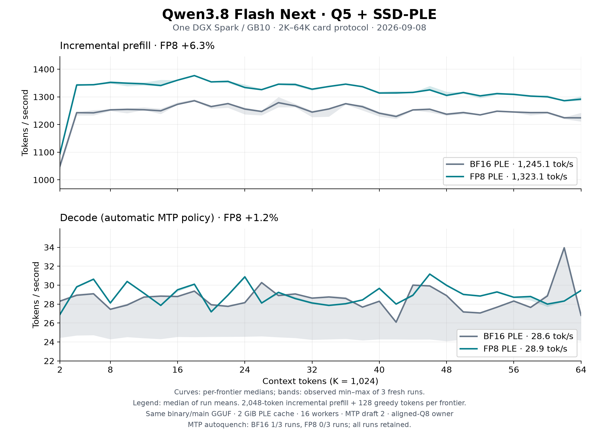
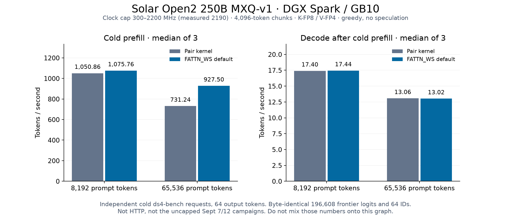
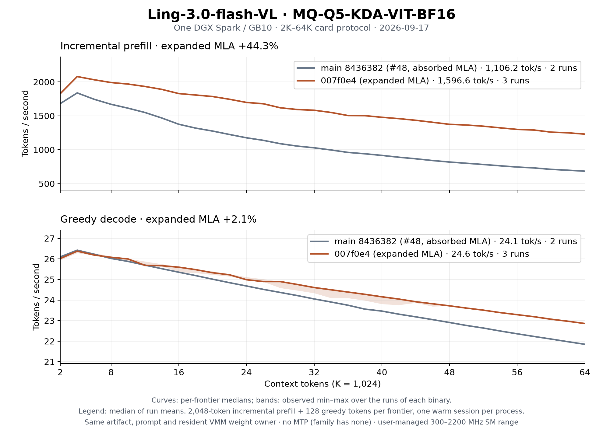
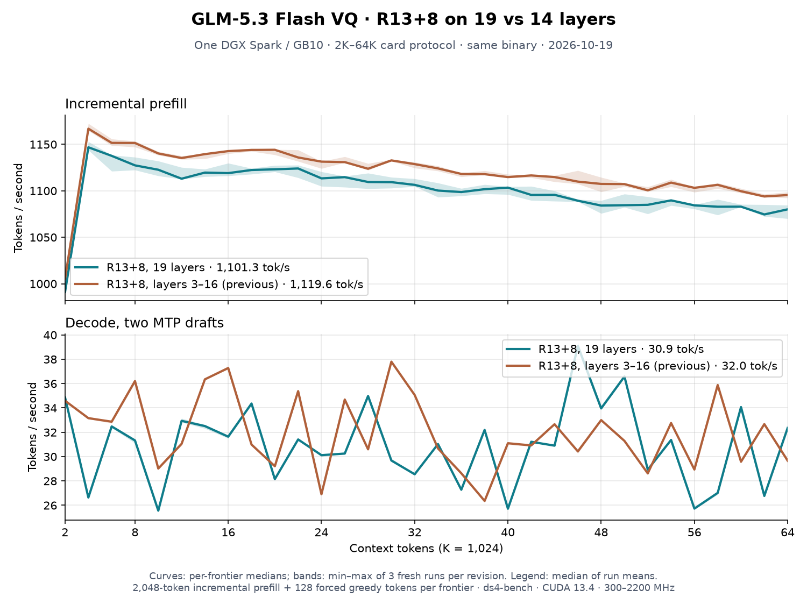
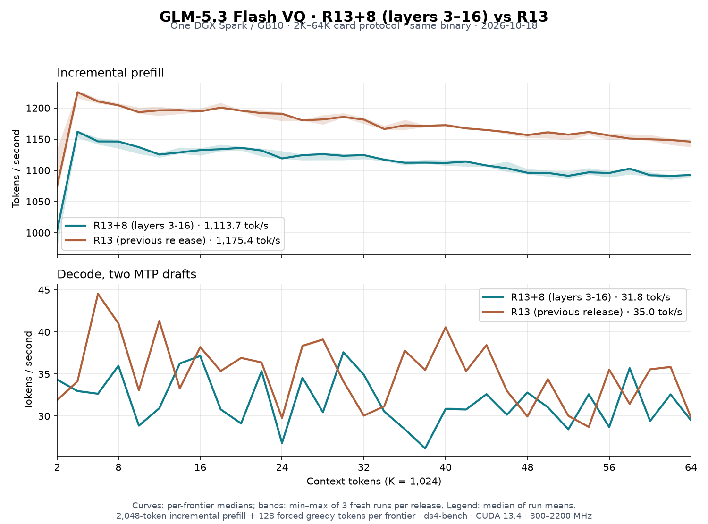
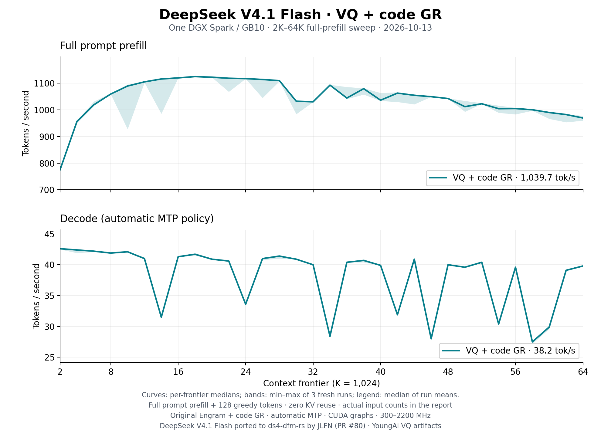
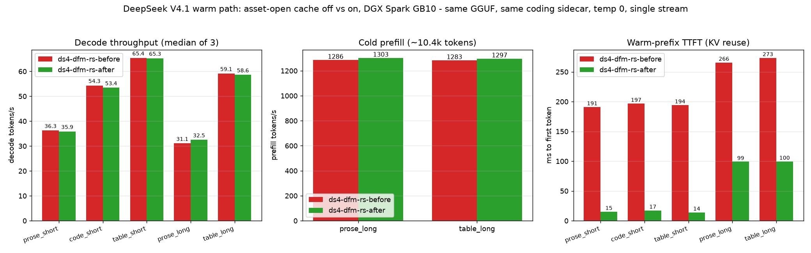

# Performance references

The [README table](../README.md#performance-and-release-evidence) presents
recorded whole-model prefill and decode examples. This guide explains their
conditions and links to the original reports. Workloads, clocks, artifacts and
sampling differ between rows; use the original protocol for a comparison.

Rates are tokens/second. `K` means 1,024 tokens; `8K + 64` means 8,192 input
tokens and 64 generated tokens. Prefill processes the prompt; decode generates
the continuation. A sweep with reused state measures incremental suffixes,
while a cold request computes the whole prompt. MTP changes the decode workload.
Throughput does not establish context, bank, cache or media qualification.

## Qwen

Qwen3.8 Flash Next Base Q5 on one DGX Spark / GB10, with only the SSD-PLE
format changed. The [FP8 PLE guide](qwen38-ple-fp8.md#reproduce-the-card-sweep)
owns the exact command, identities, paired results and numerical limits.

| PLE format | Prefill tok/s | Decode tok/s |
|---|---:|---:|
| BF16 | 1,245.1 | 28.59 |
| FP8 | 1,323.1 | 28.93 |

These cells are medians of three run means over 32 frontiers, from 2K to 64K.
Each process uses one warm session, 2,048-token incremental prefills and 128
greedy outputs per frontier. The same frozen binary and aligned-Q8 owner serve
both formats, with a 2 GiB PLE cache, 16 page workers and an 8,192-token chunk cap.

Curves show per-frontier medians; bands show observed min/max, not confidence
intervals. MTP draft 2 was requested; one BF16 run autoquenched and remains in
the data. FP8 changes embedding values and can change tokens and draft
acceptance. This is the recorded automatic-policy result, not an isolated MTP
speedup or a cold 64K/256K serving measurement.

Source: [paired results and verification](qwen38-ple-fp8.md),
[raw CSVs and receipt](benchmarks/qwen-ple-fp8-2026-09-08/).

Later cold-prefill and draft/prefix campaigns retain their own protocols:
[September 6](qwen38-prefill-2026-09-06.md),
[September 7](qwen38-prefill-2026-09-07.md),
[September 14](qwen38-perf-2026-09-14.md).

### Qwen Uncensored

The same [paired card sweep](qwen38-ple-fp8.md#reproduce-the-card-sweep) records
1,310.8 prefill / 28.96 decode for Uncensored Q5 with FP8 PLE. It is a separate
main model, measured with the same protocol. The README graph shows Base Q5.
Swift's card reuses the Base Q5 graph as a reference; no Swift throughput is
reported here.

## Solar

Solar Open2 250B MXQ-v1, one GB10, cold `ds4-bench` requests, 64 greedy outputs,
4,096-token chunks, MTP off. The [September 14 round 2](solar-open2-optimization-2026-09-14.md#round-2-skip-redundant-q3-handoff-down-sanitize)
records 1,095.61 prefill / 17.43 decode at 8K and 943.18 / 13.01 at 64K.
Both are medians of three interleaved comparisons under the 300–2200 MHz
clock range; sampled SM clocks were 2190 MHz. Logits and IDs matched byte for byte.

The curve shows the separate round-1 FATTN_WS off/on comparison. The README
uses the later round-2 result. These are cold benchmark requests, distinct
from HTTP reuse and the earlier uncapped campaigns. Keep the recorded clock
conditions when reproducing the result.

## Motif

Motif-3 MQ87-88's [August 21 C baseline](model-family-history.md#motif-3-remesure-on-the-v062-dfm-line-2026-08-21)
records 627.19 prefill / 15.06 decode at 8K + 64 on GB10. It uses a 4,096-token
chunk, aligned-Q8 VMM owner, greedy non-thinking generation and no speculation.
This is inherited `v0.6.2-dfm` evidence, not a fresh Rust-host measurement.

## dots3

dots3-note MQ87's [September 6 campaign](dots3-optimization-2026-09-06.md)
records 604.3 prefill / 16.78 decode at 8K + 64, serial plain decoding on GB10.
The same-binary kill-switch comparisons preserve the frontier argmax, top-10
and all 64 greedy IDs. The result does not qualify later opt-in banks or MTP.

## K2

K2-Horizon MQ87's [September 5 continuation scoreboard](k2-optimization-2026-09-05-cont.md#scoreboard)
contains two all-default round-6 samples: 644.78 / 13.34 and 641.94 / 13.07
prefill/decode. The README retains their ranges rather than selecting the faster
sample. These are fresh GB10 processes, 8K + 64, context 8,257, no MTP or reuse.
The report defines the accepted arithmetic differences and clock conditions.

## Inkling

Inkling Small MQ85GB's [September 22 capped-clock result](inkling-optimization-2026-09-22.md)
records 452.58 prefill / 13.07 decode for the retained router tile. Workload:
cold 8K + 64, MTP off, chunk 2,048, three interleaved pairs on GB10. SM clocks
were 2190–2197 MHz. The higher unlocked-clock figures are a separate result;
contexts above 8K were not measured in this campaign.

## Step

Step 3.7 Flash MQ83's [capped-clock aggregate](step37-optimization-2026-09-13-r3.md#final-aggregate-ab)
records 1,194.64 prefill / 22.77 decode in the matched final 2K + 64 comparison.
It uses the Q8 MTP sidecar, draft 3, three fresh-process pairs and the same VMM
owner under a 300–2200 MHz GB10 clock range. Logits and tokens match exactly.
The separate 16K result changes the MTP trajectory and is not this table row.

## Ling

Ling-3.0-flash-VL MQ-Q5's [GB10 campaign](ling3-flash-vl.md#cuda-campaign-gb10)
records 1,889 prefill / 24.65 decode at 8K + 64 after PR #48, with busy SM
clocks 2177–2197 MHz. The family has no MTP. Later PR #49/#50 results use
different retained paths and are recorded separately.

This later card sweep uses one warm session per fresh process. Curves are
per-frontier medians; bands are observed min/max over two #48 runs and three
each for #49 and #50. The [raw CSVs and receipt](benchmarks/ling3-flash-vl-2026-09-17/)
retain the workload and artifact identities.

## MiMo

MiMo-V2.6-Flash-RL mixed quant's [September 26 round 3](benchmarks/mimo2-2026-09-26/README.md#gateup-bounded-scheduling)
records 1,217.76 prefill / 24.44 decode, medians of three fresh samples per arm.
Workload: 8K + 128, chunks 4,096, MTP/DFlash off, shared VMM owner, GB10 under
a 300–2200 MHz clock range. All 152,576 logits and 128 tokens match exactly.
The [media campaign](benchmarks/mimo2-media-2026-09-26/README.md) is separate.

### MiMo MOPD

The [September 30 MOPD round 2](benchmarks/2026-09-30-mimo2-mopd-spark.md#prefill-2-pipelined-down-worklists)
records 1,206.290 prefill / 24.180 decode for the retained ON path at 8K + 128.
Three rotated fresh-process rounds use chunk 4,096, a shared VMM owner and
MTP/DFlash inactive. Busy clocks were 2184–2190 MHz within the 300–2200 range.
The longer 8K + 1,024 check has equal OFF/ON decode medians; it does not reproduce
the short-decode decrease. This is a separate artifact and workload from RL.

## Naive

Naive-N0.5-Flash MQ87's [October 1 paired index result](benchmarks/naive-2026-10-01/README.md#p8-paired-index-score-query-reuse)
records 518.85 prefill / 18.85 ordinary decode for `index2-on` on GB10.
Three fresh processes per side use separate warmups, chunk 2,048 and 32
greedy outputs; all 915,456 checked logits and token/argmax decisions match
exactly. Sampled clocks are 2190–2197 MHz. Native source is `ee28ed26`;
the report pins each round's benchmark bytes and eager/actual-state proofs.
The [September 30 index-packing pair](benchmarks/naive-2026-09-30/index-pack.md)
remains historical. These results do not qualify DSpark acceleration or
long-context serving; use the [family guide](naive-n05-flash.md) for those limits.

## GLM-5.3 Flash VQ

The 19-layer R13+8 release of GLM-5.3 Flash VQ
([model card](https://huggingface.co/Baekpica/GLM-5.3-Flash-VQ-GGUF), HF
`71c73e7e`: routed layers 3–17, 22, 27, 41 and 44 add an 8-bit residual
stage, Q4_K nonexperts unchanged) recorded **1,101.3 prefill / 30.93 decode**
with two embedded MTP drafts in the
[2K–64K sweep](benchmarks/glm53-vq-spark-64k-19-layers-2026-10-19/README.md)
(`94d776ac`). The 14-layer revision (layers 3–16, tag `r13p8-l3-16`)
measured 1,119.6 / 32.02 in the same interleaved runs and binary: prefill
−1.6% from five more layers' residual MMAs, a verify cycle +1.0% from 7.98
instead of 7.85 GB per token, and 2.171 instead of 2.226 tokens per verify
on these continuations. The 19-layer revision lowers held-out PPL from 4.042
to 3.895 and stops looping on long-context served answers (0 of 10 seeds
instead of 4); its 1M quote keeps one bank with 4,096-row prefill chunks.

The 14-layer revision (HF `35d3833d`) recorded **1,113.7 / 31.81** in the
[2K–64K sweep](benchmarks/glm53-vq-spark-64k-r13p8-2026-10-18/README.md)
(`90517b6b`). The previous R13 release measured 1,175.4 / 35.00 in the same
interleaved runs and binary: prefill −5.2% from the residual MMAs, a verify
cycle +5.5% from 7.85 instead of 7.5 GB per token, and 2.226 instead of 2.321
tokens per verify on these continuations. These are medians of three run means
across 32 frontiers in three fresh `ds4-bench` processes per release on one
DGX Spark / GB10: one warm session, 2,048-token incremental prefills and 128
forced greedy tokens per frontier. Clock range 300–2200 MHz; busy clocks
2,177–2,190 MHz.

The R13 release recorded **1,163.5 / 35.08** in the
[2K–64K sweep after the prefill PR](benchmarks/glm53-vq-spark-64k-prefill-2026-10-17/README.md)
(`3dd964ba`, #88).

Incremental prefill falls 7.1% from 4K (1,238.0) to 64K (1,149.9); the 2K point
is each process's first prefill. MTP decode follows draft acceptance on the
generated text (28.7–44.4 per frontier, 2.32 tokens per verify); a verify
cycle averages 66.2 ms. The [sweep at `c5384b5e`](benchmarks/glm53-vq-spark-64k-main-2026-10-17/README.md)
recorded 1,042.2 / 35.12 (2.34 tokens per verify): #88 changed prefill only.
The [earlier October 17 sweep](benchmarks/glm53-vq-spark-64k-2026-10-17/README.md)
(`60d0b689`) recorded 1,022.6 / 24.82 with MTP off; 512-token decodes at 2K
with MTP off measure 25.9 tok/s since `c5384b5e`. A whole 8K prompt (7,936
tokens) prefills at 1,343.8 tok/s (two fresh runs, MTP off). The
[GLM VQ page](glm53-vq.md) records the optimization steps, numerical contract
and quality screens. Throughput does not
qualify serving limits or long-context quality.

## Ling-3.1-flash VQ

Ling-3.1-flash with GVQ1 routed experts and Q4_K/FP8 nonexperts, v2 trunk
(Q4_K KDA decay/gate, Q8_0 embeddings;
[model card](https://huggingface.co/Baekpica/Ling-3.1-flash-VQ-GGUF)) recorded
**774.1 prefill / 17.70 decode** with MTP off across the 32 frontiers of the
[2K–64K v2 sweep](benchmarks/ling31-vq-spark-64k-v2-2026-10-18/README.md)
(`709cf8df`), and **861.0 / 23.58** with two embedded MTP drafts over 2K–32K
(MTP off on that range: 861.7 / 17.83). These are medians of three run means
in three fresh `ds4-bench` processes per variant on one DGX Spark / GB10: one
warm session, 2,048-token incremental prefills and 128 forced greedy tokens
per frontier. MTP stops at 32K, as in the earlier sweeps. Clock range
300–2200 MHz.

Decode gains 16% at 2K and 20% at 64K over v1: Q4_K decay/gate remove
1.85 GB of each token's 12.6 GB of weight reads, and FP8 latent rows shrink
the part that grows with context. Prefill is unchanged within the run spread;
incremental prefill falls 35% from 4K (964.9) to 64K (625.8) as the nine MLA
layers re-expand the latent cache in each step. MTP decode follows draft
acceptance (20.4–30.1 per frontier). The
[prefill-round sweep](benchmarks/ling31-vq-spark-64k-prefill-2026-10-18/README.md)
(`a64e323b`, v1, #93) recorded 778.8 / 14.86 and 859.8 / 21.15; the
[first sweep](benchmarks/ling31-vq-spark-64k-2026-10-18/README.md)
(`4d6f096b`, #92) 669.6 / 15.24 and 751.6 / 20.99. The
[Ling-3.1 page](ling31-flash-vq.md) records the execution paths, serving
shapes and quality screens. Throughput does not qualify serving limits or
long-context quality.

## DeepSeek V4.1

DeepSeek V4.1 Flash `vq8sh14-q4k-mtpnative`, original Engram tables and
`grrb-code_fit_n15360-engine` recorded **1,039.65 prefill / 38.17 decode**
in the [October 13 2K–64K campaign](benchmarks/ds41-spark-64k-2026-10-13/README.md).
These are medians of three run means across 32 frontiers, using three fresh
Rust-server processes on one DGX Spark / GB10. Each request prefills its full
prompt with zero KV reuse and generates 128 greedy tokens with automatic
embedded MTP. Clock range remains 300–2200 MHz; request-clock medians were
2,184–2,190 MHz.

The warm path is measured separately, because the cache that holds the sidecar
mount and the engram open across requests is invisible to a zero-reuse sweep.
The [warm-path campaign](benchmarks/ds41-warmpath-2026-10-13/README.md) runs the
author's five-case HTTP suite on the archived case bytes and reads warm-prefix
TTFT at **190.9 → 15.1 ms** on the 54-token prose case, 196.7 → 17.3 and
194.1 → 14.1 ms on the other short cases, and 265.7 → 99.1 and 273.4 → 99.5 ms
on the two long ones (medians; 45 samples over three passes against the archived
pre-change pass). Cold first-touch TTFT improves as well (0.657 → 0.427 s on the
same prose case) and decode stays at parity, so the warm cell is not bought with
a slower cold path or slower decode.

[JLFN](https://github.com/JLFN) ported DeepSeek V4.1 Flash serving to
`ds4-dfm-rs` ([#80](https://github.com/Baekpica/ds4-dfm-rs/pull/80)), using the
[YoungAi engine](https://github.com/fodelf/YoungAi) and
[VQ model artifacts](https://huggingface.co/wenzhouwu/YoungAi-DeepSeek-V4.1-Flash).
Curves show per-frontier medians; bands retain the observed min–max. The
[Prefill and Decode tables](benchmarks/ds41-spark-64k-2026-10-13/tables.md)
list all 96 samples and actual input counts. The 64K frontier has
66,608 actual input tokens and records
**969.5 prefill / 39.8 decode** at the median.

The graph follows the Qwen card's presentation, but Qwen uses incremental
prefill and this sweep uses full prompt prefill. They are separate workloads.
The [earlier review qualification](benchmarks/ds41-spark-review-2026-10-13/README.md)
retains source parity, serving gates and the supplied 40K screenshot comparison.
This campaign establishes throughput on the recorded serial corpus, without
extending broad long-context quality, 1M throughput or concurrent-bank claims.

## Bonsai

Prism Bonsai 2 27B PQ2_0's [September 30 prefill evidence](releases/bonsai-perf-2026-09-30.md#evidence)
uses an **RTX 4070 SUPER**, not GB10. Three fresh-server pairs on a 2,140-token
prompt with 64 outputs record mean prefill 1,023.3; the same tiled runs decode
at 18.00 / 17.50 / 18.00. The README reports that observed decode range.
Loaded clocks were 2775–2790 MHz. IDs matched the control.

The [later split-K report](releases/bonsai-splitk-2026-09-30.md) measures 15K/30K
workloads. Its decode figures are not combined with this earlier prefill row.

## Measuring and qualifying changes

- [ds4-perf](ds4-perf.md): inspection, profiling, paired comparisons and serving workloads.
- [Optimization playbook](prefill-decode-optimization-playbook.md): bottlenecks and numerical contracts.
- [Speed benchmarks](../speed-bench/README.md): manual sweeps and plot generation.
- [Contributing](../CONTRIBUTING.md#performance-and-profiling): fresh processes, matched settings and required proofs.

Use unprofiled timing for throughput; use profiler captures to explain the
execution path. Preserve the exact model, quant, prompt, cache state, context,
output, bank count and clock conditions. A kernel speedup alone does not
establish end-to-end improvement.

Release qualification remains in the [release ledgers](README.md#release-ledgers)
and [migration evidence](rust-migration/README.md). The original split matrix,
Qwen ABBA/soak, RC.3 serving checks, GLM smoke and K2 admission gates have their
own commits and workload limits. Historical PASS results do not qualify a
different artifact, a larger prompt or the current machine's live service.
